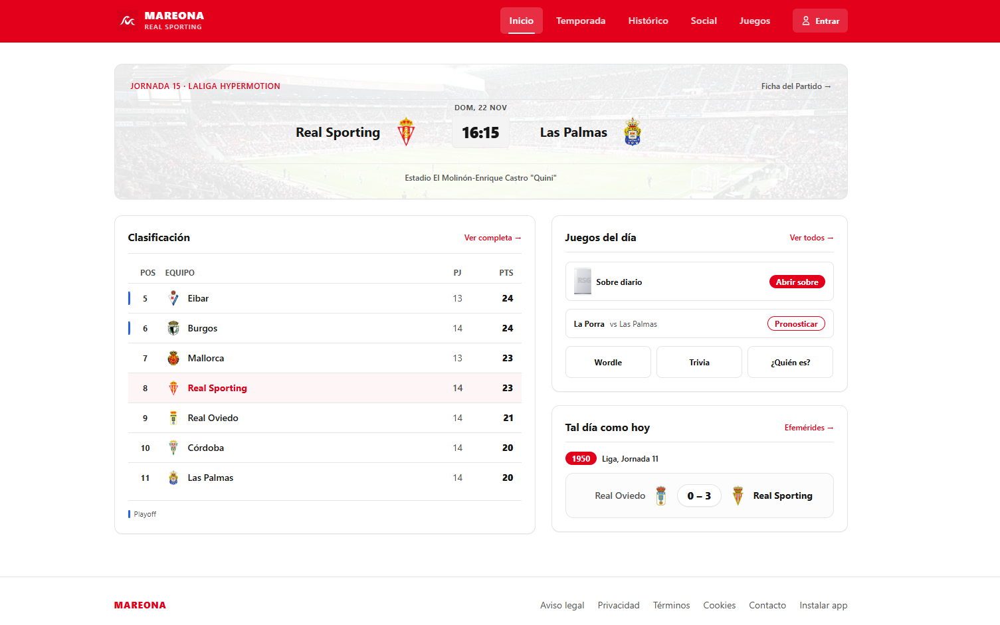
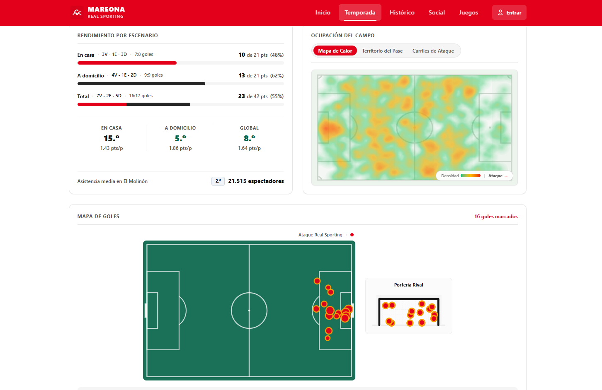
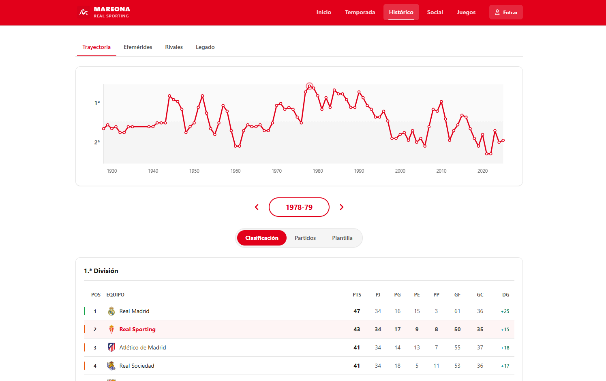
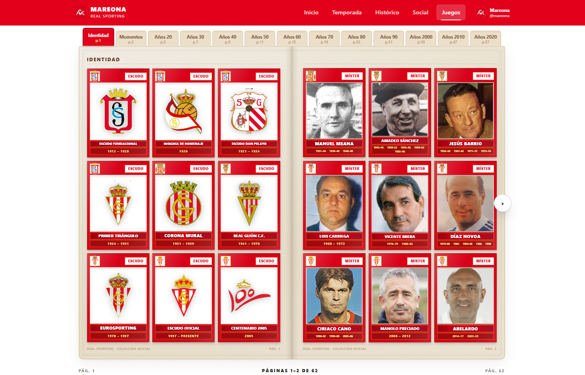
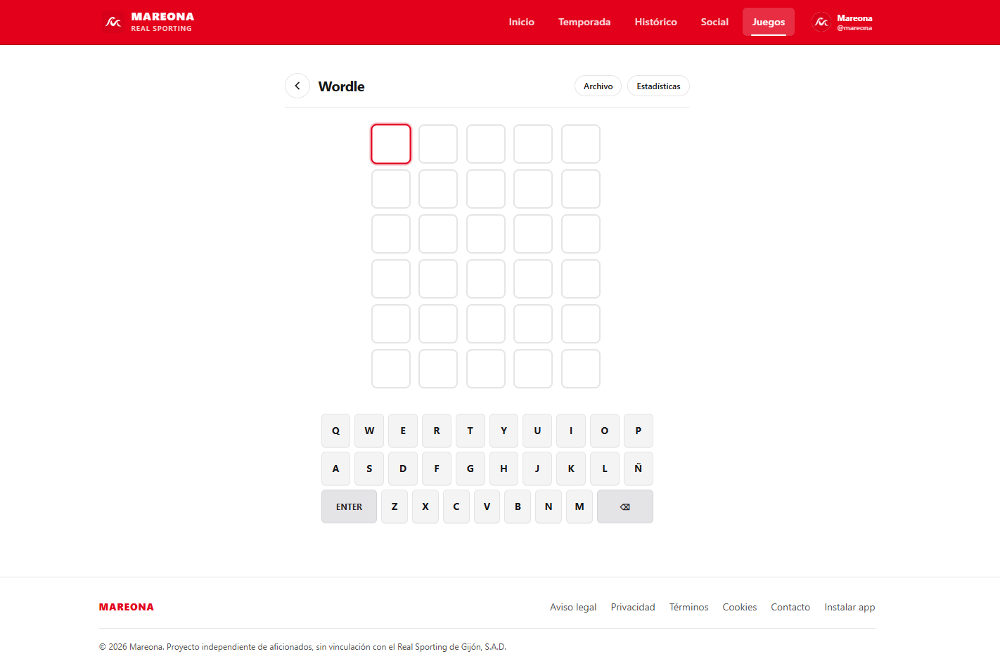
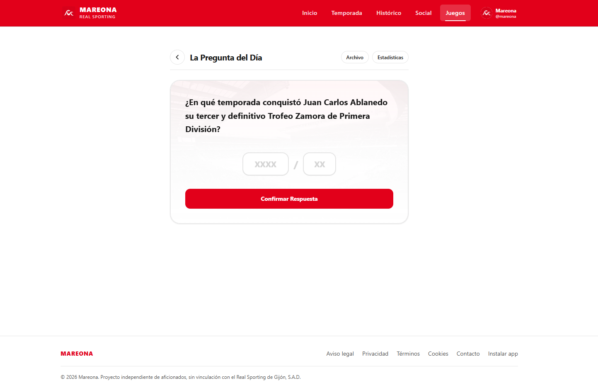
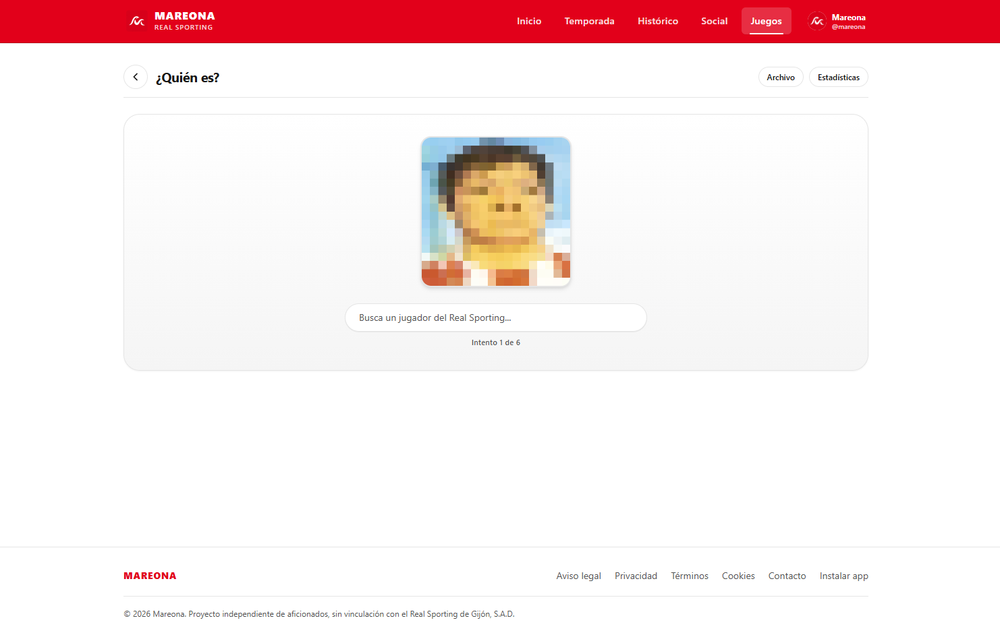
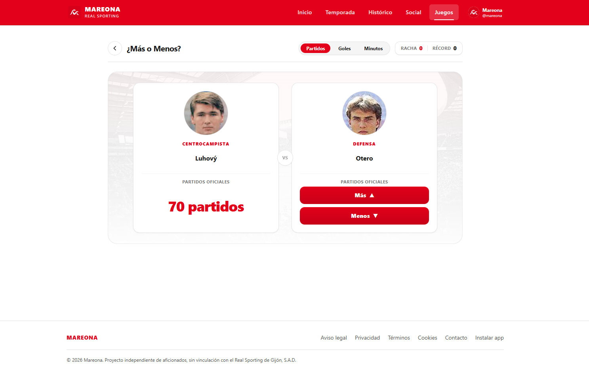

# Mareona

**Plataforma web y PWA para la afición del Real Sporting de Gijón**

 

[Aplicación en Directo](https://mareona.vercel.app) &nbsp;&bull;&nbsp; [Memoria Técnica de Ingeniería](docs/TECHNICAL_DOCS.md) &nbsp;&bull;&nbsp; [Contacto](#autor)

---

## 1. Visión del Producto

Este proyecto ofrece a la afición del Real Sporting de Gijón una plataforma en la que encontrar datos actuales e históricos, socializar con otros aficionados y divertirse con juegos sobre la historia del club.

El producto tiene como objetivo convertirse en un punto de encuentro digital para la comunidad sportinguista, ofreciendo una experiencia de usuario ágil, segura y centrada en el contenido relevante, manteniendo una buena identidad visual para facilitar la navegación y la comprensión de la información por parte de todos los usuarios. 

---

## 2. Módulos y Funcionalidades del Sistema

### 2.1. Inicio (`/`)
Punto de entrada principal a la aplicación, con un resumen de la actualidad del club y accesos rápidos a algunas de las secciones más relevantes en el día a día del usuario.

---

### 2.2. Temporada (`/temporada`)

#### Partidos (`/temporada/partidos` y `/temporada/partidos/[id]`)
Lista de todos los partidos oficiales de la temporada (LaLiga Hypermotion y Copa del Rey), incluyendo resultados, fechas y horarios. Cada partido tiene su propia ficha de detalle con información completa sobre el encuentro: previa, alineaciones tácticas sobre el césped, cronología de eventos en directo, estadísticas avanzadas comparadas, gráfico de *momentum* minuto a minuto, mapa interactivo de disparos (*shotmap*) y **La Grada**, un espacio comunitario donde los aficionados debaten antes, durante y después del encuentro y votan al **MVP del partido**.

#### Clasificación (`/temporada/clasificacion`)
Tabla de clasificación oficial de La Liga, que se actualiza automáticamente con los resultados de los partidos y permite a los usuarios ver la posición del Real Sporting y sus rivales en tiempo real. 
Se incluyen diferentes formas de visualización de la clasificación:
- **Tabla:** clasificación tradicional, mostrando todos los equipos ordenados por posición y facilitando los datos de la temporada de cada uno de ellos.
- **Distancia real:** muestra a los equipos de forma escalonada, con un escalón para cantidad de puntos, pudiendo observar visualmente de forma rápida la distancia en cuanto a puntos entre todos los equipos de la liga.
- **Evolución:** gráfico de evolución de la posición y puntos del Real Sporting a lo largo de la temporada. Muestra una línea roja que representa la posición del equipo en cada jornada, y una línea discontinua gris que enseña la cantidad de puntos que tenía el equipo en cada jornada.

#### Estadísticas (`/temporada/estadisticas`)
Se muestran estadísticas colectivas detalladas de la temporada del equipo. Cada estadística tiene asignada la posición actual del equipo respecto a los demás equipos de la liga para esa estadística en concreto. Se incluye en esas posiciones una paleta de colores que varía para mostrar de forma visual si el equipo está en la parte alta, media o baja de la clasificación para esa estadística.
También se muestran estadísticas más visuales, como mapas de las posiciones que ocupa el equipo en el campo, dónde se producen más pases, por dónde se ataca más, y la ubicación de los disparos que terminaron en gol.
El objetivo de esta sección es ofrecer a los aficionados una visión completa y comprensible del rendimiento del equipo y de sus jugadores, permitiendo un análisis profundo de la temporada al alcance de todos los públicos.

#### Plantilla (`/temporada/plantilla` y `/temporada/plantilla/[id]`)
Lista de todos los jugadores de la plantilla. Cada jugador tiene su propia ficha de detalle con información completa sobre el mismo, incluyendo datos básicos de su perfil y estadísticas detalladas de la temporada, que complementan la información de la sección de estadísticas, proporcionando datos de los rendimientos individuales de cada jugador.

#### Mi Once (`/temporada/pizarra`)
Pizarra táctica interactiva que permite a los aficionados confeccionar su propio once inicial, con varios sistemas de juego predefinidos, pero dando total libertad al usuario para colocar y mover a los jugadores en el campo. Incluye a todos los jugadores del primer equipo, y también a otros jugadores del Sporting Atlético y del Juvenil División de Honor. Permite descargar en el dispositivo como una imagen el once creado, y también compartirlo en las secciones sociales de la aplicación (Social o Grada del siguiente partido), para que otros aficionados puedan ver y comentar el once creado por el usuario.

---

### 2.3. Histórico (`/historico`)

#### Trayectoria (`/historico`)
Gráfico de la trayectoria histórica del Real Sporting de Gijón, mostrando la posición del equipo en cada temporada desde que hay registros de las competiciones hasta la actualidad. Permite a los aficionados ver cómo ha evolucionado el equipo a lo largo de los años y cómo se ha desempeñado en las distintas categorías del fútbol español. Al seleccionar una temporada concreta, se muestran los detalles de la misma, incluyendo la clasificación final de la liga, los partidos jugados y la plantilla del equipo durante esa temporada.

#### Efemérides (`/historico/efemerides`)
Calendario que muestra efemérides, acontecimientos históricos y partidos jugados por el Real Sporting de Gijón el día del año seleccionado. Inicialmente se muestra el día actual, y el usuario puede navegar por los días del año para ver qué acontecimientos ocurrieron en cualquier fecha. El objetivo es ofrecer a los aficionados una forma de conocer la historia del club y recordar momentos importantes de su trayectoria, conociendo además estadísticas y resultados de los partidos jugados en cada una de las fechas.

#### Rivales (`/historico/rivales`)
Balance histórico de enfrentamientos frente a cada club al que se enfrentó el Real Sporting de Gijón durante toda su historia. Se pueden filtrar los rivales por categoría, ordenarlos por diversos criterios y mostrarlos en forma de cuadrícula o de lista. Al seleccionar un rival concreto, se muestran los detalles de los enfrentamientos entre ambos equipos, pudiendo entrar en cada partido para ver la ficha completa del mismo. Se muestran también estadísticas generales de los enfrentamientos.

Por otra parte, se incluyen un mapa de España y un mapa del mundo, ambos interactivos, que permiten observar de una forma más visual los rivales del Sporting, haciendo un resumen de las estadísticas conjuntas de los enfrentamientos del club contra los equipos de cada zona, y permitiendo filtrar los equipos por dichas zonas geográficas. 

#### Legado (`/historico/legado`)
Tablas que muestran los datos históricos más relevantes del club, para dar el reconocimiento que merecen los jugadores y entrenadores que han formado parte de la historia del Real Sporting de Gijón. Se incluyen las siguientes tablas, todas ellas contando los datos de partidos oficiales de todas las competiciones en las que ha participado el primer equipo del Sporting:
- **Más partidos:** jugadores con más partidos oficiales disputados con el primer equipo.
- **Máximos goleadores:** jugadores con más goles oficiales marcados con el primer equipo.
- **Más temporadas:** jugadores con más temporadas oficiales disputadas con el primer equipo.
- **Entrenadores:** entrenadores con más partidos oficiales dirigiendo al primer equipo.

---

### 2.4. Social (`/social`)

#### Muro Social (`/social`)
Red social para que los aficionados interactúen entre si y hablen sobre todos los temas relacionados con el Real Sporting. Cada mensaje publicado tiene un límite de 500 caracteres, y se puede adjuntar una encuesta o una plantilla creada en la sección de Mi Once. Los usuarios pueden dar "me gusta" a los mensajes, responder a los mismos y compartirlos en aplicaciones externas. También pueden seguir a otros usuarios y ver sus publicaciones en la subsección de "Amigos". De esta manera, se pueden ver los mensajes de todos los usuarios o solo los de aquellos que se siguen, para tener una experiencia más personalizada.  
La sección "social" tiene un sistema de moderación para garantizar que los mensajes publicados sean respetuosos y no tengan contenido inapropiado.

#### Hilos de Conversación
Los mensajes publicados en la sección "social" se muestran en hilos, permitiendo una visualización clara de las respuestas anidadas, réplicas y debates ordenados por fecha de publicación. Para ver las respuestas a un mensaje, se puede hacer clic en el mismo y se abrirá una vista de hilo donde se muestran todas las respuestas y réplicas relacionadas con ese mensaje. Esto permite a los usuarios seguir la conversación de manera más organizada y entender mejor el contexto de cada mensaje.

#### Mensajería Directa
Sistema de mensajería privada y directa entre los usuarios registrados en la plataforma. Se trata de un chat en el que los usuarios pueden intercambiar mensajes de forma individual y bidireccional, sin que el resto de usuarios puedan verlos. Se garantiza la privacidad de los mensajes, manteniendo también mecanismos para denunciar cualquier tipo de comportamiento inapropiado, manteniendo un espacio seguro y respetuoso para todos los usuarios.

#### Red de Amistades
En el apartado de social, puedes hacer amigos con otros usuarios de la plataforma, enviando solicitudes de amistad y aceptándolas. Una vez que se ha establecido una amistad, los usuarios pueden ver las publicaciones de sus amigos en la sección de "Amigos" y también pueden interactuar con ellos a través de la mensajería directa. Además, el círculo de amigos se integra en las clasificaciones de la porra, permitiendo a los usuarios ver cómo se comparan con sus amigos en cuanto a predicciones y resultados.

#### Moderación y Convivencia Comunitaria
Sistema de moderación automático y manual para garantizar que los mensajes publicados en la sección de social sean respetuosos y no tienen contenido inapropiado. Se ha integrado una Inteligencia Artificial que analiza los mensajes publicados y detecta aquellos que puedan ser inapropiados, bloqueando la publicación de los que sean claramente ofensivos y enviando una alerta a los administradores para que revisen los mensajes dudosos.

---

### 2.5. Juegos (`/juegos`)

#### Memoria Rojiblanca (`/juegos/album`)
Colección digital de cromos del Real Sporting de Gijón que reúne a futbolistas de la plantilla actual y a grandes leyendas de la historia del club, además de entrenadores, escudos históricos y momentos importantes. Cada cromo cuenta con una rareza según su importancia histórica: básica, especial, histórica y legendaria. El álbum se puede consultar tanto en vista de libro interactivo para pasar las páginas como en una cuadrícula completa con filtros por décadas y posiciones.

Los cromos se obtienen abriendo tres tipos de sobres (Sobre Aficionado, Sobre Rojiblanco y Sobre Leyenda), que se pueden conseguir de las siguientes formas:
- **Bienvenida y visita diaria:** al registrarse se regalan 1 Sobre Aficionado y 1 Sobre Rojiblanco, y después se puede reclamar gratis 1 Sobre Aficionado cada día al iniciar sesión.
- **Reto diario de juegos:** acertar cualquiera de los pasatiempos diarios de la sección de juegos otorga 1 Sobre Rojiblanco al día, y mantener una racha de 7 días seguidos premia con 1 Sobre Leyenda.
- **La Porra de la jornada:** pronosticar el partido oficial del Sporting otorga sobres de distinta categoría según la puntuación obtenida al acertar resultado o goleadores.
- **Taco de repetidos:** los cromos repetidos que salgan al abrir sobres se van acumulando en el taco, pudiendo reciclar 10 repetidos para cambiarlos por 1 Sobre Rojiblanco nuevo.

#### La Porra de la Mareona (`/juegos/porra`)
Espacio donde los aficionados pronostican el resultado exacto y los goleadores rojiblancos del próximo partido oficial del Real Sporting antes del pitido inicial. El sistema calcula automáticamente la puntuación al término del encuentro en función de los aciertos (signo 1X2, marcador exacto y goleadores), alimentando una tabla clasificatoria que puede filtrarse también por el círculo de amigos.

#### Wordle (`/juegos/wordle`)
Adaptación sportinguista del popular reto de palabras. El usuario dispone de 6 intentos (o 7 en palabras de 7 o más letras) para descubrir un término oculto de entre 4 y 10 letras relacionado con el Real Sporting (apellidos de futbolistas históricos, rivales clásicos o expresiones rojiblancas). Incorpora teclado interactivo, código de color para las pistas (verde para posición correcta, amarillo para letra existente en otra posición y gris para descarte), estadísticas de rachas y archivo para jugar retos de fechas anteriores.

#### La Pregunta del Día (`/juegos/pregunta-del-dia`)
Trivia diario con preguntas de dificultad variable sobre hitos, anécdotas, récords y fechas célebres del club. Permite responder mediante un buscador predictivo o selección guiada, ofreciendo al resolver una reseña histórica explicativa que aporta contexto y valor divulgativo. Incluye estadísticas personales y archivo cronológico de preguntas.

#### ¿Quién es? (`/juegos/quien-es`)
Juego diario de deducción donde el aficionado debe adivinar el futbolista rojiblanco misterioso a partir de pistas progresivas. La imagen del jugador comienza muy pixelada y gana nitidez con cada intento. En cada ensayo, el sistema evalúa atributos clave (nacionalidad, posición, década de actividad y dorsal) indicando aciertos y aproximaciones para orientar la respuesta dentro de un límite de intentos.

#### ¿Más o Menos? (`/juegos/mas-o-menos`)
Minijuego de comparativa estadística que enfrenta de manera consecutiva a dos futbolistas de la historia del club bajo una métrica concreta (partidos jugados, goles anotados o temporadas en el club). El usuario debe acertar si el segundo jugador supera o no las cifras del primero, buscando encadenar la mayor racha de aciertos consecutivos posible.

---

### 2.6. Perfil (`/perfil`)

Espacio personal y centro de control del usuario en la plataforma:
- **Autenticación versátil y segura:** Acceso mediante correo electrónico y contraseña, Google OAuth 2.0 (con soporte para inicio rápido e integración nativa en PWA) y enlaces mágicos (*Magic Link*), gestionado íntegramente en servidor con Supabase Auth.
- **Identidad en la comunidad:** Personalización de nombre de usuario, biografía y foto de perfil (mediante avatares rojiblancos predefinidos o subida de imagen propia con compresión y optimización automática en cliente).
- **Historial, actividad y privacidad:** Muro con el histórico de publicaciones y réplicas en el muro social, registro de pronósticos y puntos en La Porra, estado de avance de la colección de cromos, gestión de la red de amistades y control total sobre la cuenta conforme al RGPD (incluyendo eliminación inmediata en cascada).

---

### 2.7. Gobernanza, Moderación y Observabilidad

Para garantizar una comunidad sana y un funcionamiento técnico fiable, la plataforma cuenta con un subsistema interno de gestión y telemetría protegido mediante control de acceso basado en roles (RBAC) y políticas de seguridad a nivel de fila (RLS):
- **Moderación comunitaria asistida:** Gestión de reportes de usuarios, bloqueo mutuo preventivo entre cuentas, revisión de mensajes retenidos por el filtro heurístico y de Inteligencia Artificial, y registro de auditoría inmutable de acciones de moderación.
- **Comunicación en tiempo real:** Emisión de avisos globales y notificaciones de sistema en la cabecera de la aplicación para informar a la comunidad sobre eventos importantes o jornadas en directo.
- **Analítica y telemetría propia sin cookies de terceros:** Sistema interno de observabilidad que registra métricas agregadas de tráfico, uso por secciones, dispositivos, distribución geográfica y captura automática de errores de cliente respetando íntegramente la privacidad del usuario.

---

## 3. Principios de Ingeniería y Diseño

### Identidad Visual y Experiencia
- **Rojo y blanco corporativos:** Paleta sobria basada estrictamente en los colores del Real Sporting (`#E2001A` y blanco puro), erradicando fondos oscuros artificiales y colores discordantes.
- **Tipografía y alineación tabular:** Empleo de tipografía sans-serif limpia con espaciado numérico tabular (`tabular-nums`) para resultados, minutos, dorsales y clasificaciones, erradicando fuentes monoespaciadas de consola en la interfaz pública.
- **Cero ruido:** Diseño directo orientado al dato deportivo y a la interacción comunitaria, sin elementos de distracción que generen ruido visual ni una sobrecarga de información.

### Experiencia Móvil, PWA y Resiliencia Offline
- **PWA instalable:** Aplicación Web Progresiva con manifiesto y Service Worker propio que ofrece un comportamiento, fluidez y respuesta equivalentes a una aplicación nativa instalada.
- **Instalador guiado (`/instalar`):** Asistente dinámico paso a paso que detecta el entorno del usuario (iOS Safari, Android Chrome o escritorio) y explica cómo añadir Mareona a la pantalla de inicio.
- **Juego sin conexión y sincronización diferida:** Los pasatiempos diarios y el álbum de cromos funcionan incluso sin cobertura (pensado para momentos de saturación de red como los días de partido en El Molinón). Una cola de sincronización local almacena los retos superados sin conexión y reclama automáticamente los sobres de recompensa al servidor en cuanto el dispositivo recupera el acceso a Internet.
- **Resiliencia sin conexión (`/offline`):** Página de cortesía nativa y guardas de interfaz que informan con transparencia al usuario en caso de pérdida o interrupción de la conectividad de red.
- **Ergonomía táctil:** Áreas de pulsación optimizadas (≥44px) para uso ergonómico con una sola mano y barra de navegación inferior adaptada a pulgar en terminales móviles.

### Accesibilidad (WCAG 2.2 AA)
- **Navegación total por teclado:** Foco visible contrastado (`--ring` corporativo) en todos los elementos interactivos, diálogos modales con trampa de foco (*focus trap*) y formularios.
- **Contraste de color certificado:** Ratios de contraste superiores a 4.5:1 en todos los textos y controles sobre el fondo claro, verificados mediante pruebas automatizadas.
- **Independencia cromática y semántica rigurosa:** Estructura HTML semántica, etiquetas ARIA, tablas equivalentes para lectores de pantalla en gráficos SVG y diferenciación de estados mediante iconos y patrones además del color.

### Calidad del Software, Seguridad y Verificación
- **Arquitectura modular y tipado estricto:** Separación limpia entre presentación, casos de uso y dominio, con validación de esquemas en el borde mediante Zod y ausencia total de tipos `any`.
- **Seguridad defensiva y RGPD:** Políticas *Row Level Security* (RLS) activas en todas las tablas de PostgreSQL, cabeceras HTTP de seguridad estrictas (CSP, HSTS), limitación de tasa de peticiones (*rate limiting*) en servidor y custodia segura de comunicaciones.
- **Suite de pruebas multinivel (597 tests automatizados en 137 suites):** Verificación continua que abarca pruebas unitarias de dominio, pruebas de integración de Server Actions, auditorías estáticas de reglas de arquitectura, tests matemáticos de contraste WCAG, pruebas de concurrencia/carga y pruebas de extremo a extremo (E2E) con Playwright.

---

## 4. Ficha Técnica

| Ámbito | Tecnología / Herramienta | Rol en la Arquitectura |
| :--- | :--- | :--- |
| **Framework Base** | Next.js 16 (App Router) & React 19 | Renderizado del lado del servidor (RSC), Server Actions y rutas API |
| **Lenguaje** | TypeScript 5 (`strict: true`) | Tipado estático estricto en la totalidad de la base de código |
| **Base de Datos** | PostgreSQL (Supabase) | Modelo relacional, funciones RPC, triggers y políticas Row Level Security |
| **Autenticación** | Supabase Auth (`@supabase/ssr`) | Credenciales, Google OAuth 2.0 y enlaces mágicos gestionados en servidor |
| **Estilos y UI** | Tailwind CSS 4 & Radix UI | Sistema de diseño accesible basado en tokens corporativos |
| **Validación** | Zod 4 | Validación de esquemas y contratos de datos en el borde de entrada |
| **Datos Deportivos** | ESPN API, FotMob, API-Football & BDFutbol | Ingesta multifuente con caché en servidor y archivo histórico compilado |
| **Moderación IA** | Groq API (`Llama 3.1 8B`) | Análisis contextual de baja latencia sobre publicaciones comunitarias |
| **Testing y QA** | Node Test Runner, Playwright & Lighthouse | Tests unitarios, integración, arquitectura, accesibilidad, carga y E2E |
| **Despliegue** | Vercel | Infraestructura cloud edge con despliegue continuo (CI/CD) |

---

## 5. Memoria Técnica de Arquitectura

Para una revisión técnica exhaustiva que cubre todos los aspectos más técnicos y profesionales del sistema:

Consulte la memoria técnica completa:  
**[Documentación Técnica de Ingeniería &rarr;](docs/TECHNICAL_DOCS.md)**

---

## 6. Aviso Legal y Atribución Deportiva

Mareona es un proyecto formativo y comunitario independiente, desarrollado sin ánimo de lucro con fines divulgativos y deportivos. No existe vinculación societaria ni patrocinio comercial con el Real Sporting de Gijón, S.A.D. ni con los organismos rectores de las competiciones oficiales.

Todos los escudos, logotipos, imágenes históricas y marcas comerciales referenciadas pertenecen exclusivamente a sus respectivos titulares legales y se emplean bajo amparo de uso legítimo e ilustrativo.

La plataforma incluye documentación legal y de cumplimiento normativo (RGPD/LSSI) accesible en `/aviso-legal`, `/privacidad`, `/cookies` y `/terminos`.

---

## 7. Autor

**Marco Lorenzo Martínez**  
Ingeniero Informático del Software 

- **Despliegue:** [mareona.vercel.app](https://mareona.vercel.app)
- **GitHub:** [@MarcoLorenzoMartinez](https://github.com/MarcoLorenzoMartinez)
- **LinkedIn:** [Marco Lorenzo Martínez](https://www.linkedin.com/in/marco-lorenzo-mart%C3%ADnez/)
- **Contacto:** [marcolorenzomart@gmail.com](mailto:marcolorenzomart@gmail.com)
