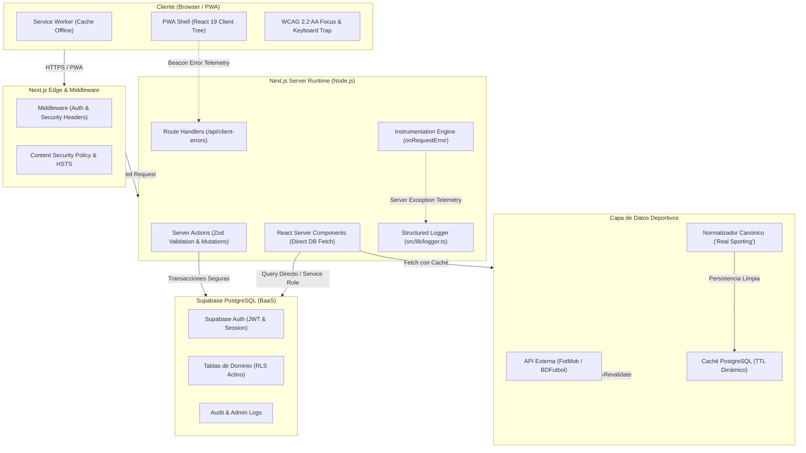
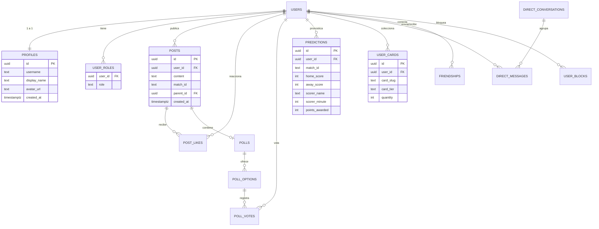

# Especificación de Arquitectura Técnica y Modelo de Dominio

> **Documento de Ingeniería de Software — Mareona**  
> *Versión 1.0 (Noviembre 2026)*  
> *Destinado a revisiones de arquitectura senior, auditorías técnicas y defensa académica de proyecto.*

---

## 1. Visión Global y Topología del Sistema

Mareona está construida sobre una arquitectura modular basada en **Next.js (App Router)**, **React 19**, **TypeScript estricto** y **Supabase (PostgreSQL 15)**, complementada con un motor de ingesta y normalización de datos deportivos externos y una capa de almacenamiento en caché multinivel.



---

## 2. Estrategia de Ingesta y Caché de Datos Deportivos

El acceso a datos deportivos de competiciones profesionales presenta desafíos críticos: límites de peticiones (rate limiting) de proveedores externos, latencias variables y posibles discrepancias en los nombres de los equipos.

### 2.1. Arquitectura de Caché Multinivel
1. **Nivel 1 (Memoria en Servidor):** Revalidación basada en tiempo (`next: { revalidate: X }`) según el estado del partido:
   - Partidos en directo: revalidación a **30-60 segundos**.
   - Partidos del día / jornada próxima: revalidación a **15 minutos**.
   - Partidos finalizados y datos de temporadas históricas: revalidación a **24 horas / estático**.
2. **Nivel 2 (Persistencia en Supabase):** Tablas de caché interna que almacenan el payload normalizado JSONB. Si la API externa cae o agota la cuota, la aplicación sirve el último dato válido persistido sin degradar la experiencia de usuario.
3. **Nivel 3 (Resiliencia ante Fallos):** Se prohíben datos inventados o mock de fallback en producción (Regla 2 de `AGENTS.md`). Cuando no hay datos disponibles, se presenta un estado vacío explícito y transparente.

### 2.2. Normalización del Nombre Canónico
Todas las respuestas de proveedores externos (`FotMob`, `API-Football`, etc.) se interceptan en el borde (`src/lib/sports-api/index.ts` y subadaptadores). Toda variación ("Sporting Gijón", "Sporting de Gijón", "Real Sporting Gijon") es convertida a la forma canónica **"Real Sporting"** antes de guardarse en base de datos o llegar a los componentes de presentación.

---

## 3. Modelo de Datos y Seguridad (PostgreSQL Row Level Security)

La base de datos PostgreSQL está protegida por un modelo de seguridad por capas donde **el 100 % de las tablas públicas tienen Row Level Security (RLS) habilitada** de forma predeterminada (default deny).

### 3.1. Diagrama Entidad-Relación (ER)



### 3.2. Reglas de Custodia y Políticas RLS Clave
- **Identidad en Servidor:** El `user_id` de cualquier acción nunca se acepta como argumento desde el cliente; se extrae obligatoriamente de la sesión autenticada en servidor mediante `supabase.auth.getUser()`.
- **Mensajería Privada:** Solo los usuarios que forman parte de una fila en `direct_conversations` (a través de `user_1_id` o `user_2_id`) tienen permiso de `SELECT` o `INSERT` en `direct_messages`.
- **Bloqueos Activos:** Las consultas de feed y mensajería filtran de forma determinista cualquier contenido originado por usuarios con relaciones activas en `user_blocks`.
- **Rol Administrador (`admin`):** Determinación segura a través de funciones PostgreSQL con `SECURITY DEFINER` (`public.is_admin()`), impidiendo la escalada de privilegios desde el cliente.

---

## 4. Arquitectura de Front-End y Sistema de Diseño

El diseño de componentes sigue el principio de **Modularidad Preventiva** con límite estricto de **≤ 180 líneas por archivo**.

### 4.1. Separación Servidor / Cliente
- **Server Components por Defecto:** Las páginas leen datos directamente desde la base de datos o el motor de caché sin exponer APIs intermedias innecesarias ni cargar JavaScript en el cliente.
- **Client Components Quirúrgicos:** Se restringe `"use client"` a componentes con estado de interacción explícito (modales interactivos, formularios de predicción, tableros de Wordle, arrastre de alineaciones). Todo archivo cliente incluye un comentario explicativo formal: `// Client: <motivo>`.

### 4.2. Tokens de Diseño y Accesibilidad (WCAG 2.2 AA)
- **Tema Claro Único:** Diseñado exclusivamente para alto contraste sobre blanco puro con `color-scheme: light`.
- **Ausencia de Azul:** Sustitución completa de las paletas predeterminadas por rojo corporativo (`#e2001a`), bordes neutros y foco visible `--ring: #b80015`.
- **Cero Fuentes Monoespaciadas (`font-mono`):** Uso riguroso de `font-sans tabular-nums` para marcadores, clasificaciones, minutos y dorsales, garantizando alineación visual sin aspecto de terminal.
- **Trampeo y Gestión de Foco en Modales:** Todos los modales implementan el hook `useModalA11y`, soportando la tecla `Escape`, control de desbordamiento en `body`, clic intencional en backdrop y áreas de toque ergonómicas (≥ 44×44 px).

---

## 5. Observabilidad, Monitoreo y Telemetría de Errores

El sistema incorpora un doble motor de captura de excepciones en producción:

```
[Cliente Web / PWA]                                [Servidor Next.js]
  │                                                        │
  ├─> React Error Boundary (error.tsx / global-error.tsx)  ├─> Instrumentation.onRequestError
  │     │                                                  │     │
  │     ▼                                                  │     ▼
  │   reportClientError()                                  │   logger.error({ context, error })
  │     │ (navigator.sendBeacon / fetch keepalive)         │
  │     ▼                                                  │
  └─> Endpoint /api/client-errors ─────────────────────────┘
        (Validación Zod + Logger Estructurado)
```

1. **Servidor (`src/instrumentation.ts`):** Mediante el hook oficial `onRequestError` de Next.js, se capturan de forma centralizada todas las excepciones no controladas generadas en Server Components, Server Actions, Route Handlers y middleware.
2. **Cliente (`src/lib/telemetry/` y `/api/client-errors`):** Los errores en el navegador son capturados por los boundaries de React y reportados de forma asíncrona mediante `navigator.sendBeacon`, garantizando el envío incluso cuando el usuario cierra la pestaña.
3. **Logger Estructurado (`src/lib/logger.ts`):** Salida en formato JSON estándar con supresión de datos sensibles (contraseñas, tokens de sesión).

---

## 6. Taxonomía de Calidad y Suite de Pruebas (9 Dimensiones)

El proyecto cuenta con **493 pruebas automatizadas** que se ejecutan en ~4 segundos mediante el test runner nativo de Node.js y Playwright:

| Dimensión | Ruta / Herramienta | Objetivo de Validación |
| :--- | :--- | :--- |
| **1. Unitarias** | `tests/unit/` | Motores de juego (Wordle, Who Are Ya, Trivia), cálculo de rachas, deduplicación de bolsas y formateadores. |
| **2. Integración** | `tests/integration/` | Server Actions de comunidad, creación de encuestas de 2-4 opciones, rate limiting deslizante y comentarios en hilo. |
| **3. Sistema / E2E** | `tests/e2e/` (Playwright) | Flujos de usuario completos: navegación, envío de porra, apertura de sobres, modo offline y protección de rutas admin. |
| **4. Accesibilidad** | `tests/a11y/` | Fórmulas matemáticas de luminancia relativa WCAG (contraste ≥ 4.5:1), ausencia de azul y estándares de modales (`role="dialog"`, `aria-modal`). |
| **5. Usabilidad** | Tests E2E & Unit | Áreas de contacto táctil (≥ 44 px), confirmación de acciones destructivas y prevención de pérdidas de datos. |
| **6. Rendimiento** | `scripts/audit-performance.mjs` (Lighthouse) | Auditoría Core Web Vitals en 10 rutas de producción (LCP < 1.2s, CLS 0, Best Practices 96-100, SEO 100). |
| **7. Arquitectura & Código** | `tests/code/architecture-rules.test.ts` | Tolerancia cero a `@ts-ignore`, prohibición total de `font-mono`, nombre canónico "Real Sporting" e higiene de `.env.example`. |
| **8. Seguridad & RLS** | `tests/load/` & `tests/code/` | Headers de seguridad HTTP (CSP, HSTS, X-Frame-Options), validación estricta Zod en el borde y permisos de sesión. |
| **9. Resiliencia & Carga** | `tests/load/concurrency-resilience.test.ts` | Disparo en paralelo de 50 peticiones simultáneas, 100 usuarios concurrentes sin colisión y degradación elegante de APIs. |

---

## 7. Registro de Decisiones Arquitectónicas (ADRs)

### ADR-001: Adopción de React Server Components (RSC) por Defecto
* **Contexto:** Se requiere máximo rendimiento en dispositivos móviles con conexiones 3G/4G y mínimo coste de computación.
* **Decisión:** Toda la aplicación se implementa como Server Components salvo requerimiento estricto de interactividad en el cliente.
* **Consecuencia:** Cero transferencia de librerías innecesarias al navegador, reducción drástica del JavaScript bundle y carga inicial ultrarrápida.

### ADR-002: Prohibición Estricta de Mock Data en Producción
* **Contexto:** Evitar la sensación de prototipo o maqueta en un producto listo para el público.
* **Decisión:** Si una consulta deportiva o social no dispone de registros, la interfaz muestra de forma transparente un estado vacío limpio.
* **Consecuencia:** Confianza total del aficionado en la veracidad de los datos mostrados.

### ADR-003: Tipografía Numérica Tabular sobre Fuentes Monoespaciadas
* **Contexto:** Las fuentes monoespaciadas (`font-mono`) en tablas deportivas o marcadores transmiten un aspecto genérico de plantilla técnica o terminal de desarrollo.
* **Decisión:** Prohibir `font-mono` en la interfaz pública y utilizar exclusivamente la fuente de sistema sans-serif con cifras tabulares (`font-sans tabular-nums`).
* **Consecuencia:** Alineación vertical perfecta de marcadores y minutos con estética editorial deportiva premium.

### ADR-004: Ingesta Dual de Telemetría sin Dependencias Pesadas
* **Contexto:** Mantener la aplicación en coste cero sin comprometer el monitoreo de errores en producción.
* **Decisión:** Implementar captura nativa mediante el hook de Next.js `onRequestError` y el endpoint ligero `/api/client-errors` en lugar de instalar SDKs pesados de terceros en el cliente.
* **Consecuencia:** Cero sobrecarga en el bundle del cliente y observabilidad completa centralizada en servidor.
