# Mareona - Memoria Técnica

## Índice

- [Capítulo 1. Introducción](#capítulo-1-introducción)
  - [1.1 Motivación y Justificación](#11-motivación-y-justificación)
  - [1.2 Objetivos del Proyecto](#12-objetivos-del-proyecto)
  - [1.3 Alcance del Proyecto](#13-alcance-del-proyecto)
  - [1.4 Alternativas Tecnológicas](#14-alternativas-tecnológicas)
- [Capítulo 2. Análisis](#capítulo-2-análisis)
  - [2.1 Funcionalidades del Sistema](#21-funcionalidades-del-sistema)
  - [2.2 Actores del Sistema](#22-actores-del-sistema)
  - [2.3 Requisitos del Sistema](#23-requisitos-del-sistema)
  - [2.4 Casos de Uso](#24-casos-de-uso)
  - [2.5 Subsistemas](#25-subsistemas)
  - [2.6 Mapa de Navegación](#26-mapa-de-navegación)
- [Capítulo 3. Diseño del Sistema](#capítulo-3-diseño-del-sistema)
  - [3.1 Arquitectura](#31-arquitectura)
  - [3.2 Base de Datos](#32-base-de-datos)
  - [3.3 Diseño de los Subsistemas](#33-diseño-de-los-subsistemas)
  - [3.4 Funcionamiento Global de la Aplicación](#34-funcionamiento-global-de-la-aplicación)
  - [3.5 Seguridad y Privacidad](#35-seguridad-y-privacidad)
  - [3.6 Diseño de la Interfaz](#36-diseño-de-la-interfaz)
- [Capítulo 4. Implementación](#capítulo-4-implementación)
  - [4.1 Tecnologías y Lenguajes](#41-tecnologías-y-lenguajes)
  - [4.2 Herramientas](#42-herramientas)
  - [4.3 Estructura del Código](#43-estructura-del-código)
  - [4.4 Calidad del Código](#44-calidad-del-código)
  - [4.5 Internacionalización](#45-internacionalización)
  - [4.6 Uso de Herramientas de IA en el Desarrollo](#46-uso-de-herramientas-de-ia-en-el-desarrollo)
- [Capítulo 5. Pruebas](#capítulo-5-pruebas)
  - [5.1 Estrategia de Pruebas](#51-estrategia-de-pruebas)
  - [5.2 Pruebas Unitarias](#52-pruebas-unitarias)
  - [5.3 Pruebas de Integración](#53-pruebas-de-integración)
  - [5.4 Pruebas Extremo a Extremo](#54-pruebas-extremo-a-extremo)
  - [5.5 Pruebas de Accesibilidad](#55-pruebas-de-accesibilidad)
  - [5.6 Pruebas de Carga y Rendimiento](#56-pruebas-de-carga-y-rendimiento)
  - [5.7 Reglas de Código Automatizadas](#57-reglas-de-código-automatizadas)
- [Capítulo 6. Manual de Usuario](#capítulo-6-manual-de-usuario)
  - [6.1 Registro e Inicio de Sesión](#61-registro-e-inicio-de-sesión)
  - [6.2 Inicio](#62-inicio)
  - [6.3 Temporada](#63-temporada)
  - [6.4 Histórico](#64-histórico)
  - [6.5 Social](#65-social)
  - [6.6 Juegos](#66-juegos)
  - [6.7 Perfil](#67-perfil)
  - [6.8 Instalación como Aplicación](#68-instalación-como-aplicación)
- [Capítulo 7. Conclusiones y Ampliaciones](#capítulo-7-conclusiones-y-ampliaciones)
  - [7.1 Conclusiones](#71-conclusiones)
  - [7.2 Ampliaciones](#72-ampliaciones)
- [Capítulo 8. Referencias](#capítulo-8-referencias)
- [Capítulo 9. Apéndices](#capítulo-9-apéndices)
  - [9.1 Glosario](#91-glosario)
  - [9.2 Propiedad Intelectual y Licencias](#92-propiedad-intelectual-y-licencias)

---

# Capítulo 1. Introducción

## 1.1 Motivación y Justificación

Mareona es una plataforma web y PWA (Progressive Web App) diseñada para la afición del Real Sporting de Gijón, que ofrece datos actuales e históricos, un espacio de comunidad para los aficionados y una serie de juegos temáticos relacionados con el club. La aplicación centraliza información que actualmente se encuentra dispersa en diversas fuentes, proporcionando un acceso más fácil y organizado a los seguidores del equipo, y fomenta la creación de una comunidad sana, activa y participativa alrededor del Real Sporting.
Actualmente, los aficionados enfrentan dificultades para acceder a datos de la temporada actualizados, consultar datos históricos del club y encontrar un espacio de interacción tranquilo con otros seguidores del club. Las redes sociales y foros existentes a menudo carecen de moderación efectiva, lo que puede llevar a discusiones poco constructivas y a la propagación de información incorrecta. Además, no existen juegos temáticos que permitan a los aficionados interactuar de manera lúdica con la historia y actualidad del club, ni que fomenten el aprendizaje de la historia del Real Sporting de manera entretenida, y la fidelización de la afición, especialmente entre los más jóvenes.
Mareona busca cubrir estas posibilidades, ofreciendo una plataforma que combina información, interacción y entretenimiento, para que la afición pueda disfrutar a diario de una experiencia que refuerce su vínculo con el club. La aplicación se desarrolla con un enfoque de coste cero para los usuarios, accesibilidad según los estándares WCAG 2.2 AA, y con funcionalidades que permiten su uso incluso sin conexión a internet, garantizando así que todos los aficionados puedan acceder a la información y participar en la comunidad sin barreras.

## 1.2 Objetivos del Proyecto

El objetivo principal del proyecto es reunir en una sola aplicación la actualidad deportiva, el archivo histórico, la comunidad y los juegos temáticos para la afición del Real Sporting de Gijón. Para lograrlo se han definido los siguientes objetivos específicos:

1. Mostrar datos de la temporada actualizados y fiables, incluyendo calendario, resultados, clasificaciones, estadísticas colectivas e individuales y fichas de partido.
2. Ofrecer un archivo histórico del club con trayectoria por temporadas, efemérides, balance frente a rivales y registros de jugadores y entrenadores.
3. Proporcionar un espacio de comunidad moderado donde los aficionados puedan publicar opiniones, debatir en hilos, seguir a otros usuarios y enviarse mensajes privados.
4. Incluir juegos diarios y un álbum de cromos digitales ligados a la historia y la actualidad del club para fomentar la participación recurrente.
5. Mantener la plataforma gratuita para el usuario y operable dentro de planes de infraestructura sin coste.
6. Cumplir con los estándares de accesibilidad WCAG 2.2 AA en contraste, navegación por teclado y compatibilidad con lectores de pantalla.
7. Funcionar como PWA instalable con modo sin conexión para consultar el archivo histórico y jugar a los retos diarios aunque falle la cobertura móvil.
8. Proteger los datos personales y la integridad de las operaciones mediante validación en servidor, políticas de acceso en base de datos y pruebas automatizadas.

## 1.3 Alcance del Proyecto

Mareona cubre el seguimiento deportivo del Real Sporting, la consulta de su archivo histórico, la interacción social entre aficionados y una colección de juegos diarios y de coleccionismo. La aplicación se organiza en siete áreas funcionales accesibles desde la navegación principal o mediante permisos de administración:

- Inicio (`/`): resumen con el próximo partido o encuentro en directo, efeméride del día y accesos directos a las secciones principales.
- Temporada (`/temporada`): calendario y resultados oficiales de la temporada del Real Sporting, ficha completa de cada encuentro (alineaciones, cronología en directo, estadísticas comparadas, gráfico de *momentum*, mapa de disparos y *La Grada* con votación al MVP), clasificación en tres vistas (tabla tradicional, distancia real por puntos y evolución por jornada), estadísticas colectivas con posición en liga y mapas tácticos, fichas individuales de la plantilla y pizarra táctica interactiva (*Mi Once*) para crear y compartir alineaciones.
- Histórico (`/historico`): trayectoria del club temporada a temporada con acceso a clasificaciones, partidos y plantillas pasadas, calendario de efemérides, balance frente a rivales con mapas interactivos de España y del mundo, y tablas históricas de jugadores y entrenadores.
- Social (`/social`): muro comunitario con hilos de respuestas, encuestas y alineaciones compartidas, red de amistades, mensajería directa privada, bloqueo entre usuarios y moderación automática con IA acompañada de revisión manual.
- Juegos (`/juegos`): tres retos diarios sobre el club (*Wordle*, *La Pregunta del Día* y *¿Quién es?*), el modo de racha libre *¿Más o Menos?*, *La Porra* de cada partido oficial con clasificación global y por amigos, y el álbum de cromos *Memoria Rojiblanca* con apertura de sobres y reciclaje de repetidos.
- Perfil (`/perfil`): autenticación por correo electrónico o Google, edición de datos y avatar, borrado completo de cuenta y soporte de instalación como PWA con modo sin conexión para el archivo histórico y los juegos diarios.
- Administración (`/admin`): panel restringido a moderadores y administradores para gestionar usuarios, revisar mensajes reportados o retenidos, publicar avisos y consultar métricas de visitas y errores de cliente.

En la Ilustración 1 se muestra la distribución de los módulos de la aplicación y su agrupación entre zonas públicas, áreas que requieren sesión y el panel de administración.

```mermaid
flowchart TB
    App["Mareona (PWA)"]
    App --> Inicio["Inicio (/)"]
    App --> Temporada["Temporada (/temporada)"]
    App --> Historico["Histórico (/historico)"]
    App --> Social["Social (/social)"]
    App --> Juegos["Juegos (/juegos)"]
    App --> Perfil["Perfil (/perfil)"]
    App --> Admin["Administración (/admin)"]

    Temporada --> T1["Partidos y La Grada"]
    Temporada --> T2["Clasificación"]
    Temporada --> T3["Estadísticas"]
    Temporada --> T4["Plantilla"]
    Temporada --> T5["Mi Once"]

    Historico --> H1["Trayectoria"]
    Historico --> H2["Efemérides"]
    Historico --> H3["Rivales y mapas"]
    Historico --> H4["Legado"]

    Social --> S1["Muro social e hilos"]
    Social --> S2["Amistades"]
    Social --> S3["Mensajes directos"]

    Juegos --> J1["La Porra"]
    Juegos --> J2["Memoria Rojiblanca"]
    Juegos --> J3["Juegos diarios"]

    Admin --> A1["Usuarios y roles"]
    Admin --> A2["Moderación"]
    Admin --> A3["Anuncios y telemetría"]
```

*Ilustración 1. Mapa de módulos de Mareona.*


## 1.4 Alternativas Tecnológicas

El proyecto parte de una restricción económica clara: toda la infraestructura debe funcionar dentro de los planes gratuitos de los servicios elegidos, sin renunciar a seguridad en base de datos, accesibilidad ni rendimiento en móvil. Con ese criterio se evaluaron las opciones de cada capa.

### 1.4.1 Framework de Aplicación

Se evaluó desarrollar una aplicación de página única (SPA) con React y Vite conectada a un servidor REST independiente (Express, NestJS o Spring Boot), frente a utilizar Next.js 16 con App Router y React 19.

Se eligió Next.js 16 porque los Server Components permiten renderizar en el servidor las vistas con mayor volumen de datos (`/temporada` y `/historico`) sin enviar ese JavaScript al navegador, lo que reduce el tiempo de carga inicial en dispositivos móviles y mejora la indexación. Además, las Server Actions resuelven las escrituras contra el servidor sin mantener una API REST separada, y el proxy en el borde valida y renueva la sesión antes de servir cada página.

Esta elección tiene dos contrapartidas asumidas en el proyecto: exige controlar con rigor qué módulos se ejecutan solo en servidor y qué componentes necesitan `"use client"`, y hace incompatibles los plugins de PWA basados en Webpack con el empaquetador Turbopack, por lo que el Service Worker (`public/sw.js`) se implementó manualmente.

### 1.4.2 Backend y Base de Datos

Se comparó el uso de bases de datos documentales o gestionadas sin esquema fijo (Firebase Firestore, MongoDB Atlas) y el despliegue de un PostgreSQL propio con Prisma en un servidor privado, frente a Supabase (PostgreSQL gestionado, Auth, Storage y políticas RLS).

Se optó por Supabase por tres motivos:

- El dominio de Mareona es relacional: clasificaciones, árboles de respuestas, solicitudes de amistad, inventario de cromos y cálculo de puntos de la porra dependen de claves ajenas e integridad referencial.
- PostgreSQL permite encapsular operaciones atómicas en funciones PL/pgSQL (`SECURITY DEFINER`) y aplicar *Row Level Security* (RLS) en todas las tablas, de modo que la propia base de datos impide leer o modificar filas sin permiso aunque falle una comprobación previa en la aplicación.
- Supabase integra en un único servicio la autenticación SSR (correo electrónico y OAuth con Google) y el almacenamiento de avatares, evitando mantener servicios separados.

Como limitación, el plan gratuito acota el número de conexiones simultáneas, el espacio de almacenamiento y puede pausar proyectos inactivos, lo que obliga a reutilizar clientes de servidor y mantener las consultas ligeras.

### 1.4.3 Despliegue

Se valoró alojar la aplicación en un servidor virtual privado (VPS) con Docker o en Vercel. Se eligió Vercel por su integración directa con Next.js 16, el despliegue continuo automático desde GitHub y la gestión sin mantenimiento de certificados TLS y cabeceras HTTP desde `next.config.ts`, todo dentro del plan gratuito.

El compromiso de este modelo es que las funciones de servidor tienen límites de tiempo de ejecución y transferencia mensual en la capa gratuita. Para no superarlos en días de partido, las respuestas de datos deportivos se almacenan en caché y las páginas estáticas o históricas se sirven desde datos compilados.

### 1.4.4 Fuentes de Datos Deportivos

Se estudió contratar un único proveedor comercial de datos deportivos (Opta, StatsPerform o API-Football en plan de pago) frente a combinar varias fuentes gratuitas con almacenamiento en caché y un archivo histórico propio.

Ninguna fuente gratuita cubre por sí sola todas las necesidades del proyecto: suelen imponer cuotas diarias bajas (por ejemplo, 100 peticiones al día en API-Football) y no ofrecen simultáneamente estadísticas avanzadas como mapas de disparos o *momentum* junto con un siglo de historia del club. Por ello se combinan:

- ESPN API para resultados, clasificación en vivo y plantilla actual.
- Un parser sobre FotMob para datos detallados de partido, mapas de disparos, *momentum* y estadísticas avanzadas de temporada.
- API-Football como respaldo cuando alguna consulta principal no está disponible.
- Un conjunto de ficheros JSON propios compilados en `src/data/historical` para el archivo histórico desde los orígenes del club.

Todas las llamadas externas pasan obligatoriamente por adaptadores en el servidor (`src/lib/sports-api/`) que validan los datos con Zod, normalizan el nombre del club a `"Real Sporting"` y guardan los resultados en memoria y en la tabla `external_api_cache` de Supabase. La desventaja de depender de APIs no oficiales o gratuitas es que su formato puede variar sin aviso; si una fuente falla o no devuelve datos, la interfaz informa de la ausencia sin inventar valores.

### 1.4.5 Interfaz y Estilos

Se descartaron librerías de componentes cerradas con estilos predefinidos (Material UI, Ant Design o dependencias UI pesadas) en favor de Tailwind CSS 4, componentes accesibles propios (`use-modal-a11y.ts` y controles HTML/ARIA nativos) y la librería de iconos `lucide-react`.

Las librerías cerradas dificultan imponer una identidad visual estricta en rojo y blanco sin sobrescribir estilos internos y añaden código innecesario al paquete del navegador. Tailwind CSS 4 genera únicamente las clases utilizadas en la aplicación, mientras que los componentes propios garantizan el manejo del foco, la navegación por teclado y los atributos ARIA requeridos por WCAG 2.2 AA con una huella mínima en cliente.

---
# Capítulo 2. Análisis

## 2.1 Funcionalidades del Sistema

El apartado 1.3 presentó los siete módulos de Mareona. A continuación se detallan las capacidades concretas de cada uno y las reglas de funcionamiento que definen el alcance del sistema.

En el área de Inicio y Temporada, cualquier persona puede consultar sin necesidad de cuenta el próximo partido o el encuentro en directo, el calendario de LaLiga Hypermotion y Copa del Rey, la ficha completa de cada partido, la clasificación en sus tres vistas (tabla tradicional, distancia real por puntos y evolución por jornada), las estadísticas colectivas e individuales de la plantilla y la pizarra táctica *Mi Once*. En *Mi Once* el usuario coloca jugadores del primer equipo, del Sporting Atlético o del Juvenil División de Honor sobre sistemas predefinidos, exporta la alineación como imagen y, si tiene sesión iniciada, la comparte en Social o en *La Grada* del siguiente partido.

El Archivo Histórico reúne datos compilados desde los orígenes del club en cuatro vistas de solo lectura: trayectoria por temporadas (con acceso a clasificación, partidos y plantilla de cada campaña), efemérides por día del año, balance histórico frente a rivales (con filtros por categoría y mapas interactivos de España y del mundo) y tablas de legado de jugadores y entrenadores en partidos oficiales.

El área Social requiere cuenta iniciada para escribir y se articula en cuatro piezas:

- El muro social (`/social`) permite publicar mensajes de hasta 500 caracteres, responder en hilos ordenados por fecha, adjuntar encuestas o alineaciones de *Mi Once*, marcar "me gusta", compartir enlaces externos y filtrar el muro para ver solo publicaciones de amigos.
- *La Grada* (integrada en la ficha de cada partido) agrupa el debate específico del encuentro y la votación al MVP del partido.
- La red de amistades gestiona solicitudes enviadas y recibidas, además de habilitar el filtro de amigos en el muro y en la clasificación de *La Porra*.
- La mensajería directa ofrece conversaciones privadas uno a uno entre usuarios, con borrado lógico por parte del usuario y mecanismo de reporte.

Todo mensaje publicado en el muro o en *La Grada* pasa por un sistema de moderación automática con IA antes de mostrarse, y los usuarios pueden bloquearse entre sí o reportar mensajes y perfiles.

El módulo de Juegos combina un sistema de pronósticos, tres retos diarios, un juego continuo de racha y un álbum de cromos digitales:

- *La Porra* permite pronosticar el resultado exacto y los goleadores rojiblancos del próximo partido oficial hasta el cierre previo al inicio; al finalizar el encuentro se calculan los puntos (signo 1X2, marcador exacto y goleadores) y se actualiza la clasificación global y de amigos.
- Los tres juegos diarios (*Wordle*, *La Pregunta del Día* y *¿Quién es?*) comparten un reto diario común por fecha en zona horaria `Europe/Madrid` y permiten consultar retos anteriores en el archivo de cada juego.
- *¿Más o Menos?* funciona en sesiones libres sin límite diario, comparando la trayectoria de jugadores históricos del club por partidos oficiales, goles o minutos disputados.
- *Memoria Rojiblanca* organiza cromos en cuatro rarezas (básica, especial, histórica y legendaria) que se obtienen al abrir sobres (Aficionado, Rojiblanco y Leyenda) conseguidos por bienvenida, visita diaria, acierto en juegos diarios, racha de siete días, puntos en *La Porra* o reciclaje de diez cromos repetidos.

Las funcionalidades de cuenta y administración completan el sistema: el usuario gestiona su perfil, avatar y borrado completo de cuenta desde `/perfil`, instala la aplicación como PWA desde `/instalar` o el navegador, y el personal autorizado accede a `/admin` para gestionar usuarios, revisar contenido moderado o reportado, publicar anuncios y consultar métricas de tráfico y errores.

No forman parte del sistema la edición colaborativa de datos históricos por parte de usuarios, los pagos ni recompensas monetarias, las notificaciones push nativas ni la mensajería grupal privada.

## 2.2 Actores del Sistema

El sistema distingue cuatro perfiles con permisos crecientes. Los roles de moderación y administración no se asignan en el registro: se almacenan en la tabla `user_roles` (`moderator` y `admin`) y se verifican en servidor y en base de datos. En la Ilustración 2 se representa la relación jerárquica entre ellos y la Tabla 1 resume sus capacidades.

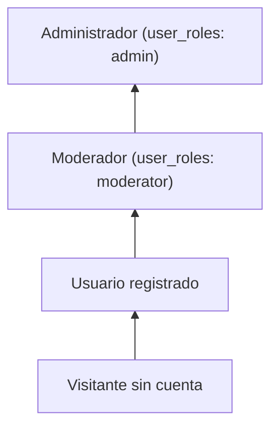

*Ilustración 2. Jerarquía de actores del sistema.*

| Actor | Acceso y capacidades principales | Restricciones |
| :--- | :--- | :--- |
| Visitante sin cuenta | Consulta Inicio, Temporada, Histórico, páginas legales y puede probar los juegos diarios en local. | No puede publicar en Social ni en La Grada, votar MVP, enviar mensajes, participar en La Porra ni guardar sobres en el álbum. |
| Usuario registrado | Hereda la consulta pública y añade publicación en Social y La Grada, encuestas, amistades, mensajería directa, pronósticos en La Porra, guardado de progreso y sobres en Juegos, reportes, bloqueos y gestión o borrado de su perfil. | Solo edita o borra sus propios contenidos dentro de las reglas de moderación; no accede a `/admin`. |
| Moderador | Hereda las capacidades del usuario registrado y está modelado en `user_roles` para tareas de revisión de contenido retenido o reportado. | En la versión actual, el acceso a `/admin` exige rol `admin` (`assertAdmin()`), por lo que la moderación operativa recae en el administrador hasta habilitar vistas dedicadas. |
| Administrador | Hereda las capacidades anteriores y accede a `/admin` para revisar moderación, suspender o reactivar usuarios, gestionar anuncios globales, limpiar caché deportiva y consultar telemetría de visitas, errores y registros de auditoría. | Todas sus acciones de gestión quedan registradas de forma inmutable en `admin_audit_logs`. |

*Tabla 1. Actores del sistema y permisos asociados.*

En producción, si un visitante o un usuario sin rol `admin` intenta acceder a las rutas de administración, el servidor devuelve un código HTTP 404 para ocultar la existencia del panel.

## 2.3 Requisitos del Sistema

### 2.3.1 Requisitos Funcionales

Los requisitos funcionales se agrupan por área de negocio y describen las operaciones que el sistema debe ofrecer.

Cuenta y sesión:
- Permitir el registro y el inicio de sesión mediante correo electrónico y contraseña o mediante OAuth con Google.
- Mantener la sesión del usuario mediante cookies seguras renovadas en el servidor en cada petición.
- Permitir al usuario editar su nombre visible, nombre de usuario y avatar en `/perfil`, así como solicitar el borrado definitivo de su cuenta y datos personales.
- Impedir el acceso a acciones de escritura a usuarios suspendidos (`is_banned`).

Temporada:
- Mostrar el calendario completo de partidos oficiales del Real Sporting en LaLiga Hypermotion y Copa del Rey, destacando el próximo encuentro o el partido en directo.
- Presentar la ficha de cada partido con alineaciones, cronología de eventos, estadísticas comparadas, gráfico de *momentum* y mapa de disparos cuando la fuente externa disponga de esos datos.
- Mostrar la clasificación actualizada en tres modos: tabla general, distancia real por puntos y evolución por jornada.
- Presentar estadísticas colectivas de la temporada con la posición del equipo en liga para cada métrica y mapas tácticos de actividad.
- Listar la plantilla actual con fichas individuales por jugador y ofrecer una pizarra táctica interactiva para confeccionar, descargar y compartir alineaciones.

Archivo histórico:
- Mostrar el gráfico de trayectoria histórica del club por temporada con acceso a clasificación, partidos y plantilla de cada campaña registrada.
- Consultar efemérides y partidos disputados en cualquier fecha del calendario.
- Mostrar el balance histórico frente a cada rival con filtros por categoría, mapas interactivos de España y del mundo y acceso al detalle de los enfrentamientos.
- Mostrar las clasificaciones históricas de jugadores con más partidos, máximos goleadores, más temporadas y entrenadores con más encuentros oficiales.

Social y moderación:
- Permitir a usuarios autenticados publicar mensajes de hasta 500 caracteres, responder en hilos, editar o eliminar sus publicaciones dentro de las reglas establecidas y dar "me gusta".
- Permitir adjuntar encuestas de votación y alineaciones creadas en *Mi Once* a las publicaciones del muro.
- Gestionar solicitudes de amistad, listado de amigos, bloqueo mutuo entre usuarios y filtrado del muro por amigos.
- Ofrecer mensajería directa privada entre usuarios con borrado lógico y conservación para custodia ante denuncias.
- Evaluar automáticamente los mensajes nuevos mediante un modelo de lenguaje antes de publicarlos y permitir a la comunidad reportar mensajes o usuarios.

Juegos y álbum de cromos:
- Permitir el envío y modificación de pronósticos en *La Porra* antes del inicio del partido oficial y calcular automáticamente las puntuaciones al finalizar el encuentro.
- Mantener una clasificación general y filtrada por amigos de *La Porra*.
- Generar un reto diario determinista por fecha en zona horaria `Europe/Madrid` para *Wordle*, *La Pregunta del Día* y *¿Quién es?*, además de permitir jugar fechas pasadas.
- Ofrecer partidas continuas de *¿Más o Menos?* comparando estadísticas históricas de jugadores (partidos, goles y minutos).
- Entregar sobres de bienvenida, recompensa diaria, recompensa por juego diario o racha y reciclaje de cromos repetidos en *Memoria Rojiblanca*, actualizando el álbum y evitando sobres duplicados.

Administración:
- Proveer vistas de administración para gestionar usuarios (suspensión y reactivación), moderar mensajes y reportes, gestionar anuncios globales y consultar estadísticas de visitas y errores del cliente.
- Registrar en un log de auditoría cada acción administrativa ejecutada.

### 2.3.2 Requisitos No Funcionales

Los requisitos no funcionales fijan las restricciones técnicas y de calidad que condicionan el diseño:

- Coste de infraestructura cero: todas las piezas (hospedaje, base de datos, autenticación, almacenamiento, moderación y fuentes de datos) deben operar dentro de planes gratuitos.
- Accesibilidad WCAG 2.2 AA: contraste mínimo de 4,5:1 en texto normal, operabilidad completa mediante teclado, foco visible en rojo corporativo y ausencia de información transmitida solo por color.
- Uso móvil y PWA: áreas táctiles mínimas de 44x44 px, navegación inferior en pantallas pequeñas, instalación en iOS, Android y escritorio, y consulta sin conexión del archivo histórico y los juegos diarios.
- Seguridad en base de datos y borde: *Row Level Security* (RLS) activada en todas las tablas, validación con Zod en toda entrada externa, cabeceras de seguridad HTTP (`CSP`, `X-Frame-Options`, `Referrer-Policy`) y límite de peticiones en rutas sensibles.
- Privacidad y cumplimiento legal: eliminación efectiva de cuenta y datos personales bajo demanda, custodia legal de mensajes denunciados y páginas de aviso legal, privacidad, cookies y términos accesibles sin registro.
- Veracidad de datos: prohibición de mostrar datos deportivos simulados o de relleno cuando falte información en las fuentes externas; la interfaz debe indicar la ausencia de forma explícita.
- Rendimiento y cobertura móvil: carga inicial ligera mediante Server Components en las rutas de datos y tiempo de espera acotado (3 segundos) en el Service Worker para no bloquear la navegación con mala cobertura en el estadio.

## 2.4 Casos de Uso

Los casos de uso se agrupan por área funcional para mostrar qué actor inicia cada acción sin sobrecargar un único diagrama. En las Ilustraciones 3 a 7 se recogen los flujos principales de acceso y perfil, información deportiva e histórica, comunidad, juegos y administración.

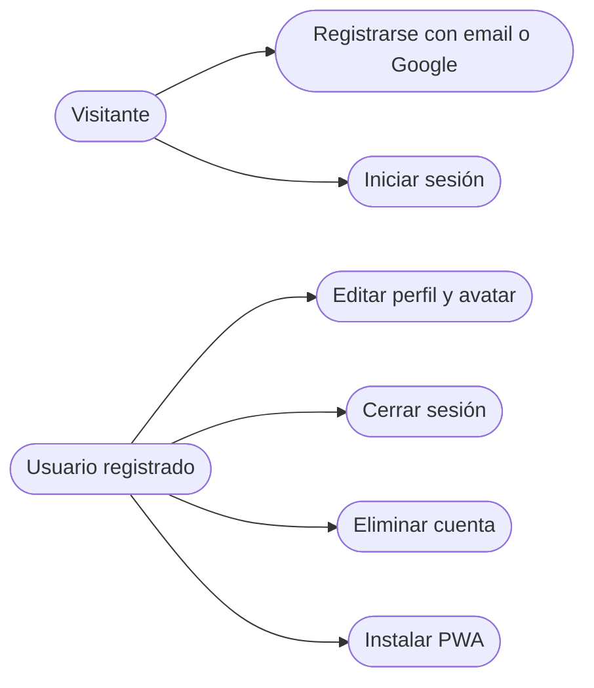

*Ilustración 3. Casos de uso de identidad, perfil e instalación.*

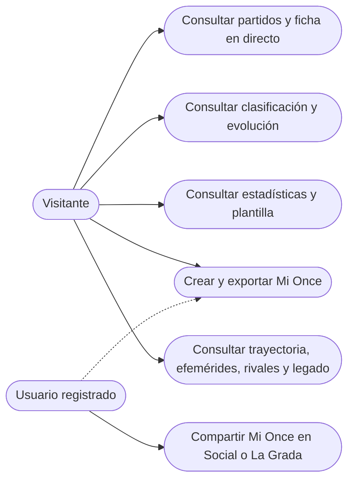

*Ilustración 4. Casos de uso de Temporada e Histórico.*

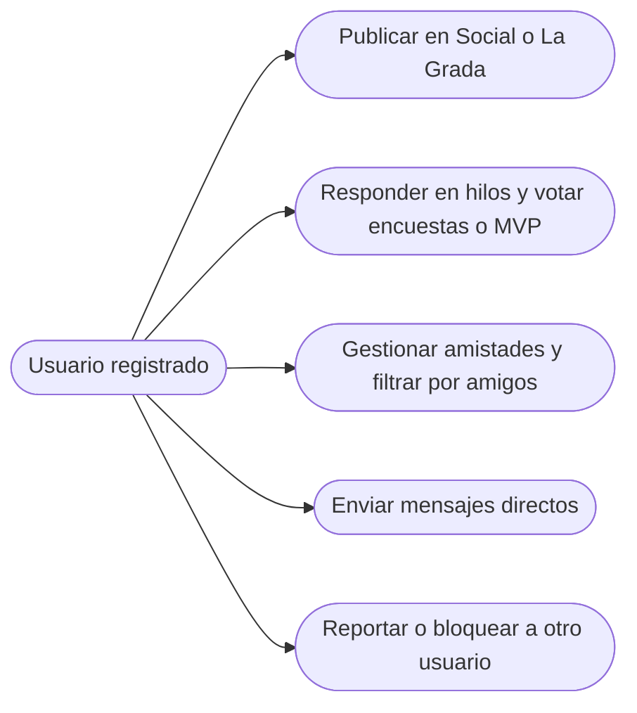

*Ilustración 5. Casos de uso del módulo Social y La Grada.*

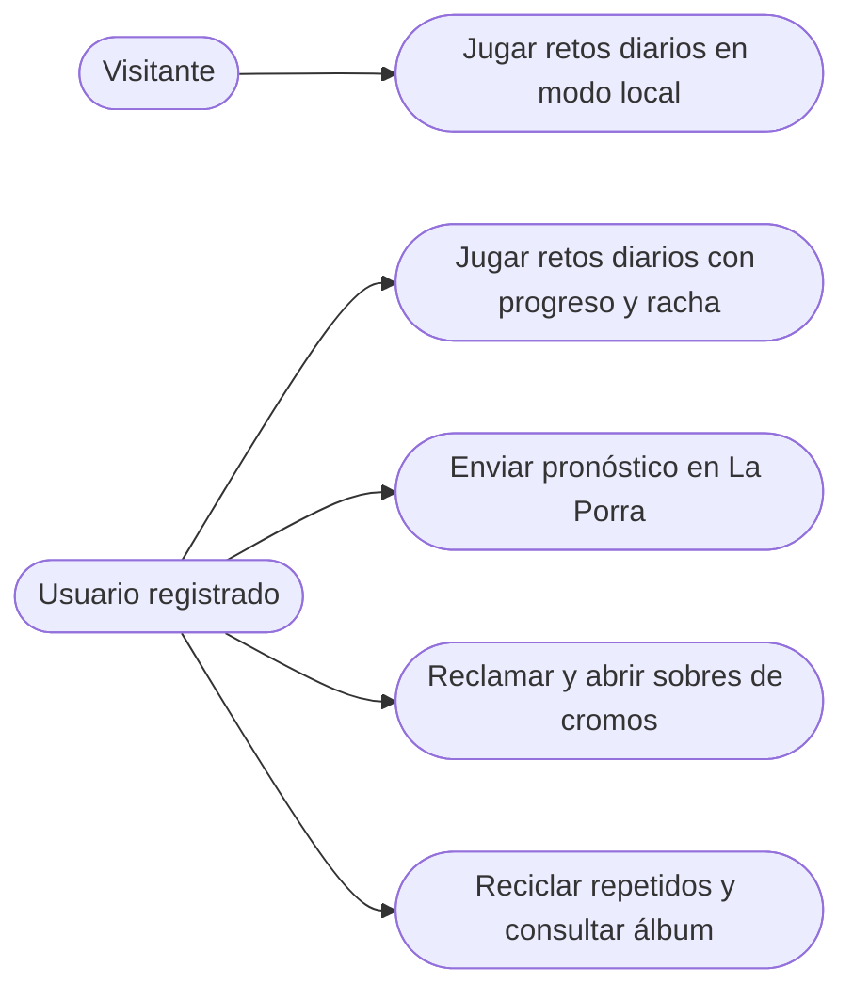

*Ilustración 6. Casos de uso de Juegos, La Porra y Memoria Rojiblanca.*

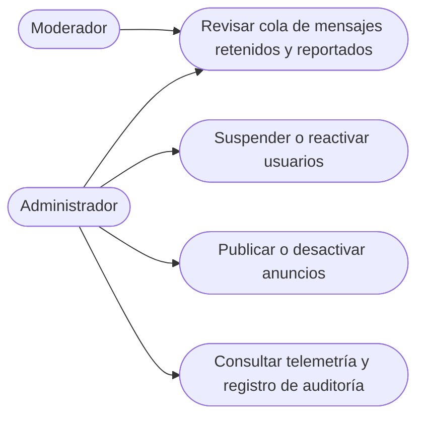

*Ilustración 7. Casos de uso de moderación y administración.*

## 2.5 Subsistemas

El sistema se divide en nueve subsistemas con responsabilidades acotadas. En la Ilustración 8 se muestra cómo dependen unos de otros, evitando dependencias circulares entre dominio, presentación e infraestructura.

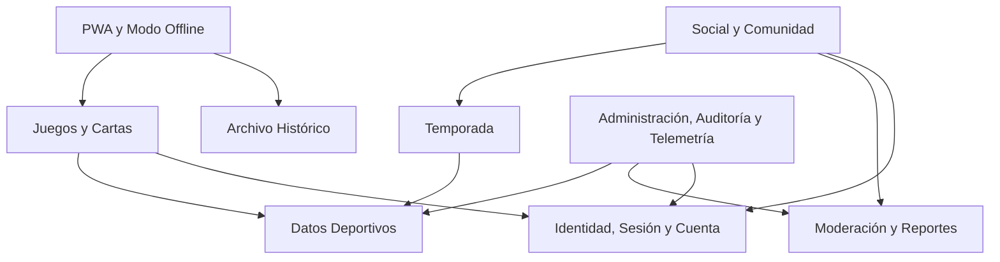

*Ilustración 8. Subsistemas de Mareona y dependencias entre ellos.*

### 2.5.1 Datos Deportivos

Centraliza la comunicación con las fuentes externas (ESPN, FotMob y API-Football), valida los datos entrantes con Zod, normaliza los nombres de equipos a la forma canónica `"Real Sporting"` y gestiona la caché en memoria y en PostgreSQL (`external_api_cache`). Expone funciones tipadas de solo servidor para los subsistemas de Temporada, Juegos y Administración.

### 2.5.2 Temporada

Construye las vistas de partidos, ficha de encuentro, clasificación, estadísticas colectivas, plantilla y pizarra táctica (`/temporada/*` e Inicio). Consume los datos ya normalizados del subsistema de Datos Deportivos y se enlaza con Social mediante *La Grada* en cada ficha de partido y la publicación de alineaciones de *Mi Once*.

### 2.5.3 Archivo Histórico

Gestiona la trayectoria por temporadas, efemérides, balance frente a rivales y registros de legado (`/historico/*`) a partir de los conjuntos de datos estáticos compilados en `src/data/historical`. No depende de APIs externas ni de sesión de usuario, por lo que puede servirse sin conexión a través del subsistema PWA.

### 2.5.4 Social y Comunidad

Gestiona las publicaciones del muro social (`/social`), *La Grada* de cada partido, encuestas, hilos de respuestas, solicitudes de amistad y mensajería directa privada. Depende de Identidad para autorizar al autor en servidor, de Moderación antes de hacer públicos los textos y de Temporada para asociar debates y votaciones de MVP a un partido concreto.

### 2.5.5 Moderación y Reportes

Evalúa los mensajes creados por los usuarios mediante la API de Groq (Llama 3.1 8B Instant), registra intentos bloqueados, gestiona reportes de mensajes y usuarios, y aplica bloqueos mutuos. Suministra la cola de revisión que utilizan moderadores y administradores.

### 2.5.6 Juegos y Cartas

Agrupa los motores de *La Porra*, los tres juegos diarios (*Wordle*, *La Pregunta del Día* y *¿Quién es?*), el juego continuo *¿Más o Menos?* y el álbum *Memoria Rojiblanca* (`/juegos/*`). Calcula los retos diarios por fecha, liquida puntos de *La Porra* a partir de los resultados de Datos Deportivos, gestiona el inventario de sobres y cromos en Supabase y sincroniza partidas offline cuando el usuario tiene sesión.

### 2.5.7 Administración, Auditoría y Telemetría

Controla el acceso al panel `/admin/*` verificando el rol en `user_roles`, ejecuta acciones disciplinarias y gestión de anuncios, registra cada operación administrativa en `admin_audit_logs` y recoge métricas de visitas y errores de cliente (`/api/telemetry` y `/api/client-errors`). El bloque API incluye además rutas técnicas de soporte como `/api/cron/settle-porra` y `/api/wordle/dict`.

### 2.5.8 PWA y Modo Offline

Incluye el manifiesto web, el Service Worker (`public/sw.js`), la cola de sincronización en `localStorage` para acciones realizadas sin red (aislada por cuenta autenticada) y la página de ayuda para instalación (`/instalar` y `/offline`). Da soporte al Archivo Histórico y a los Juegos en condiciones de baja cobertura.

### 2.5.9 Identidad, Sesión y Cuenta

Gestiona el registro, el inicio de sesión con correo electrónico o Google OAuth (`/auth/callback`), el proxy de renovación de cookies de sesión en el borde (`src/proxy.ts`), la edición de perfil en `/perfil` y el borrado completo de cuenta mediante RPC en base de datos.

## 2.6 Mapa de Navegación

La navegación de Mareona se estructura alrededor de cinco entradas principales en la barra superior (escritorio) e inferior (móvil) —Inicio, Temporada, Histórico, Social y Juegos—, el acceso al perfil del usuario, las páginas legales y de soporte PWA, y el área aislada de administración. La Ilustración 9 muestra el árbol completo de rutas implementado en `src/app`.

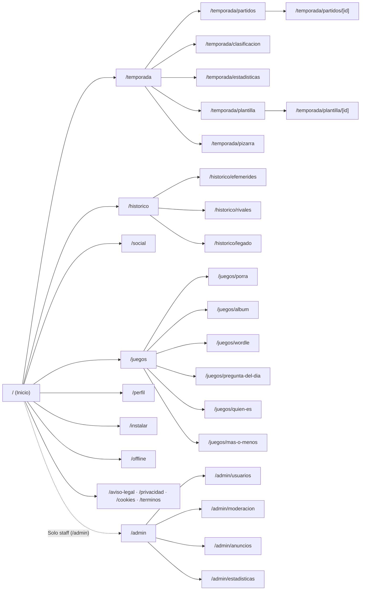

*Ilustración 9. Mapa de navegación de Mareona.*

---

# Capítulo 3. Diseño del Sistema

## 3.1 Arquitectura

### 3.1.1 Visión General

Mareona sigue una arquitectura cliente-servidor basada en Next.js 16 (App Router) desplegado en Vercel y apoyado en Supabase para persistencia, autenticación, tiempo real y almacenamiento de archivos. El cliente no se conecta nunca de forma directa a las APIs deportivas ni al modelo de moderación: toda petición externa pasa por código de servidor que valida, normaliza y almacena en caché los resultados.

En la Ilustración 10 se muestran los cuatro bloques principales de la arquitectura y el flujo de comunicación entre ellos.

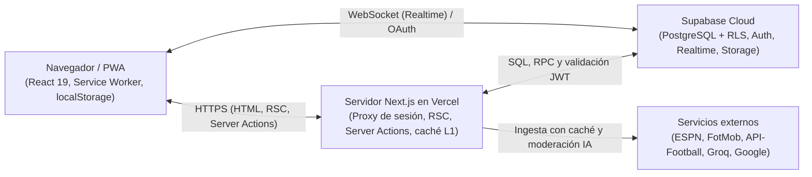

*Ilustración 10. Arquitectura general de Mareona.*

### 3.1.2 Capas y Reglas de Dependencia

El código fuente bajo `src/` se organiza en cuatro capas unidireccionales. Las capas externas dependen de las internas, pero la lógica de dominio no importa componentes de React ni detalles de transporte HTTP:

- Presentación (`src/app/` y `src/components/`): rutas de App Router, layouts, Server Components, componentes interactivos de cliente y diccionarios de texto (`src/i18n/`).
- Borde y validación (`src/proxy.ts`, Server Actions y `src/app/api/`): renovación de sesión, limitación de peticiones (`rate-limiter.ts`) y validación de entradas con esquemas Zod.
- Dominio (`src/lib/`): motores de cálculo de La Porra, juegos diarios, pizarra táctica, árboles de conversación, normalización deportiva y analítica.
- Infraestructura y datos (`src/lib/supabase/`, `src/lib/sports-api/`, `src/data/`): clientes de Supabase (navegador, servidor SSR y `service_role`), conectores externos y conjuntos de datos históricos en JSON.

En la Ilustración 11 se representan las dependencias permitidas entre capas. El cumplimiento de estas fronteras se verifica de forma automática mediante la suite `tests/code/architecture-rules.test.ts` y la directiva `import "server-only"` en los módulos que manejan credenciales o el cliente administrativo de Supabase: si un componente de cliente intenta importarlos, la compilación falla.

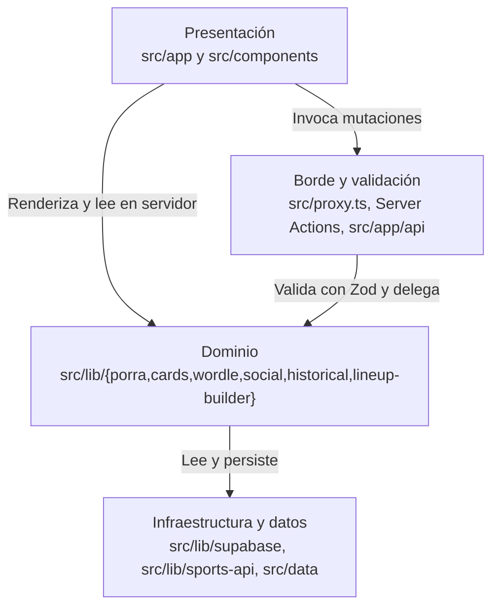

*Ilustración 11. Capas de la aplicación y flujo de dependencias.*

### 3.1.3 Server Components y Client Components

Por defecto, todas las páginas de `src/app/` son Server Components. Cuando el usuario solicita una ruta como `/temporada` o `/historico`, el servidor ejecuta las consultas en paralelo mediante `Promise.all`, construye el HTML y envía solo los datos necesarios al navegador, sin incluir en el paquete de cliente las librerías de parseo ni las fuentes de datos históricas.

El uso de `"use client"` se limita a piezas que requieren estado local o APIs del navegador: manejo de eventos táctiles y `<canvas>` en *Mi Once*, interacción de teclado en *Wordle*, suscripciones WebSocket de Supabase Realtime en mensajes o marcador en vivo, detección de red en la cola offline y los diálogos modales. Cada archivo marcado con `"use client"` documenta el motivo en su primera línea. La Ilustración 12 muestra cómo se reparten ambas responsabilidades dentro de una pantalla mixta.

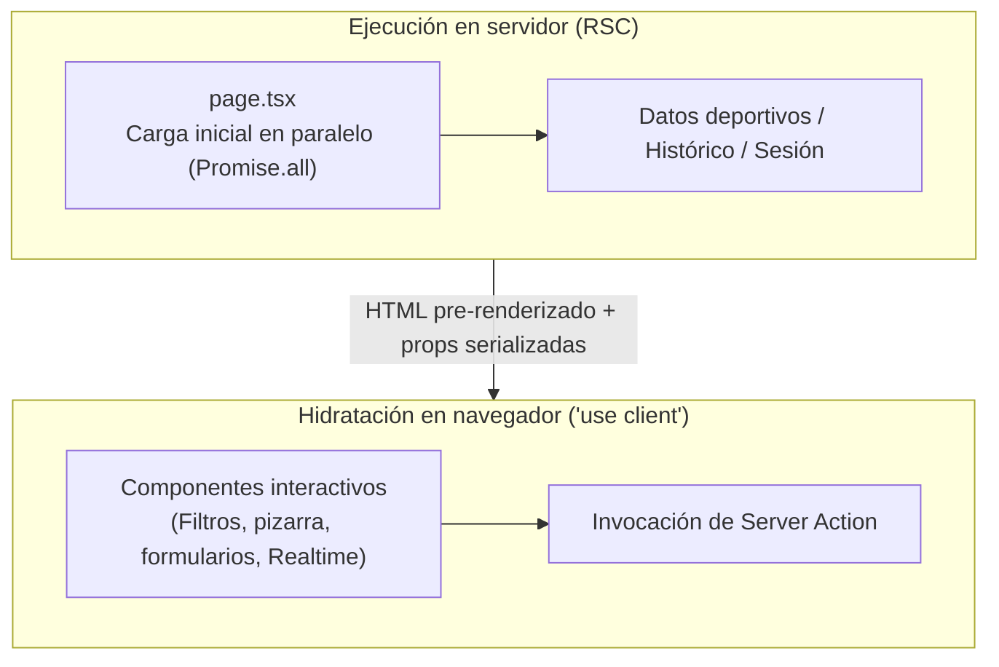

*Ilustración 12. Reparto entre Server Components y Client Components.*

### 3.1.4 Despliegue e Infraestructura

La aplicación se despliega en Vercel a partir del repositorio Git, separando las variables de entorno públicas (`NEXT_PUBLIC_SUPABASE_URL`, `NEXT_PUBLIC_SUPABASE_ANON_KEY`, `NEXT_PUBLIC_GOOGLE_CLIENT_ID`, `NEXT_PUBLIC_APP_URL`, `NEXT_PUBLIC_SHOW_OFFICIAL_ASSETS`, `NEXT_PUBLIC_ENABLE_LOCAL_TELEMETRY`) de las credenciales y secretos que solo existen en el servidor (`SUPABASE_SERVICE_ROLE_KEY`, `SPORTS_API_KEY`, `SPORTS_API_BASE_URL`, `GROQ_API_KEY`, `GROQ_MODEL`, `CRON_SECRET`), integrando `@vercel/analytics` para métricas básicas de tráfico en producción.

Las cabeceras HTTP de seguridad y el control de caché del Service Worker (`no-cache, no-store, must-revalidate` en `/sw.js` para que las actualizaciones lleguen de inmediato a las aplicaciones instaladas) se configuran en `next.config.ts`. Los avatares de usuario se almacenan comprimidos en el bucket `avatars` de Supabase Storage. La Ilustración 13 resume la topología de despliegue.

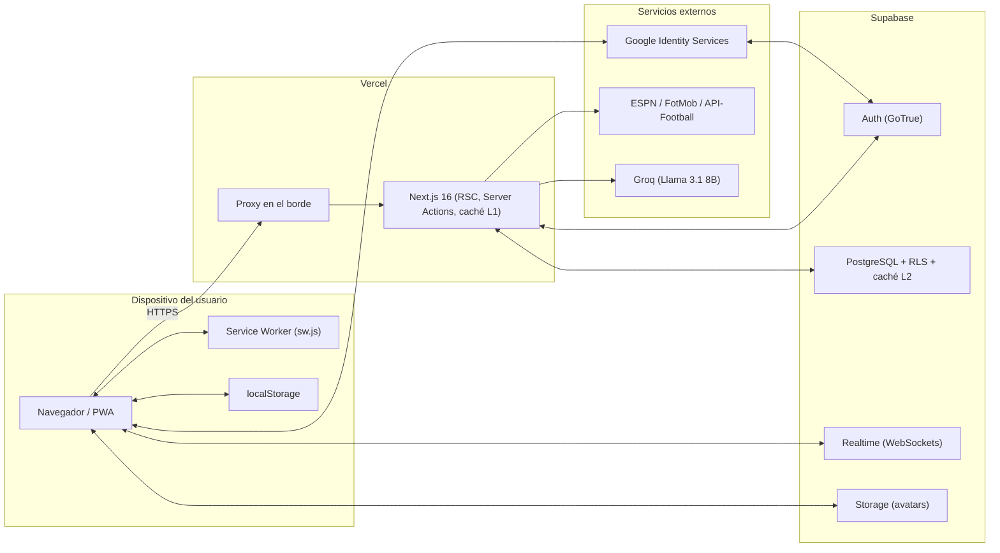

*Ilustración 13. Diagrama de despliegue e infraestructura.*

### 3.1.5 Sesión y Autenticación

La sesión se gestiona con `@supabase/ssr` mediante cookies HTTP firmadas, evitando guardar tokens en `localStorage` donde quedarían expuestos a scripts. Antes de cada petición de página (excluyendo estáticos e imágenes en `config.matcher`), el proxy `src/proxy.ts` invoca `updateSession()` para leer las cookies, validar el JWT contra Supabase Auth y renovarlo con el *refresh token* si ha caducado. En las Server Actions y rutas protegidas, la identidad del usuario se obtiene siempre en servidor con `supabase.auth.getUser()`.

El sistema admite acceso con correo electrónico y contraseña (validados con Zod [11]) y con Google. Para el acceso con Google se distingue si el usuario navega en pestaña normal o en una PWA instalada en modo `standalone`: en PWA instalada, especialmente en iOS y Android, se evita abrir ventanas emergentes que rompen el contexto aislado y se utiliza el flujo OAuth con PKCE redirigiendo a `/auth/callback`, donde el código se intercambia por la sesión (Ilustración 14). Al crearse una cuenta en `auth.users`, el trigger `on_auth_user_created` genera automáticamente su registro en `public.profiles` con un `username` único derivado del correo.

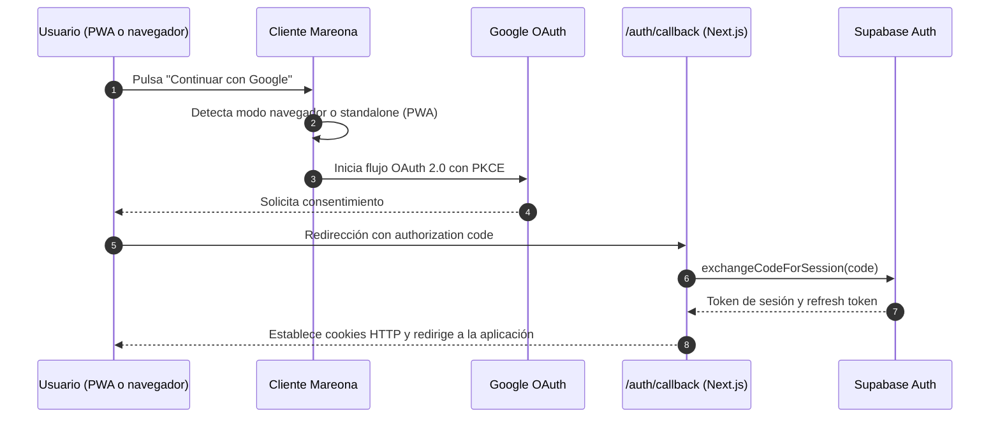

*Ilustración 14. Secuencia de inicio de sesión con Google y flujo PKCE.*

## 3.2 Base de Datos

### 3.2.1 PostgreSQL con Supabase

Mareona utiliza PostgreSQL 15+ gestionado en Supabase con las extensiones `pgcrypto` (generación de UUID v4) y `citext` (comparación de texto sin distinción de mayúsculas para garantizar la unicidad de los nombres de usuario). Se eligió un modelo relacional porque el dominio exige integridad referencial estricta entre usuarios, pronósticos, hilos de conversación, amistades e inventario de cromos, además de permitir transacciones atómicas en funciones PL/pgSQL y control de acceso en cada fila mediante *Row Level Security* (RLS).

### 3.2.2 Modelo Entidad-Relación

Para facilitar su lectura, el modelo entidad-relación se divide en dos bloques: el bloque de usuarios, comunidad, moderación y administración (Ilustración 15) y el bloque de datos deportivos, pronósticos y coleccionismo (Ilustración 16).

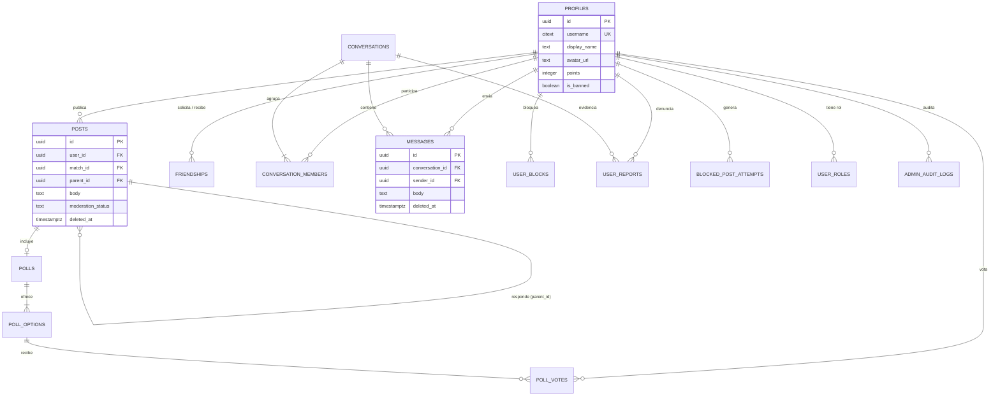

*Ilustración 15. Diagrama entidad-relación del bloque de usuarios, social, moderación y administración.*

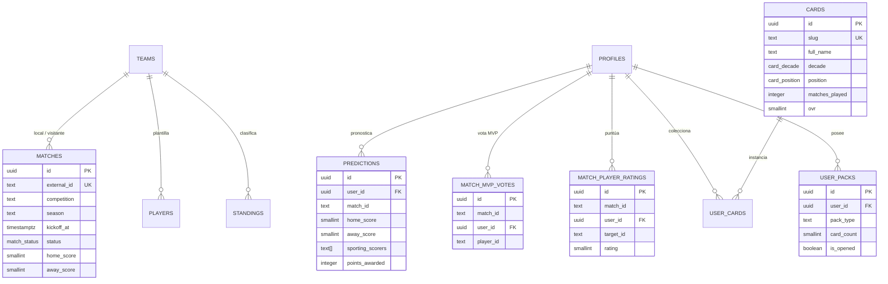

*Ilustración 16. Diagrama entidad-relación del bloque deportivo, pronósticos y cromos.*

### 3.2.3 Diccionario de Datos

Las tablas del esquema `public` se agrupan por dominio en la Tabla 2, indicando su finalidad y sus campos o restricciones clave.

| Bloque | Entidad | Finalidad y campos clave |
| :--- | :--- | :--- |
| Identidad y administración | `profiles` | Extensión 1:1 de `auth.users` con borrado en cascada; `username` (`citext`), `avatar_url`, `points` de La Porra y estado disciplinario (`is_banned`, `banned_until`, `banned_reason`). |
| Identidad y administración | `user_roles` | Roles asignados (`admin`, `moderator`) con unicidad `(user_id, role)`. |
| Identidad y administración | `admin_audit_logs` | Historial inmutable de acciones administrativas (`admin_id` con `ON DELETE RESTRICT`, `action`, `target_type`, `target_id`, `metadata`). |
| Identidad y administración | `system_announcements` | Avisos globales (`severity`, `is_active`) e interruptor `read_only_wall` para congelar el muro ante incidencias. |
| Identidad y administración | `site_visits` | Telemetría anónima sin cookies (`pathname`, `device_type`, `is_pwa`, `session_id`, `duration_seconds`, `country`, `province`). |
| Datos deportivos | `teams` | Catálogo de clubes; índice parcial único `is_home_club` para asegurar un único club local (Real Sporting). |
| Datos deportivos | `matches` | Partidos oficiales (`external_id`, `competition`, `kickoff_at`, `status`, marcadores, `lineups` y `events` en `JSONB`). |
| Datos deportivos | `players` | Jugadores vinculados a un equipo con demarcación normalizada y dorsal (`1..99`). |
| Datos deportivos | `standings` | Clasificación por competición y temporada con clave única `(competition, season, team_id)`. |
| Datos deportivos | `external_api_cache` | Caché persistente L2 (`cache_key` PK, `payload JSONB`, `fetched_at`, `expires_at`). |
| Social y moderación | `posts` | Publicaciones del muro y de La Grada (`match_id` opcional), respuestas (`parent_id`), `body` hasta 4.000 caracteres, `moderation_status` y `deleted_at`. |
| Social y moderación | `polls`, `poll_options`, `poll_votes` | Encuestas adjuntas 1:1 a un post; restricción `UNIQUE (poll_id, user_id)` para impedir votos duplicados. |
| Social y moderación | `friendships` | Relaciones entre usuarios (`pending`, `accepted`, `declined`) con comprobación `requester_id <> addressee_id`. |
| Social y moderación | `conversations`, `conversation_members`, `messages` | Mensajería directa 1:1 identificada por `direct_key` canónica; `messages` usa borrado lógico (`deleted_at`) y `REPLICA IDENTITY FULL` para Realtime. |
| Social y moderación | `user_blocks`, `user_reports`, `blocked_post_attempts` | Bloqueos entre usuarios, denuncias con `evidence_snapshot` inmutable y registro de textos rechazados por la IA. |
| Juegos y cromos | `predictions` | Pronósticos de La Porra vinculados por `match_id` (`text` externo), clave única `(user_id, match_id)`, goles (`0..20`), `sporting_scorers` (`text[]`) y `points_awarded` sincronizado automáticamente con `profiles.points`. |
| Juegos y cromos | `match_mvp_votes`, `match_player_ratings` | Votos al MVP del partido (único por usuario y partido) y calificaciones individuales (`0..10`) en *La Grada* vinculados por `match_id` externo en texto. |
| Juegos y cromos | `cards`, `user_cards`, `user_packs`, `user_account_state` | Catálogo de cromos (década, demarcación, `ovr`, `matches_played`) y estado autoritativo unificado por usuario en `user_account_state` (`cards`, `packs`, `missions`, `storage_entries` en `JSONB`, `revision`), complementado con las tablas heredadas `user_cards`/`user_packs`. |

*Tabla 2. Diccionario de datos resumido por dominios.*

### 3.2.4 Row Level Security

Todas las tablas de `public` tienen activado `ENABLE ROW LEVEL SECURITY`, reforzado con permisos granulares por columna (`REVOKE UPDATE ... GRANT UPDATE (cols)`). De este modo, incluso si un usuario manipula peticiones al endpoint REST de Supabase, la base de datos bloquea lecturas o escrituras no autorizadas (Tabla 3).

| Tabla(s) | Política de lectura (`SELECT`) | Política de escritura (`INSERT` / `UPDATE` / `DELETE`) | Garantía destacada |
| :--- | :--- | :--- | :--- |
| `profiles` | Pública (`anon`, `authenticated`). | Solo el propietario (`auth.uid() = id`). | Solo permite actualizar `username`, `display_name` y `avatar_url`; trigger `BEFORE UPDATE` (`protect_profile_privileged_columns`) impide alterar `points` o `is_banned`. |
| `predictions` | Pública (`anon`, `authenticated`) para consultar la clasificación. | Escritura directa (`INSERT`/`UPDATE`/`DELETE`) revocada para clientes (`20261121180000`); solo Server Actions con `service_role` tras validar sesión y plazo. | Trigger `sync_profile_porra_points` sincroniza `profiles.points` al liquidar `points_awarded`. |
| `match_mvp_votes`, `match_player_ratings` | Pública (`anon`, `authenticated`) para calcular totales y medias reales. | `INSERT` y `UPDATE` exclusivos del usuario autenticado no sancionado (`auth.uid() = user_id`). | Unicidad por `(match_id, user_id)` en MVP y `(match_id, user_id, target_id)` en notas. |
| `posts` | Pública para filas activas (`deleted_at IS NULL`). | `INSERT` condicionado a no estar sancionado ni activo `is_wall_read_only()`; `UPDATE` del autor sobre `body` y `deleted_at`. | Trigger `protect_post_moderation_columns` impide autoaprobar un mensaje retenido (`flagged`). |
| `messages` | Miembros de la conversación con `deleted_at IS NULL`. | `INSERT` condicionado a `can_message_conversation` (membresía y ausencia de bloqueo). | El remitente solo puede actualizar `deleted_at` (borrado lógico); el texto original se conserva intacto ante denuncias. |
| `blocked_post_attempts` | Solo `is_admin()`. | `INSERT` del propio `user_id` desde servidor. | El usuario no puede consultar ni borrar su historial de intentos bloqueados. |
| `user_roles`, `admin_audit_logs` | Solo `is_admin()`. | `user_roles` solo `service_role`; `admin_audit_logs` solo `INSERT` de administradores. | Impide autoasignarse roles o borrar el rastro de auditoría. |
| `site_visits` | Solo `is_admin()`. | `INSERT` permitido a `anon` y `authenticated`. | Permite registrar visitas anónimas sin exponer métricas de tráfico. |
| `user_account_state`, `user_cards`, `user_packs` | Lectura limitada al propietario (`auth.uid() = user_id`). | Escritura directa revocada en `user_account_state` (`service_role` vía Server Actions autoritativas); lógica de apertura validada en servidor (`openPackServerAction`). | Garantiza saldo de sobres, misiones y progreso diario verificados en servidor sin manipulación desde cliente. |
| `matches`, `teams`, `players`, `standings`, `cards` | Pública (`anon`, `authenticated`). | Solo `service_role` desde procesos de servidor. | Ningún cliente puede alterar datos deportivos ni el catálogo de cromos. |

*Tabla 3. Políticas de Row Level Security por tabla.*

### 3.2.5 Funciones y Triggers

La lógica que exige atomicidad, bloqueo de filas o ejecución privilegiada reside en funciones PL/pgSQL (`SECURITY DEFINER` con `SET search_path = ''` para evitar inyección de esquema) y triggers de PostgreSQL (Tabla 4).

| Nombre | Tipo | Cuándo se ejecuta y qué hace |
| :--- | :--- | :--- |
| `handle_new_user()` | Trigger (`on_auth_user_created`) | Al crearse una cuenta en `auth.users`, genera un `username` único desde correo/metadatos, hidrata `display_name` y `avatar_url` de Google OAuth cuando existen, y crea la fila en `public.profiles`. |
| `open_card_pack(p_pack_id, p_user_id)` / `openPackServerAction` | RPC / Server Action | Bloqueo atómico y transición autoritativa de sobres: comprueba saldo, aplica garantías por categoría (`leyenda` OVR ≥ 82; `rojiblanco` OVR ≥ 75), acredita cromos y persiste el snapshot en `user_account_state`. |
| `sync_active_player_card_matches(p_matches)` | RPC (`service_role`) | Al finalizar un partido oficial del Real Sporting, actualiza en bloque `matches_played` de los cromos de la plantilla activa. |
| `apply_prediction_points(p_prediction_id, p_points)` | RPC (`service_role`) | Bloquea la predicción con `FOR UPDATE`, comprueba `points_awarded IS NULL` para garantizar idempotencia y suma los puntos al perfil en la misma transacción. |
| `get_or_create_direct_conversation(p_other_user)` y `can_message_conversation(p_conversation_id)` | RPC / Helper RLS | Verifican en `user_blocks` en ambos sentidos que ninguno haya bloqueado al otro antes de crear un chat o admitir un mensaje. |
| `delete_current_user()` | RPC | Permite al usuario autenticado borrar su registro en `auth.users` (`WHERE id = auth.uid()`), eliminando en cascada sus datos personales conforme al art. 17 del RGPD. |

*Tabla 4. Funciones PL/pgSQL y triggers principales.*

### 3.2.6 Migraciones

Toda la estructura de la base de datos se define en `supabase/migrations/` mediante **23 archivos SQL** ordenados cronológicamente con prefijo de fecha estándar (`YYYYMMDDHHMMSS_nombre.sql`). Ninguna migración ya aplicada se modifica destructivamente: cualquier cambio posterior de esquema o de políticas RLS se añade como una nueva migración incremental (Tabla 5).

| Migración | Cambio principal |
| :--- | :--- |
| `20261012000000_init_schema.sql` | Tablas base (`profiles`, `teams`, `matches`, `players`, `standings`, `predictions`, `posts`, `external_api_cache`), políticas RLS y `apply_prediction_points`. |
| `20261021000000_username_from_email.sql` | Generación automática de `username` único en `handle_new_user()`. |
| `20261021010000_storage_avatars.sql` | Políticas del bucket `avatars` en Supabase Storage. |
| `20261022000000_cards_schema.sql` | Esquema inicial de `cards`, `user_cards` y `user_packs`. |
| `20261023000000_card_match_sync.sql` | Función `sync_active_player_card_matches` para sincronizar partidos jugados. |
| `20261027000000_friendships.sql` | Tabla `friendships` y políticas RLS de solicitudes y amistades. |
| `20261029000000_pack_inventory_tiers.sql` | Tipos de sobre (`aficionado`, `rojiblanco`, `leyenda`) y RPC `open_card_pack`. |
| `20261105000000_post_moderation.sql` | Columnas de moderación (`moderation_status`, `moderation_reason`) en `posts`. |
| `20261105000100_blocked_post_attempts.sql` | Registro de intentos bloqueados por la moderación automática. |
| `20261105000200_polls.sql` | Tablas `polls`, `poll_options` y `poll_votes` asociadas a publicaciones. |
| `20261106000000_admin_roles_and_audit.sql` | Tabla `user_roles`, función `is_admin()`, flags de sanción en `profiles`, `admin_audit_logs` y `system_announcements`. |
| `20261109000000_delete_current_user_rpc.sql` | RPC `delete_current_user()` para supresión completa de cuenta. |
| `20261111000000_dm_soft_delete_and_legal_custody.sql` | Mensajería directa (`conversations`, `conversation_members`, `messages`), borrado lógico y custodia legal. |
| `20261111010000_user_reports_and_mutual_block_guard.sql` | Denuncias (`user_reports`), `user_blocks` y bloqueo mutuo en chats directos. |
| `20261111020000_site_visits_telemetry.sql` | Tabla `site_visits` para telemetría anónima sin cookies. |
| `20261117000000_widen_post_body_length.sql` | Ampliación del límite de `posts.body` a 4.000 caracteres para admitir alineaciones serializadas. |
| `20261119000000_fix_admin_table_grants_and_rls.sql` | Ajuste de permisos (`GRANT`) y políticas RLS de las tablas administrativas. |
| `20261120000000_grant_anon_profiles_select.sql` | Lectura pública de perfiles básicos para usuarios no autenticados. |
| `20261120000100_posts_select_own_for_soft_delete.sql` | Permite al autor consultar su propia publicación durante el borrado lógico. |
| `20261120010000_production_security_and_match_schemas.sql` | Guardas RLS de privilegios, `match_mvp_votes`, `match_player_ratings` y `external_api_cache`. |
| `20261121000000_v1_security_rls_rpcs_and_post_likes.sql` | Endurecimiento v1.0, `post_likes`, RPCs agregadas, custodia legal y límites del bucket `avatars`. |
| `20261121120000_user_account_state_and_grants.sql` | Tabla `user_account_state` y restauración de permisos `GRANT` en tablas núcleo. |
| `20261121180000_v1_audit_hardening.sql` | Columna `storage_entries` en `user_account_state`, limpieza de caché privada, bloqueo directo de `predictions`/`user_account_state`, filtro `rating > 0` y metadatos Google OAuth. |

*Tabla 5. Historial cronológico de migraciones en Supabase.*

## 3.3 Diseño de los Subsistemas

### 3.3.1 Datos Deportivos

El subsistema `src/lib/sports-api/` centraliza todas las lecturas a fuentes deportivas externas (ESPN, FotMob y API-Football como respaldo) y entrega modelos de dominio tipados al resto de la aplicación.

Para evitar agotar las cuotas de las APIs gratuitas en días de partido y mantener tiempos de respuesta bajos, las peticiones atraviesan una caché de dos niveles (`cache.ts` y `client.ts`) como muestra la Ilustración 17:

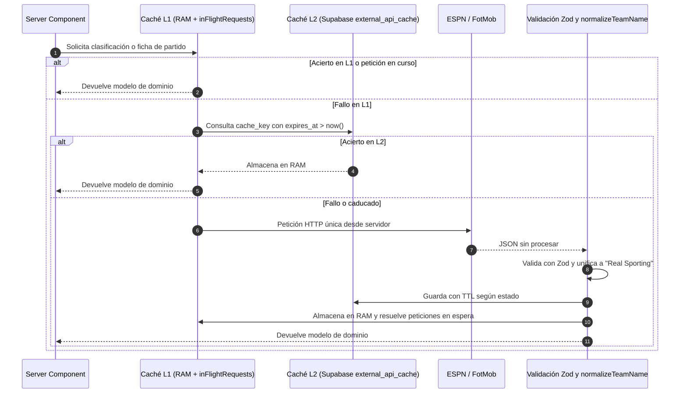

*Ilustración 17. Secuencia de ingesta y caché de datos deportivos.*

Tres decisiones rigen este subsistema:

- Deduplicación en vuelo (`inFlightRequests`): si varios usuarios solicitan la misma vista en el mismo segundo tras un gol, un mapa de promesas en memoria agrupa todas las solicitudes en una sola llamada HTTP saliente y reparte el resultado.
- Caducidad variable (`resolveMatchDetailTtlMs`): los encuentros en directo o en la hora previa al saque inicial usan un TTL de 30 a 60 segundos; la clasificación se cachea 1 hora; el calendario y las plantillas, entre 12 y 24 horas; y los partidos finalizados mantienen una caché larga al no cambiar sus datos.
- Normalización y veracidad: `normalizeTeamName` convierte en el borde variantes externas como `"Sporting Gijón"` o `"Sporting de Gijón"` en el nombre canónico `"Real Sporting"` antes de llegar a la interfaz. El cruce de jugadores entre ESPN y FotMob combina normalización Unicode NFD, dorsal y apellidos. Si una fuente no responde o carece de datos, la aplicación informa de la ausencia sin mostrar datos inventados.

### 3.3.2 Temporada

El subsistema de Temporada construye las vistas `/temporada/*` e Inicio. En la ficha de partido (`/temporada/partidos/[id]`) integra datos de múltiples procedencias en un mismo esquema de componentes (Ilustración 18): calendario y marcador base desde ESPN, coordenadas tácticas 2D, estadísticas avanzadas comparadas, mapa de disparos (*shotmap*) y *momentum* minuto a minuto desde FotMob, y el hilo comunitario de *La Grada* junto a la votación del MVP desde Supabase. Durante partidos en directo, el cliente actualiza la información mediante polling controlado.

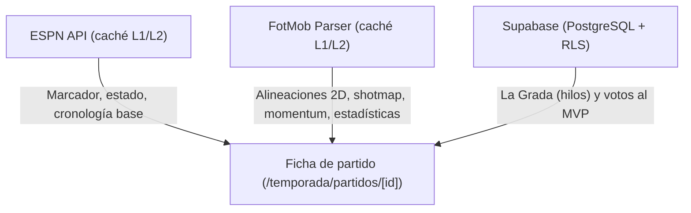

*Ilustración 18. Origen de los datos en la ficha de partido.*

La clasificación (`/temporada/clasificacion`) añade sobre la tabla filtrable por ámbito (*General*, *En casa*, *A domicilio*) dos vistas propias: *Distancia real*, que agrupa a los 22 equipos en peldaños por puntuación exacta incluyendo los peldaños vacíos para visualizar las brechas de puntos, y *Evolución*, un gráfico SVG de doble eje (posición y puntos acumulados por jornada) acompañado de una tabla HTML oculta (`sr-only`) para lectores de pantalla.

La pizarra táctica *Mi Once* (`/temporada/pizarra`, en `src/lib/lineup-builder/`) permite alinear jugadores del primer equipo, Sporting Atlético y Juvenil División de Honor. Al cambiar de sistema táctico (`formation-transition.ts`), reasigna los jugadores por demarcación y distancia euclídea sobre coordenadas normalizadas en lugar de vaciar el campo. La exportación a PNG se realiza directamente sobre `<canvas>` (`export-canvas.ts`), y para compartir la pizarra en el muro social sin subir imágenes ni añadir tablas se serializa la formación, los dorsales y las coordenadas en una etiqueta `<!--once:...-->` dentro del texto del mensaje (`shared-lineup-codec.ts`).

### 3.3.3 Archivo Histórico

El archivo histórico (`/historico/*`) cubre la trayectoria del club desde 1905 sin realizar consultas a base de datos ni depender de APIs externas. Para lograr tiempos de respuesta estables y funcionamiento sin conexión, los datos se procesan previamente con scripts de ingesta y se compilan en archivos JSON tipados bajo `src/data/historical/`.

Los Server Components y las utilidades de `src/lib/historical/` leen estos ficheros directamente en servidor. En `/historico/rivales`, `canonical-opponents.ts` agrupa bajo un único club las distintas denominaciones históricas de un mismo rival y enlaza sus coordenadas geográficas (`rivals-geo.json`) con trazados SVG propios de España (`spain-svg-paths.json`) y del mundo (`world-svg-paths.json`), coloreando cada territorio según el volumen de enfrentamientos o el balance de resultados.

### 3.3.4 Social

El módulo Social (`src/lib/social/` y `src/lib/match-community/`) articula el muro general (`/social`), *La Grada* de cada encuentro, la red de amistades y los mensajes directos privados. En la Ilustración 19 se resume cómo se relacionan las entidades del bloque social.

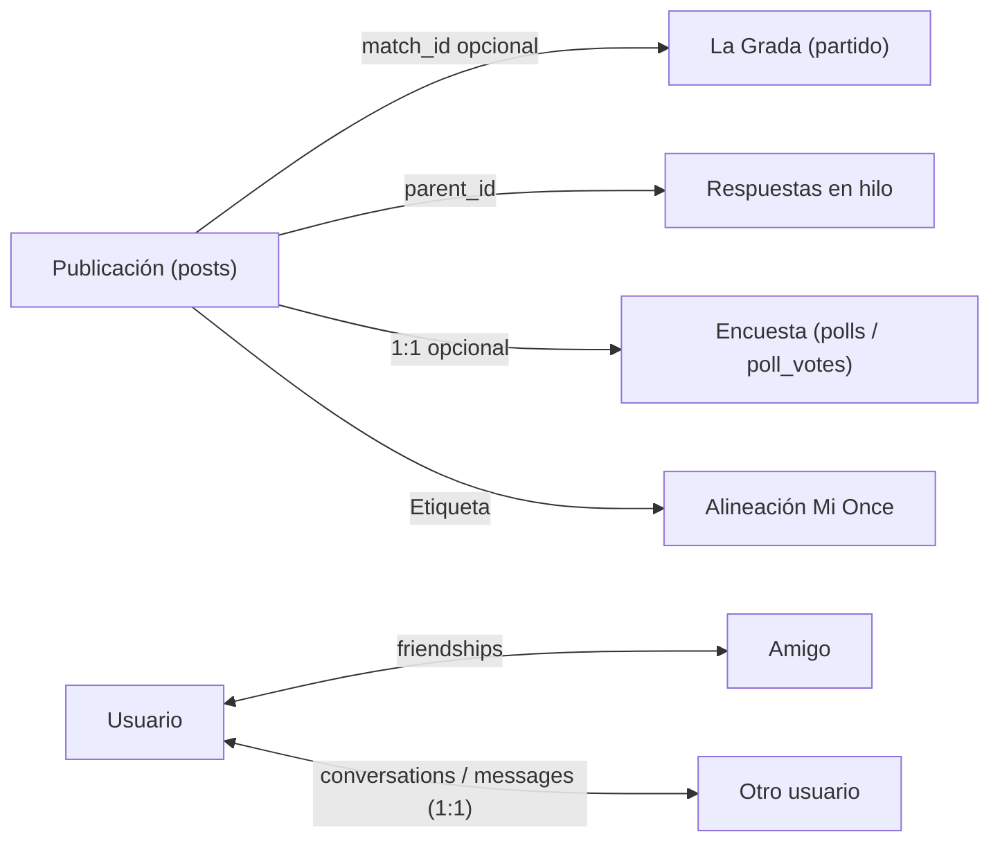

*Ilustración 19. Relación entre publicaciones, hilos, encuestas, amistades y mensajería directa.*

Para evitar consultas recursivas costosas al cargar hilos, los mensajes y sus respuestas se obtienen en una única consulta SQL plana y se ensamblan en memoria en tiempo lineal $O(N)$ mediante tablas hash (`post-tree.ts` y `comment-tree.ts`).

En la mensajería directa 1:1, cada pareja de usuarios comparte una única conversación identificada por la clave canónica `direct_key = least(u1, u2) || ':' || greatest(u1, u2)`. Cuando un remitente borra un mensaje, se ejecuta un borrado lógico (`deleted_at = now()`) que lo oculta al instante mediante RLS y Supabase Realtime (`REPLICA IDENTITY FULL`), pero conserva el texto original en base de datos para poder aportar evidencia si existe una denuncia.

### 3.3.5 Moderación y Reportes

Toda publicación nueva en el muro social, respuesta en *La Grada* o mensaje directo pasa por una cadena de validación y moderación automática antes de hacerse visible (Ilustración 20).

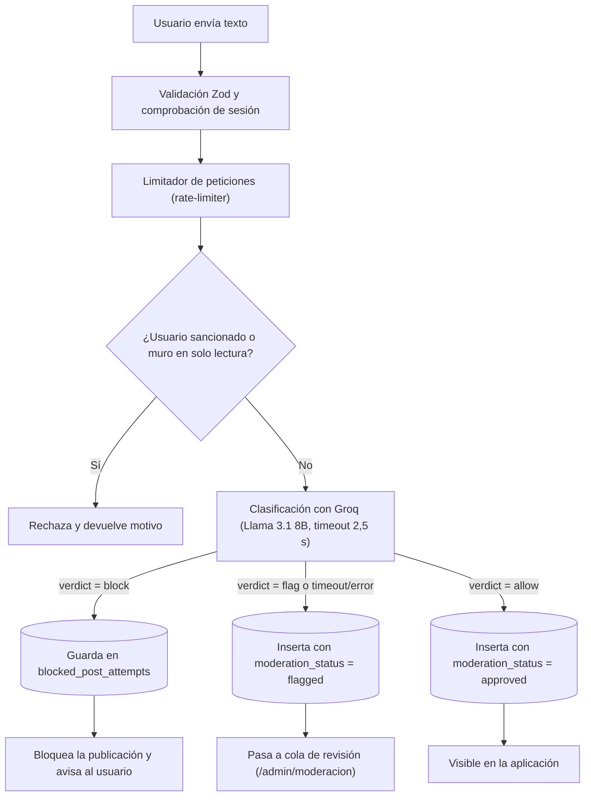

*Ilustración 20. Flujo de validación y moderación de mensajes.*

El texto del usuario se envía a la API de Groq (modelo Llama 3.1 8B Instant, temperatura 0 y límite de 2,5 segundos) envuelto en etiquetas `<mensaje>...</mensaje>` para separar datos de instrucciones y reducir el riesgo de *prompt injection*. Las instrucciones al modelo permiten la crítica deportiva habitual y bloquean solo discurso de odio, insultos personales entre usuarios, amenazas o publicación de datos privados. Si la API externa supera el tiempo de espera o falla, el mensaje queda marcado para revisión manual en lugar de bloquear al usuario. Adicionalmente, cualquier usuario puede bloquear a otro (`user_blocks`, lo que impide mensajes directos en ambos sentidos) o enviar una denuncia (`user_reports`).

### 3.3.6 Juegos y Cartas

El subsistema de juegos (`src/lib/games/`, `wordle/`, `trivia/`, `who-are-ya/`, `higher-lower/` y `cards/`) agrupa tres retos diarios, un juego continuo de racha y el álbum de cromos *Memoria Rojiblanca*.

Los tres retos diarios (*Wordle*, *La Pregunta del Día* y *¿Quién es?*) calculan el día actual en zona horaria `Europe/Madrid` (`daily-date.ts`) para que el cambio de reto ocurra a medianoche de Gijón. Para elegir la palabra, pregunta o futbolista del día sin repeticiones cercanas ni estado en servidor, `daily-permutation.ts` divide el tiempo en ciclos del tamaño $N$ del catálogo y aplica en cada ciclo una permutación completa de Fisher-Yates sembrada con el generador determinista Mulberry32: ningún elemento se repite hasta agotar el catálogo completo. En cambio, *¿Más o Menos?* funciona en sesiones libres comparando partidos, goles o minutos de jugadores históricos del club.

En *Memoria Rojiblanca*, los cromos se distribuyen mediante sobres de tres categorías (`aficionado`, `rojiblanco` y `leyenda`). La Ilustración 21 recoge el ciclo de vida de un sobre desde su concesión hasta su apertura atómica en base de datos, y la Ilustración 22 muestra el flujo de una partida diaria.

```mermaid
stateDiagram-v2
    [*] --> Concedido: Bienvenida, visita diaria, juego, racha 7 días, Porra o reciclaje (10 repetidos)
    Concedido --> Pendiente: Saldo acumulado en user_account_state.packs
    Pendiente --> Abriendo: Usuario pulsa abrir (openPackServerAction)
    Abriendo --> Abierto: Servidor valida saldo, garantiza rareza y actualiza cards
    Abierto --> [*]
```

*Ilustración 21. Estados de un sobre de cromos.*

```mermaid
flowchart LR
    Inicio["Abre reto del día (Europe/Madrid)"] --> Modo{"¿Tiene sesión?"}
    Modo -->|No| Local["Juega y guarda estado en partición local de invitado"]
    Modo -->|Sí| Red{"¿Hay conexión?"}
    Red -->|Sí| Server["Evalúa, envía prueba al servidor (verifyDailyGameWinProof) y persiste"]
    Red -->|No| Queue["Encola resultado en localStorage por cuenta (sin sobrescribir derrotas)"]
    Queue -->|"Al volver la red"| Server
```

*Ilustración 22. Flujo de una partida diaria con y sin conexión.*

Cuando un partido oficial del Real Sporting pasa a estado `finished`, `card-catalog-sync.ts` invoca `sync_active_player_card_matches` para actualizar el contador de partidos oficiales en los cromos de la plantilla activa.

### 3.3.7 La Porra

*La Porra* (`src/lib/porra/engine.ts`) permite pronosticar el marcador exacto y los goleadores rojiblancos del siguiente partido oficial hasta 60 segundos antes del inicio (`PORRA_CUTOFF_MS = 60_000`). Esta ventana y la identidad del usuario se verifican en la Server Action antes de persistir mediante `service_role` (con escritura directa desde cliente revocada en `predictions`).

Cuando el partido finaliza, el cálculo de puntos asigna 5 puntos por marcador exacto, 2 puntos por signo 1X2 sin marcador exacto y 1 punto por cada goleador acertado (teniendo en cuenta dobletes o múltiples goles del mismo jugador sin duplicar aciertos). La liquidación (`settlePendingPorraMatches` en `src/lib/porra/settle.ts`) se dispara de forma automática bajo demanda (con ventana de enfriamiento de 3 minutos) y cuenta además con un cron diario de respaldo en Vercel (`/api/cron/settle-porra`, configurado en `vercel.json` y protegido con `CRON_SECRET`). La acreditación usa `apply_prediction_points` para evitar sumas duplicadas y concede un sobre de recompensa (`user_account_state.packs`) según la puntuación obtenida (1-2 puntos: Aficionado; 3-4 puntos: Rojiblanco; 5 o más: Leyenda). La Ilustración 23 resume la secuencia completa.

```mermaid
sequenceDiagram
    autonumber
    participant U as Usuario
    participant SA as Server Action / Cron
    participant DB as PostgreSQL (predictions / profiles)
    participant Sports as Datos Deportivos

    U->>SA: Envía marcador y goleadores
    SA->>DB: Upsert con service_role si kickoff_at > now() + 60s
    Note over DB: Escritura directa bloqueada y lecturas ocultas hasta inicio
    Sports-->>SA: Partido pasa a estado finished con resultado final
    SA->>SA: Liquidación bajo demanda o cron (/api/cron/settle-porra)
    SA->>DB: apply_prediction_points(id, puntos) con FOR UPDATE
    DB-->>U: Suma puntos al perfil y asigna sobre de recompensa
```

*Ilustración 23. Secuencia de envío y liquidación de La Porra.*

### 3.3.8 Administración, Auditoría y Telemetría

El subsistema de administración (`src/lib/admin/`) protege todas las rutas `/admin/*` y sus Server Actions mediante `assertAdmin()`, que valida la sesión en servidor con `supabase.auth.getUser()` y comprueba la pertenencia a `public.user_roles`. Si el usuario no tiene permiso, invoca `notFound()` para responder con HTTP 404. Todas las acciones sobre usuarios, moderación, anuncios o limpieza de caché se registran en `admin_audit_logs`.

La telemetría propia (`src/lib/telemetry/`) sustituye a rastreadores comerciales sin utilizar cookies de seguimiento. Un componente ligero envía la ruta, el tipo de dispositivo, si la aplicación se ejecuta en modo `standalone` y el tiempo de permanencia hacia `/api/telemetry`, donde se extraen país y provincia desde las cabeceras de Vercel descartando la dirección IP. Los errores de JavaScript no capturados en navegador se validan con Zod y se notifican con límite de peticiones a `/api/client-errors`.

### 3.3.9 PWA y Modo Offline

Al ser incompatibles los plugins de PWA basados en Webpack con Turbopack en Next.js 16, `public/sw.js` implementa un Service Worker propio (`VERSION = "v6"`) con tres cachés versionadas (`mareona-shell-v6`, `mareona-static-v6` y `mareona-images-v6`) y limpieza FIFO al superar límites de entradas.

- En la instalación se precachean `/offline`, `/juegos` e `/historico` extrayendo sus recursos JS y CSS mediante expresión regular, y en navegación se habilita copia offline bajo demanda para los juegos (`/juegos/wordle`, `/juegos/pregunta-del-dia`, `/juegos/mas-o-menos`) y todo `/historico/*` con estrategia *network-first* y límite de espera de 3 segundos (`NAVIGATION_TIMEOUT_MS`), además de cachear las peticiones al diccionario de Wordle (`/api/wordle/dict?len=...`).
- Las rutas dinámicas o privadas (`/temporada`, `/social`, `/perfil`, el resto de `/api/*`) van siempre a red para no mezclar sesiones ni mostrar marcadores obsoletos, mostrando `/offline` si no hay conexión.
- Los paquetes inmutables de `/_next/static/*` usan *cache-first* y las imágenes usan *stale-while-revalidate*.

Si un usuario completa un juego diario sin red, `offline-sync-queue.ts` guarda el resultado en la partición de `localStorage` del usuario (`account-storage-partition.ts`, con absorción segura de la sesión previa de invitado al iniciar sesión) conservando siempre el primer intento del día para evitar trampas, y `OfflineSyncListener` lo envía al servidor cuando el navegador recupera conexión para verificar su prueba (`verifyDailyGameWinProof`) (Ilustración 24).

```mermaid
sequenceDiagram
    autonumber
    participant U as Usuario sin conexión
    participant SW as Service Worker (sw.js)
    participant LS as Cola offline (localStorage)
    participant SA as Server Action

    U->>SW: Navega a /juegos/wordle
    SW-->>U: Sirve HTML y JS desde caché (tras fallo o timeout de 3 s)
    U->>LS: Completa el reto; enqueueGameResult() guarda intento único
    Note over U,LS: Al recuperar cobertura se dispara el evento online
    LS->>SA: OfflineSyncListener envía los eventos pendientes
    SA-->>LS: Confirma persistencia en Supabase y elimina de la cola
```

*Ilustración 24. Ejecución y sincronización de una partida sin conexión.*

## 3.4 Funcionamiento Global de la Aplicación

Los siguientes diagramas muestran el comportamiento conjunto de las piezas descritas en los apartados anteriores.

### 3.4.1 Recorrido de una Petición de Página

Cuando el navegador solicita una ruta de la aplicación, el proxy en el borde actualiza la sesión antes de que el Server Component lea los datos necesarios en paralelo y devuelva el HTML al cliente (Ilustración 25).

```mermaid
sequenceDiagram
    autonumber
    participant B as Navegador
    participant P as Proxy (src/proxy.ts)
    participant Auth as Supabase Auth
    participant RSC as Server Component
    participant Data as Caché / Supabase / JSON

    B->>P: GET /temporada/clasificacion
    P->>Auth: Valida JWT y refresca cookies si caducaron
    P->>RSC: Reenvía petición con sesión actualizada
    RSC->>Data: Ejecuta lecturas en paralelo (Promise.all)
    Data-->>RSC: Datos normalizados
    RSC-->>B: Devuelve HTML renderizado + payload RSC
```

*Ilustración 25. Recorrido completo de una petición de página.*

### 3.4.2 Recorrido de un Dato Deportivo

Un dato deportivo nunca llega en bruto a la interfaz: atraviesa el conector de origen, la validación de esquema, la normalización del club y las dos capas de caché antes de pintarse en un componente (Ilustración 26).

```mermaid
flowchart LR
    Ext["API externa (ESPN / FotMob)"] -->|"JSON"| Val["Validación Zod"]
    Val --> Norm["normalizeTeamName -> Real Sporting"]
    Norm --> L2["Caché L2 (Supabase)"]
    Norm --> L1["Caché L1 (RAM)"]
    L1 --> RSC["Server Component"]
    RSC --> UI["Interfaz (<TeamCrest>, tablas, gráficos)"]
```

*Ilustración 26. Recorrido de un dato deportivo de extremo a extremo.*

### 3.4.3 Escritura de un Usuario

Todas las modificaciones iniciadas por el usuario (publicar un mensaje, votar una encuesta, guardar una porra o actualizar el perfil) siguen el mismo patrón de validación en Server Action antes de llegar a PostgreSQL (Ilustración 27).

```mermaid
sequenceDiagram
    autonumber
    participant UI as Componente cliente
    participant SA as Server Action
    participant RL as Limitador y Zod
    participant DB as Supabase (PostgreSQL + RLS)

    UI->>SA: Invoca acción con formulario
    SA->>RL: Valida datos (Zod), cuota y getUser()
    RL->>DB: Ejecuta INSERT/UPDATE o RPC con JWT del usuario
    DB-->>SA: Comprueba política RLS y confirma
    SA-->>UI: Revalida ruta y muestra notificación (toast)
```

*Ilustración 27. Flujo estándar de una escritura mediante Server Action.*

### 3.4.4 Ciclo de Vida de un Usuario

Un usuario puede navegar de forma anónima, registrarse para acceder a las funciones interactivas, sufrir una suspensión temporal o definitiva por parte de administración o eliminar su cuenta en cualquier momento (Ilustración 28).

```mermaid
stateDiagram-v2
    [*] --> Visitante: Accede sin cuenta
    Visitante --> Activo: Registro email o Google OAuth
    Activo --> Visitante: Cierra sesión
    Activo --> Suspendido: is_banned = true (administración)
    Suspendido --> Activo: Fin de sanción o reactivación
    Activo --> Eliminado: delete_current_user() (borrado en cascada)
    Suspendido --> Eliminado: delete_current_user()
    Eliminado --> [*]
```

*Ilustración 28. Ciclo de vida de la cuenta de usuario.*

### 3.4.5 Estados de las Entidades Principales

La Ilustración 29 resume las transiciones de estado de las dos entidades con ciclo de vida operativo más frecuente en el día a día: los partidos oficiales (junto con el cierre de *La Porra*) y las publicaciones del muro social.

```mermaid
stateDiagram-v2
    direction LR
    state "Partido oficial y Porra" as MP {
        [*] --> Programado: scheduled (Porra abierta)
        Programado --> CerradoPorra: kickoff_at - 60s (Porra cerrada)
        CerradoPorra --> EnDirecto: live (polling activo)
        EnDirecto --> Finalizado: finished (liquida puntos y sincroniza cromos)
        Finalizado --> [*]
    }

    state "Publicación (posts)" as PostState {
        [*] --> EnModeracion: Envío del usuario
        EnModeracion --> Bloqueado: verdict = block (blocked_post_attempts)
        EnModeracion --> Retenido: verdict = flag (cola /admin)
        EnModeracion --> Publicado: verdict = allow
        Retenido --> Publicado: Aprobado por moderador
        Retenido --> Eliminado: Ocultado por moderador
        Publicado --> Eliminado: Borrado lógico (deleted_at)
    }
```

*Ilustración 29. Estados de partidos, pronósticos y publicaciones.*

### 3.4.6 Funcionamiento sin Conexión

Cuando el dispositivo pierde cobertura, el Service Worker intercepta las rutas compatibles con el modo offline y la cola local retiene los resultados de los juegos diarios hasta que vuelve la red (Ilustración 30).

```mermaid
flowchart TD
    Req["Usuario navega o interactúa"] --> Net{"¿Hay conexión?"}
    Net -->|Sí| Online["Petición normal a Vercel y sincronización de cola pendiente"]
    Net -->|No| Route{"¿Ruta en PRECACHE_PATHS?"}
    Route -->|"/juegos/* o /historico/*"| Cache["Sirve HTML + JS/CSS desde caché"]
    Cache --> Action["Juega en local y encola resultado en localStorage"]
    Route -->|"/temporada, /social, /perfil"| OfflinePage["Muestra página /offline"]
```

*Ilustración 30. Comportamiento de la aplicación ante pérdida de red.*

## 3.5 Seguridad y Privacidad

### 3.5.1 Seguridad de las Peticiones

Las respuestas de Next.js incorporan cabeceras de seguridad configuradas en `src/lib/security/headers.ts` según controles OWASP ASVS nivel 2: `Content-Security-Policy` restrictiva (`default-src 'self'`, `frame-ancestors 'none'`, `object-src 'none'`, orígenes explícitos para Supabase, Google Identity Services y CDN deportivas), `X-Frame-Options: DENY`, `X-Content-Type-Options: nosniff`, `Strict-Transport-Security` con precarga y `Permissions-Policy` deshabilitando cámara, micrófono y geolocalización del navegador.

En el lado del servidor, cada escritura pasa por cuatro barreras consecutivas (Ilustración 31): renovación y verificación de cookies en el proxy, validación estricta con Zod 4, limitador de peticiones por ventana deslizante (`rate-limiter.ts`) con limpieza periódica de memoria, y obtención del `user_id` exclusivamente desde `supabase.auth.getUser()` antes de delegar en las políticas RLS de PostgreSQL. Las claves sensibles (`SUPABASE_SERVICE_ROLE_KEY`, `SPORTS_API_KEY`, `GROQ_API_KEY`) están aisladas en módulos con `import "server-only"`.

```mermaid
flowchart LR
    C["Cliente"] -->|"HTTPS + Cabeceras CSP/HSTS"| P["Proxy de sesión"]
    P -->|"Cookies HTTP"| Z["Validación Zod + Rate Limiter"]
    Z -->|"auth.getUser()"| RLS["PostgreSQL + RLS + Column Grants"]
```

*Ilustración 31. Cadena de seguridad en una petición.*

### 3.5.2 Privacidad y Protección de Datos

El diseño incorpora medidas directas de cumplimiento con el RGPD, la LOPDGDD y el Reglamento de Servicios Digitales (DSA):

- Derecho de supresión (art. 17 RGPD): desde `/perfil`, el diálogo de eliminación ejecuta `public.delete_current_user()`, borrando la cuenta en `auth.users` y sus datos asociados en cascada sin requerir trámites por correo.
- Limpieza de metadatos en avatares: antes de subir una imagen de perfil a Supabase Storage, `avatar-compression.ts` la redimensiona y recodifica en un `<canvas>` del navegador, reduciendo su peso y eliminando metadatos EXIF como la ubicación GPS.
- Custodia de mensajes privados: el borrado lógico en `messages` oculta al instante el mensaje a ambos participantes mediante RLS, pero conserva el registro íntegro para adjuntar evidencia inmutable (`evidence_snapshot`) si existe una denuncia en `user_reports`.
- Telemetría sin cookies: al no almacenar direcciones IP ni usar cookies de seguimiento, no se requieren banners de consentimiento publicitario, y las páginas legales (`/aviso-legal`, `/privacidad`, `/cookies`, `/terminos`) son públicas sin necesidad de registro.

### 3.5.3 Escudos, Fotografías y Atribución

Ningún componente de interfaz renderiza etiquetas `` directas para recursos deportivos de terceros. Todo escudo o fotografía pasa por `<TeamCrest>` y `<PlayerPhoto>` (`src/components/media/`), que muestran una silueta o monograma vectorial cuando falla la carga externa. Además, ambos componentes leen la variable `NEXT_PUBLIC_SHOW_OFFICIAL_ASSETS` para poder sustituir al instante los activos oficiales por marcadores neutros sin modificar ninguna pantalla, siguiendo las pautas recogidas en `docs/LEGAL-ASSETS.md`.

## 3.6 Diseño de la Interfaz

### 3.6.1 Identidad Visual

La interfaz utiliza un único tema claro (`color-scheme: light`) basado en rojo corporativo y blanco (`docs/DESIGN.md` y `src/app/globals.css`), eliminando cualquier tono azul por defecto del navegador en enlaces, selecciones o anillos de foco (reservando el azul exclusivamente para los indicadores deportivos de zona competitiva en clasificación —Champions League y Playoff de ascenso— y la convención cromática estándar en Wordle):

| Token | Valor | Uso principal |
| :--- | :--- | :--- |
| `--brand` | `#e2001a` | Cabeceras, navegación activa, botones principales y píldoras seleccionadas. |
| `--brand-strong` | `#b80015` | Anillos de foco (`--ring`), enlaces de texto pequeño y estados de pulsación. |
| `--background` | `#ffffff` | Fondo predominante de la aplicación. |
| `--surface` | `#f5f5f5` | Fondos secundarios de tarjetas y filas alternas. |
| `--foreground` | `#171717` | Texto principal. |
| `--foreground-muted` | `#525252` | Texto secundario y metadatos. |
| `--border` / `--border-strong` | `#e5e5e5` / `#737373` | Separadores suaves y bordes de controles interactivos. |
| `--success` / `--warning` | `#15803d` / `#92400e` | Estados de éxito y aviso, acompañados siempre de icono y texto. |

*Tabla 6. Tokens de color del sistema visual.*

Para cifras, minutos, marcadores y tablas clasificatorias se utiliza exclusivamente tipografía sans-serif con espaciado tabular (`font-sans tabular-nums`), evitando por regla fuentes monoespaciadas en la interfaz pública.

### 3.6.2 Principios de Diseño

Cada pantalla responde a una pregunta principal sin párrafos explicativos ni decoración superflua: en Inicio se prioriza el próximo encuentro y accesos directos (Ilustración 32), y en Temporada el foco recae sobre los datos y visualizaciones comparativas (Ilustración 33). Los selectores de vista y filtros deportivos se presentan en barra horizontal con estilo píldora (`rounded-full`) sin duplicar títulos dentro de las tarjetas hijas, y los iconos quedan restringidos a navegación móvil o acciones y estados concretos.

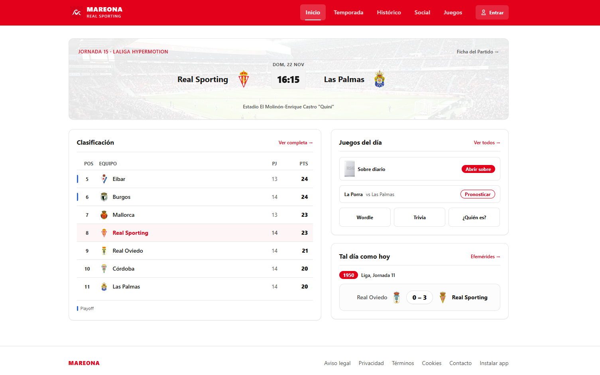

*Ilustración 32. Pantalla de Inicio con resumen de actualidad y accesos principales.*

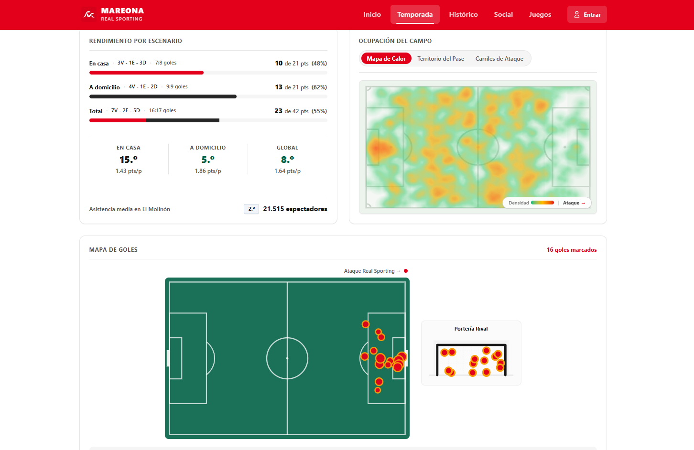

*Ilustración 33. Vista de estadísticas de temporada con mapas tácticos y posiciones en liga.*

### 3.6.3 Componentes Reutilizables

Los elementos comunes de interfaz se agrupan en `src/components/ui/` y componentes de dominio compartidos: botones y píldoras segmentadas (`rounded-full`), tablas nativas con encabezados semánticos para clasificaciones y registros históricos, tarjetas de borde fino (`--border`) sobre fondo blanco, diálogos modales accesibles apoyados en `use-modal-a11y.ts` y notificaciones emergentes (`toast-container.tsx`) para confirmar acciones de servidor. Ningún archivo de componente (`.tsx`) en `src/` supera las 180 líneas, extrayendo subcomponentes y hooks dedicados cuando una vista crece.

### 3.6.4 Versión Móvil

En pantallas pequeñas, la navegación principal se traslada a una barra inferior fija adaptada al pulgar con áreas táctiles mínimas de 44x44 px. La maquetación evita desbordamientos horizontales desde 320 px de ancho, y la pizarra táctica, los carruseles y los formularios ajustan eventos táctiles y áreas seguras para no activar gestos del navegador ni zoom involuntario al enfocar campos de texto.

### 3.6.5 Accesibilidad

El cumplimiento de WCAG 2.2 nivel AA se integra en los componentes base:

- Contraste verificado: `--brand` sobre blanco alcanza 4,90:1, `--brand-strong` 6,94:1 y `--foreground-muted` 7,82:1; los bordes de controles alcanzan al menos 3:1.
- Independencia del color: en *Wordle* cada celda combina color, borde e icono (✓, ▲, ×) junto con `aria-label` descriptivo; en los gráficos de evolución la posición y los puntos se distinguen por trazo continuo con círculos frente a trazo discontinuo con cuadrados.
- Alternativa textual en gráficos: todos los gráficos SVG (evolución, *momentum* y mapas de disparos) incluyen una tabla HTML oculta (`sr-only`) con `<caption>` y `<th scope="col">` para lectores de pantalla.
- Teclado y modales: toda la interfaz es operable con teclado con foco visible en `--brand-strong`; los modales aplican `role="dialog"`, `aria-modal="true"`, trampa de foco, cierre con `Escape` y restauración del foco al elemento que los abrió.

---

# Capítulo 4. Implementación

## 4.1 Tecnologías y Lenguajes

El proyecto se desarrolla sobre un stack web tipado en TypeScript, apoyado en PostgreSQL para la persistencia y Tailwind CSS para la capa visual. En la Tabla 7 se recogen las tecnologías principales y las versiones definidas en `package.json`.

| Tecnología / Lenguaje | Versión | Función en el proyecto |
| :--- | :--- | :--- |
| TypeScript | 5 | Lenguaje principal de servidor, dominio y componentes de interfaz (`strict: true`). |
| Next.js | 16.4 | Framework de aplicación con App Router, Server Components, Server Actions y proxy en el borde. |
| React / React DOM | 19.3 | Renderizado en servidor y componentes interactivos en cliente. |
| Tailwind CSS | 4 | Sistema de estilos utilitarios compilado mediante `@tailwindcss/turbopack`. |
| Componentes UI propios | — | Controles nativos accesibles con gestión de foco (`use-modal-a11y.ts`) y ARIA sin librerías UI pesadas. |
| Zod | 4.6 | Validación de formularios, Server Actions, rutas API y respuestas de fuentes externas. |
| Supabase JS / SSR | 2.117 / 0.12 | Acceso a PostgreSQL, autenticación mediante cookies HTTP, Realtime y Storage. |
| PostgreSQL (PL/pgSQL) | 15+ | Base de datos relacional, políticas *Row Level Security* y funciones atómicas. |
| Lucide React | 1.55 | Iconografía funcional de interfaz. |
| Vercel Analytics | 2.0 | Telemetría ligera integrada en el despliegue de producción. |

*Tabla 7. Tecnologías, lenguajes y versiones principales.*

## 4.2 Herramientas

Para el desarrollo, la verificación automática y el despliegue se utilizan las herramientas recogidas en la Tabla 8.

| Herramienta | Propósito |
| :--- | :--- |
| Node.js (`v24.14` en entorno) | Entorno de ejecución y ejecutor nativo de pruebas (`node --test`) sin transpiladores externos. |
| ESLint (`eslint-config-next`) | Análisis estático de código, reglas de React, Next.js y Core Web Vitals. |
| `tsc --noEmit` | Comprobación completa de tipos de TypeScript antes de compilar. |
| Playwright (`1.58`) | Pruebas extremo a extremo en navegador Chromium y simulación de modo sin conexión. |
| Lighthouse (`12.4`) | Auditoría automatizada de rendimiento, Core Web Vitals, accesibilidad y PWA (`scripts/audit-performance.mjs`). |
| Supabase CLI | Gestión del esquema local y versionado de migraciones SQL en `supabase/migrations/`. |
| Vercel | Plataforma de despliegue continuo conectada al repositorio Git. |
| Git | Control de versiones con historial de commits siguiendo *Conventional Commits*. |

*Tabla 8. Herramientas de desarrollo, calidad y despliegue.*

## 4.3 Estructura del Código

El repositorio separa el código de la aplicación (`src/`), las migraciones de base de datos (`supabase/`), la suite de pruebas (`tests/`), los scripts de ingesta y auditoría (`scripts/`), los recursos estáticos (`public/`) y la documentación (`docs/`):

```text
mareona/
├── docs/                  # Especificación, diseño, licencias, capturas y memoria técnica
├── public/                # Manifiesto PWA, Service Worker (sw.js), escudos y recursos estáticos
├── scripts/               # Scripts de ingesta histórica y auditoría Lighthouse
├── supabase/
│   └── migrations/        # 23 migraciones SQL incrementales y políticas RLS
├── tests/
│   ├── a11y/              # Contraste WCAG 2.2 y estándares ARIA en modales
│   ├── code/              # Reglas estáticas de arquitectura y seguridad
│   ├── e2e/               # Flujos completos en navegador con Playwright
│   ├── integration/       # Pruebas de Server Actions sociales y de La Grada
│   ├── load/              # Concurrencia en rate limiter y cola offline
│   └── unit/              # Pruebas unitarias de motores de juego, parsers y esquemas
└── src/
    ├── app/               # Rutas App Router: (main)/, admin/, api/, auth/callback/
    ├── components/        # Componentes UI por dominio (auth, cards, games, media, social, sports...)
    ├── context/           # Proveedores de contexto en cliente
    ├── data/              # Conjuntos JSON compilados (histórico, trivia, wordle, who-are-ya)
    ├── i18n/              # Diccionario tipado en español
    ├── lib/               # Lógica de dominio y adaptadores (sports-api, social, porra, cards, pwa...)
    ├── types/             # Tipos globales y tipos generados de PostgreSQL (database.types.ts)
    └── proxy.ts           # Punto de entrada del proxy de sesión en el borde
```

*Ilustración 34. Organización de carpetas del repositorio.*

## 4.4 Calidad del Código

El desarrollo sigue reglas verificables automáticamente mediante `npm run check` (`tsc --noEmit && eslint && node --test tests/**/*.test.ts`):

- Tipado estricto en TypeScript: `strict: true` en `tsconfig.json`, prohibición de `any`, `as any`, `@ts-ignore` y `@ts-expect-error`. Toda entrada externa se valida con Zod en el borde, y los tipos de base de datos proceden de `src/types/database.types.ts` generado desde el esquema real.
- Modularidad de componentes: ningún archivo de componente (`.tsx`) en `src/` supera las 180 líneas; cuando una vista o diálogo crece, se divide en subcomponentes y hooks dedicados (separando la lógica extensa, los adaptadores externos y las definiciones de tipos en módulos `.ts`).
- Documentación interna y commits: las funciones de dominio, adaptadores y Server Actions incorporan comentarios TSDoc (`@param`, `@returns`, `@throws`) y comentarios en inglés centrados en el porqué de las decisiones. El historial sigue el formato *Conventional Commits* (`type(scope): imperative description`).
- Estándares integrados: el cumplimiento de accesibilidad (WCAG 2.2 AA [1]), privacidad (RGPD [2] / LOPDGDD [3]) y seguridad (OWASP ASVS nivel 2 [5], RLS y cabeceras HTTP) forma parte de los criterios de aceptación descritos en los apartados 3.5 y 3.6 y se verifica en la batería de pruebas del Capítulo 5.

## 4.5 Internacionalización

La interfaz se presenta en español. Para evitar cadenas dispersas en las vistas de datos y facilitar una traducción futura, los módulos de Inicio, Temporada e Histórico consumen un diccionario tipado bajo `src/i18n/`, mientras que el resto de secciones mantienen por ahora sus literales en español dentro de los componentes.

El archivo `src/i18n/index.ts` expone `getDictionary(locale)`, que devuelve en tiempo de ejecución el objeto tipado `Dictionary` a partir de `src/i18n/dictionaries/es.ts` sin latencia de red ni dependencias externas. Para añadir o modificar un texto cubierto por el diccionario basta editar `es.ts`; TypeScript comprueba en compilación que las claves consumidas existen.

## 4.6 Uso de Herramientas de IA en el Desarrollo

Durante la construcción del proyecto se utilizaron asistentes de codificación basados en modelos de lenguaje como apoyo en la generación de código repetitivo, redacción de pruebas unitarias, refactorización de componentes para respetar el límite de 180 líneas y elaboración de documentación.

Para mantener la coherencia técnica y evitar código genérico, los asistentes operaron bajo restricciones explícitas definidas en el repositorio:

- El archivo `AGENTS.md` fija las reglas obligatorias del proyecto: prohibición de `any` y `@ts-ignore`, prohibición de `font-mono` en la interfaz pública, prohibición de datos ficticios de respaldo, normalización obligatoria a `"Real Sporting"` en `sports-api`, uso de `<TeamCrest>` y `<PlayerPhoto>`, y ejecución de `npm run check` tras los cambios.
- Cuatro skills especializadas en `.agents/skills/` (`design-taste-frontend`, `mobile-native`, `emil-design-eng` y `ask-sonner`) guían la densidad visual en tablas, la ergonomía táctil móvil, las transiciones rápidas y las notificaciones.

Todo el código generado, las migraciones SQL, las políticas RLS y la lógica de seguridad fueron revisados, probados y validados manualmente antes de integrarse en el repositorio.

---

# Capítulo 5. Pruebas

## 5.1 Estrategia de Pruebas

La verificación del sistema se organiza en seis niveles automatizados ejecutados mediante el corredor nativo de Node.js (`node --test`) [14] y Playwright. La suite de Node agrupa **105 archivos** (**146 suites** y **641 tests**) que se ejecutan en unos segundos, complementados por **5 suites extremo a extremo** en navegador Chromium y un script de auditoría Lighthouse [15]. En la Ilustración 35 se muestra la pirámide de pruebas y en la Tabla 9 los comandos disponibles en `package.json`.

```mermaid
flowchart BT
    L1["Base: Unitarias (99 archivos en tests/unit/)\nMotores de juegos, parsers deportivos, Porra, códec táctico, esquemas Zod"]
    L2["Integración (2 archivos en tests/integration/)\nServer Actions sociales, encuestas, comentarios y votos al MVP"]
    L3["Código y arquitectura (1 archivo en tests/code/)\nReglas estáticas sobre src/: sin font-mono, sin @ts-ignore, cabeceras OWASP"]
    L4["Accesibilidad (2 archivos en tests/a11y/)\nContraste WCAG 2.2 AA sobre globals.css y estándares ARIA en modales"]
    L5["Carga y concurrencia (1 archivo en tests/load/)\nRáfagas sobre el limitador de peticiones y cola offline"]
    L6["Cima: Extremo a extremo (5 archivos en tests/e2e/)\nNavegación pública, La Porra, muro social, seguridad admin y PWA offline"]

    L1 --> L2 --> L3 --> L4 --> L5 --> L6
```

*Ilustración 35. Pirámide de pruebas de Mareona.*

| Comando | Alcance |
| :--- | :--- |
| `npm run test:unit` | Ejecuta los 99 archivos de pruebas unitarias de dominio. |
| `npm run test:integration` | Ejecuta las pruebas de Server Actions sociales y de *La Grada*. |
| `npm run test:a11y` | Verifica contraste WCAG 2.2 AA y atributos ARIA en modales. |
| `npm run test:code` | Comprueba reglas de arquitectura, seguridad y limpieza sobre `src/`. |
| `npm run test:load` | Evalúa concurrencia en el limitador de peticiones y cola de sincronización. |
| `npm run check` | Ejecuta `tsc --noEmit`, `eslint` y toda la suite de Node (`npm test`). |
| `npm run test:e2e` | Lanza las 5 suites de navegador con Playwright. |
| `npm run audit:perf` | Ejecuta Google Lighthouse sobre 10 rutas principales en servidor local. |

*Tabla 9. Comandos de verificación y pruebas.*

## 5.2 Pruebas Unitarias

Las 99 suites de archivos en `tests/unit/` validan la lógica pura de dominio aislada de la red y de React:

- Motores de juego: evaluación en dos pasadas de *Wordle* (`wordle-engine.test.ts`), ausencia de repeticiones en la permutación diaria Mulberry32 + Fisher-Yates (`daily-permutation.test.ts`, `wordle-words.test.ts`), cálculo de fechas en `Europe/Madrid` (`game-daily-date.test.ts`), comparación de atributos en *¿Quién es?* y *¿Más o Menos?*, y liquidación de puntos y cortes horarios en *La Porra* (`porra-engine.test.ts`, `porra-cutoff.test.ts`).
- Coleccionismo: probabilidades y garantías por tipo de sobre en `card-packs.test.ts`, paginación del álbum y sincronización de partidos disputados en `cards-match-sync.test.ts`.
- Datos deportivos y pizarra: parsers de ESPN y FotMob, resolución de jugadores por nombre y dorsal (`fotmob-player-resolver.test.ts`), normalización del club, transiciones entre sistemas tácticos (`formation-transition.test.ts`) y códec de alineaciones compartidas.
- Seguridad, privacidad y offline: esquemas Zod de autenticación, mensajería, encuestas y administración, borrado de cuenta (`account-deletion.test.ts`), moderación con IA (`moderation-ai.test.ts`), cola sin conexión (`offline-sync.test.ts`) y telemetría.

Por ejemplo, la suite `wordle-words.test.ts` comprueba que el catálogo contiene más de 100 palabras históricas del club, que el algoritmo no repite ninguna palabra dentro de un ciclo completo de longitud $N$, y que la validación acepta nombres con `ñ` mientras rechaza cadenas aleatorias o de longitud incorrecta.

## 5.3 Pruebas de Integración

Las pruebas de `tests/integration/` (`social-actions.test.ts` y `match-community-actions.test.ts`) verifican de extremo a extremo el comportamiento de las Server Actions del muro social y de *La Grada* simulando las dependencias externas (sesión de Supabase y respuesta de moderación). Comprueban la validación de esquemas Zod, el rechazo de publicaciones bloqueadas por la IA o por sanción del usuario, la creación de encuestas, la respuesta en hilos y el registro de votos al MVP del partido.

## 5.4 Pruebas Extremo a Extremo

Las 5 suites de Playwright en `tests/e2e/` prueban la aplicación real en navegador Chromium:

- `navigation-public.spec.ts`: recorrido por las rutas públicas principales sin sesión iniciada.
- `porra-flow.spec.ts`: flujo de pronóstico y estado de *La Porra*.
- `social-wall.spec.ts`: visualización e interacción en el muro social.
- `admin-security.spec.ts`: comprobación de que los accesos sin rol `admin` a `/admin/*` reciben rechazo del servidor.
- `offline-pwa.spec.ts`: simulación de pérdida de red (`offline`) para verificar que las rutas precacheadas y la página `/offline` responden correctamente.

## 5.5 Pruebas de Accesibilidad

El cumplimiento de WCAG 2.2 AA se comprueba en `tests/a11y/` mediante dos suites automatizadas:

- `wcag-contrast.test.ts`: lee los tokens de color reales definidos en `src/app/globals.css`, calcula la luminancia relativa sRGB según la fórmula del W3C y comprueba que los pares de texto normal superan el ratio 4,5:1 y los controles y texto grande superan 3,0:1.
- `modal-standards.test.ts`: verifica que los componentes modales implementan `role="dialog"`, `aria-modal="true"` y gestión de foco mediante `use-modal-a11y.ts`.

Estas comprobaciones se completan con revisión manual de navegación por teclado (`Tab`, `Shift+Tab`, `Escape`) y presencia de tablas `sr-only` en los gráficos SVG.

## 5.6 Pruebas de Carga y Rendimiento

En `tests/load/concurrency-resilience.test.ts` se somete a ráfagas simultáneas al limitador de peticiones en memoria (`rate-limiter.ts`), a la deduplicación de llamadas externas concurrentes y a la cola de sincronización offline para verificar que bloquean exactamente al superar el umbral y no degradan el estado ante escrituras rápidas.

Adicionalmente, `scripts/audit-performance.mjs` lanza Google Lighthouse sobre diez rutas representativas (`/`, `/temporada`, `/temporada/clasificacion`, `/temporada/plantilla`, `/juegos/porra`, `/juegos/wordle`, `/social`, `/historico`, `/instalar` y `/aviso-legal`) para medir Core Web Vitals (LCP, CLS, TBT), accesibilidad y criterios de PWA instalable.

## 5.7 Reglas de Código Automatizadas

La suite `tests/code/architecture-rules.test.ts` audita de forma estática todo el árbol `src/` y la configuración del proyecto en cada ejecución de `npm run check`:

- Verifica la ausencia total de `font-mono` en componentes y hojas de estilo públicas.
- Comprueba que no existen directivas `@ts-ignore` ni `@ts-expect-error` en ningún archivo `.ts` o `.tsx`.
- Valida que `normalizeTeamName` convierte variantes externas del club en `"Real Sporting"`.
- Inspecciona `.env.example` con expresiones regulares para asegurar que no contiene tokens JWT, claves privadas ni credenciales reales.
- Comprueba que `getSecurityHeaders()` y `buildContentSecurityPolicy()` incluyen `frame-ancestors 'none'`, `default-src 'self'`, `X-Frame-Options: DENY`, `X-Content-Type-Options: nosniff` y `Strict-Transport-Security`.
- Verifica la existencia de la migración de endurecimiento de BD (guards anti-escalado y tablas de *La Grada*/*La Porra*) y la conexión del interruptor legal `NEXT_PUBLIC_SHOW_OFFICIAL_ASSETS` en todos los componentes de activos oficiales.

Junto con `tsc --noEmit` y ESLint, esta suite impide integrar código que vulnere las reglas de arquitectura y seguridad definidas para el repositorio.

---

# Capítulo 6. Manual de Usuario

Este capítulo explica cómo utilizar Mareona desde el punto de vista de un aficionado. 
Para comenzar, es importante saber que no hace falta tener cuenta para consultar resultados, clasificaciones, datos históricos ni para probar los juegos en local; la cuenta solo es necesaria para publicar en Social, enviar mensajes, participar en *La Porra* o guardar sobres y rachas.

## 6.1 Registro e Inicio de Sesión

Para iniciar sesión o crear una cuenta se pulsa el botón de acceso en la cabecera superior (o al intentar realizar cualquier acción que requiera cuenta, como publicar o guardar un pronóstico). Se abre una ventana con dos pestañas: *Iniciar sesión* y *Crear cuenta*.

El usuario puede entrar de dos maneras:

- Con su cuenta de Google mediante el botón *Continuar con Google*.
- Con correo electrónico y contraseña (*o con tu correo*), recibiendo un mensaje de confirmación en el alta inicial.

Al registrarse por primera vez aparece un paso opcional de bienvenida para elegir el nombre de usuario público con el que se mostrará en Social y en *La Porra*. Si ya se tiene sesión iniciada, el avatar de la cabecera permite acceder al perfil o cerrar sesión (Ilustración 36).

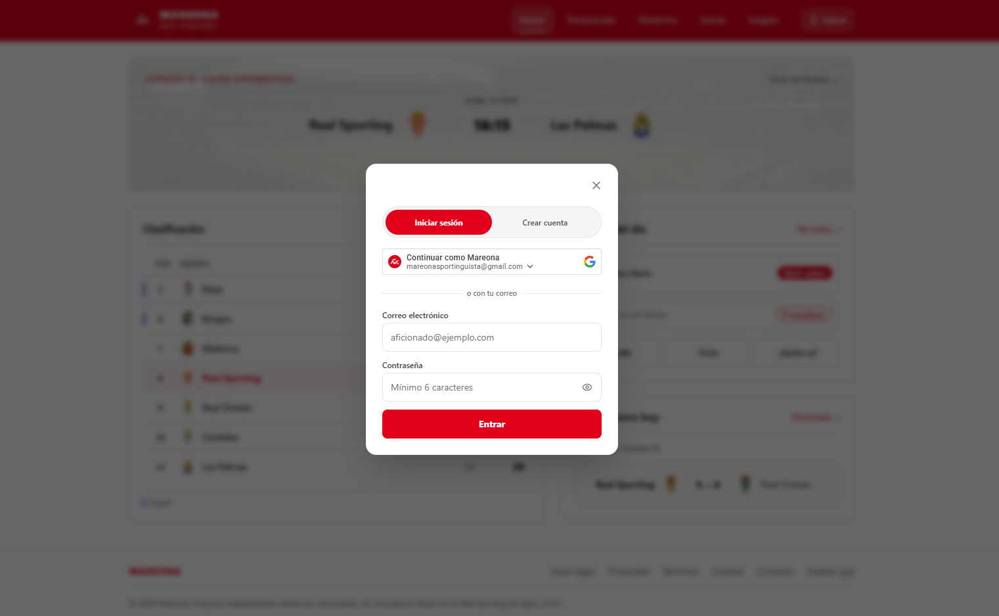

*Ilustración 36. Ventana de registro e inicio de sesión.*

## 6.2 Inicio

La portada (`Inicio`) reúne en una sola pantalla el resumen del día para el aficionado (Ilustración 37):

- El próximo partido oficial del Real Sporting (fecha, hora, rival y competición) o el marcador en directo si el encuentro está en juego, con enlace directo a su ficha.
- El bloque *Juegos del día*, con accesos directos a *La Porra*, al *Sobre diario* de bienvenida o visita y a los pasatiempos.
- El bloque *Tal día como hoy*, que muestra la efeméride destacada de la fecha actual y enlaza con la sección de *Efemérides*.

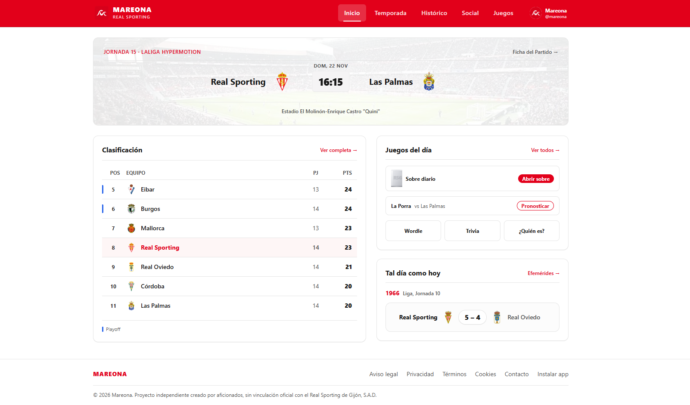

*Ilustración 37. Pantalla de Inicio.*

## 6.3 Temporada

Al entrar en *Temporada* desde la barra de navegación aparece una barra secundaria con cinco pestañas: *Partidos*, *Clasificación*, *Estadísticas*, *Plantilla* y *Mi Once*.

### 6.3.1 Partidos

Muestra el calendario oficial del Real Sporting en LaLiga Hypermotion y Copa del Rey, con filtros superiores en píldora para ver *Todos*, *Disputados* o *Próximos* (Ilustración 38). El siguiente encuentro aparece destacado con la etiqueta *Próximo*.

Al pulsar en cualquier partido se abre la *Ficha del Partido*, organizada en seis pestañas (que se muestran u ocultan dependiendo de si se ha disputado o no el encuentro):

- *Eventos*: cronología de goles, penaltis, tarjetas y sustituciones dividida en 1.ª y 2.ª parte.
- *Estadísticas*: comparativa entre ambos equipos agrupada en *Control y Posesión*, *Ataque y Remates*, *Defensa y Portería* y *Disciplina e Infracciones*.
- *Alineaciones*: disposición táctica de titulares sobre el campo, banquillo, suplentes y entrenador, alternando entre las pestañas *Local* y *Visitante*.
- *Cara a cara*: balance histórico frente a ese rival y últimos precedentes oficiales.
- *Detalles*: estadio, ciudad, competición, temporada y asistencia cuando esté disponible.
- *Grada*: espacio de comentarios específico del partido y votación al mejor jugador (MVP) del encuentro.

Si un encuentro aún no ha comenzado o las fuentes no disponen todavía de alineaciones o estadísticas, la ficha indica que el dato está pendiente sin mostrar información inventada.

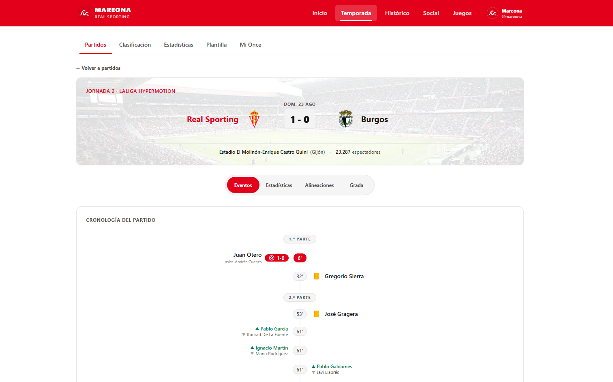

*Ilustración 38. Calendario de partidos y acceso a la ficha del encuentro.*

### 6.3.2 Clasificación

Presenta la tabla de LaLiga Hypermotion con filtros de ámbito (*General*, *En Casa* y *A Domicilio*) a la derecha y tres modos de visualización a la izquierda (Ilustración 39):

- *Tabla*: clasificación tradicional con posición, equipo, partidos jugados, ganados, empatados, perdidos, goles a favor, en contra, diferencia y puntos, diferenciando las zonas de *Ascenso directo*, *Playoff* y *Descenso*.
- *Distancia Real*: coloca a los equipos en peldaños verticales de un punto cada uno, dejando huecos vacíos para ver de un vistazo la distancia real en puntos entre rivales.
- *Evolución*: gráfico por jornadas de la trayectoria del Real Sporting con tres selectores (*Ambas Líneas*, *Puntos Acumulados* y *Posición en la Tabla*).

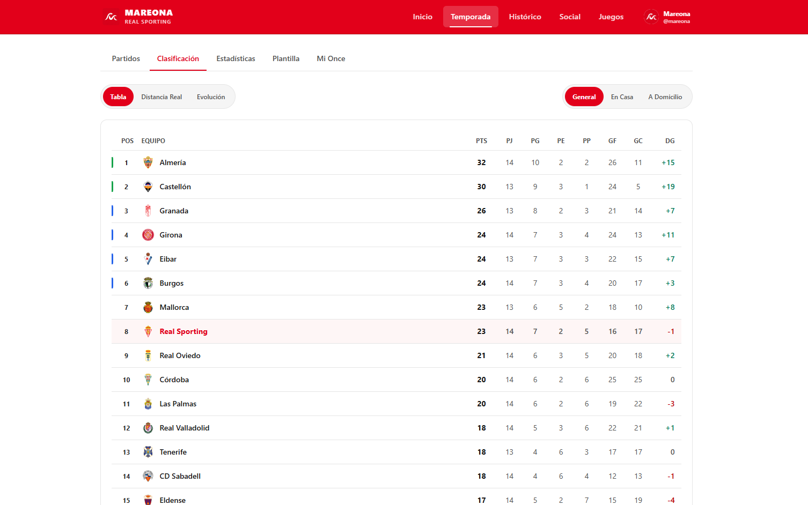

*Ilustración 39. Vista de clasificación de la temporada.*

### 6.3.3 Estadísticas

Muestra las métricas colectivas del Real Sporting en la temporada junto con su puesto respecto al resto de equipos de la liga en cada apartado (Ilustración 40). Se acompaña de mapas tácticos que indican las zonas de mayor presencia en el campo, distribución de pases, bandas de ataque y ubicación de los disparos que terminaron en gol.

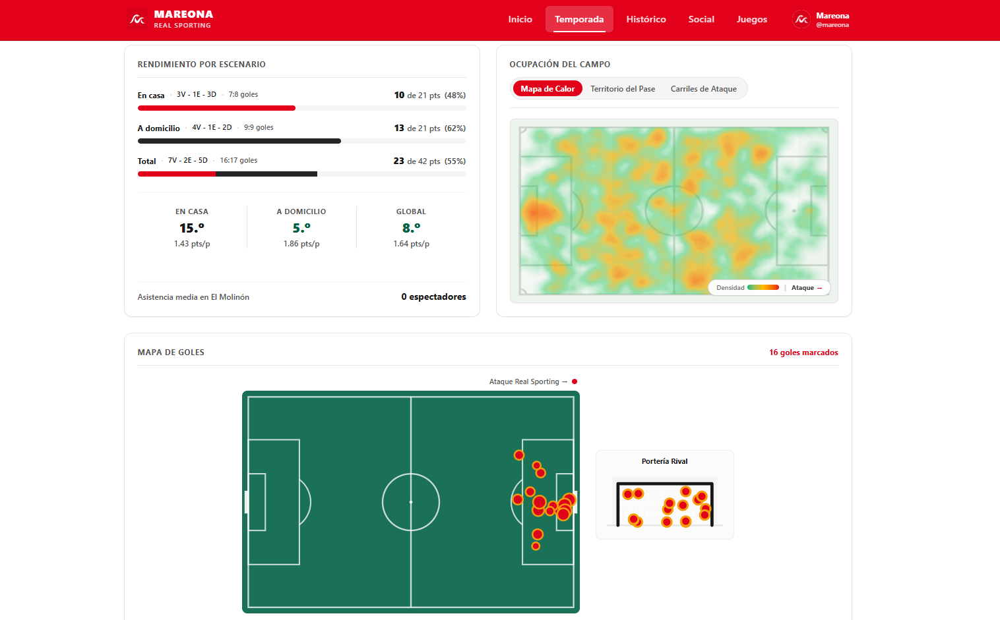

*Ilustración 40. Estadísticas de la temporada y mapas tácticos.*

### 6.3.4 Plantilla

Lista todos los futbolistas del primer equipo agrupados por demarcación (*Porteros*, *Defensas*, *Centrocampistas* y *Delanteros*) (Ilustración 41). Al pulsar sobre cualquier jugador se abre su ficha individual con sus datos de perfil y estadísticas acumuladas de la temporada.

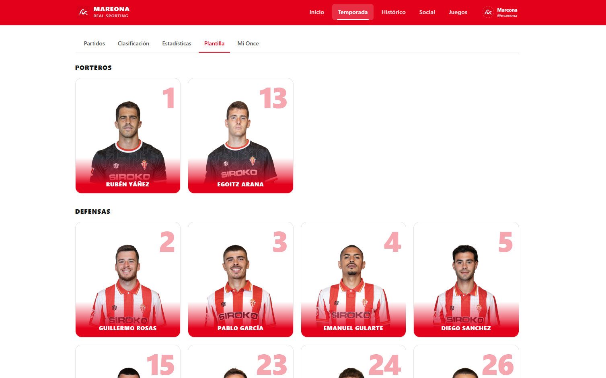

*Ilustración 41. Plantilla del primer equipo.*

### 6.3.5 Mi Once

Es una pizarra táctica interactiva para confeccionar alineaciones propias (Ilustración 42). El usuario elige un sistema de juego (por ejemplo `4-3-3` o `4-2-3-1`) y añade jugadores desde el selector lateral o modal, donde puede filtrar entre primer equipo, Sporting Atlético, Juvenil División de Honor o crear un jugador personalizado.

Las fichas se mueven libremente arrastrando con el ratón o el dedo y actualizan su etiqueta de demarcación según la zona del campo donde se suelten. Si se cambia de formación, los jugadores ya colocados se recolocan automáticamente en las posiciones más cercanas del nuevo sistema. Desde la barra superior se puede descargar la pizarra como imagen PNG o, teniendo sesión iniciada, compartirla directamente en Social o en la *Grada* del próximo partido.

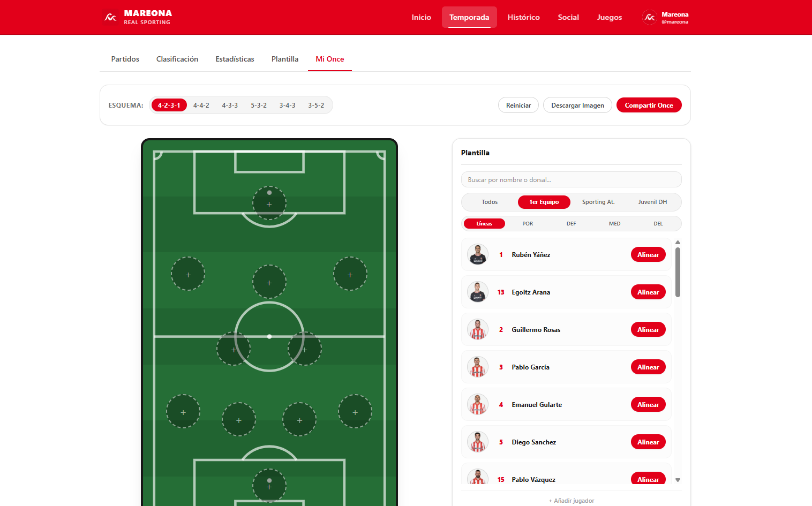

*Ilustración 42. Pizarra táctica Mi Once.*

## 6.4 Histórico

La sección *Histórico* se divide en cuatro pestañas:

- *Trayectoria*: gráfico con la posición del Real Sporting en cada temporada desde los primeros registros oficiales (Ilustración 43). Al seleccionar una temporada concreta se muestran su clasificación final, los partidos disputados y la plantilla de aquel año.
- *Efemérides*: calendario histórico que abre por defecto el día actual y permite navegar por cualquier fecha del año para leer acontecimientos y resultados de partidos jugados en ese día.
- *Rivales*: balance histórico contra cada club al que se ha enfrentado el Sporting, con filtros por categoría, búsqueda, vista en cuadrícula o lista, detalle de cada enfrentamiento y dos mapas interactivos (España y el mundo) que resumen las cifras por territorio al pulsar cada zona.
- *Legado*: cuatro tablas históricas oficiales con los jugadores con más partidos, máximos goleadores, más temporadas y entrenadores con más encuentros dirigidos.

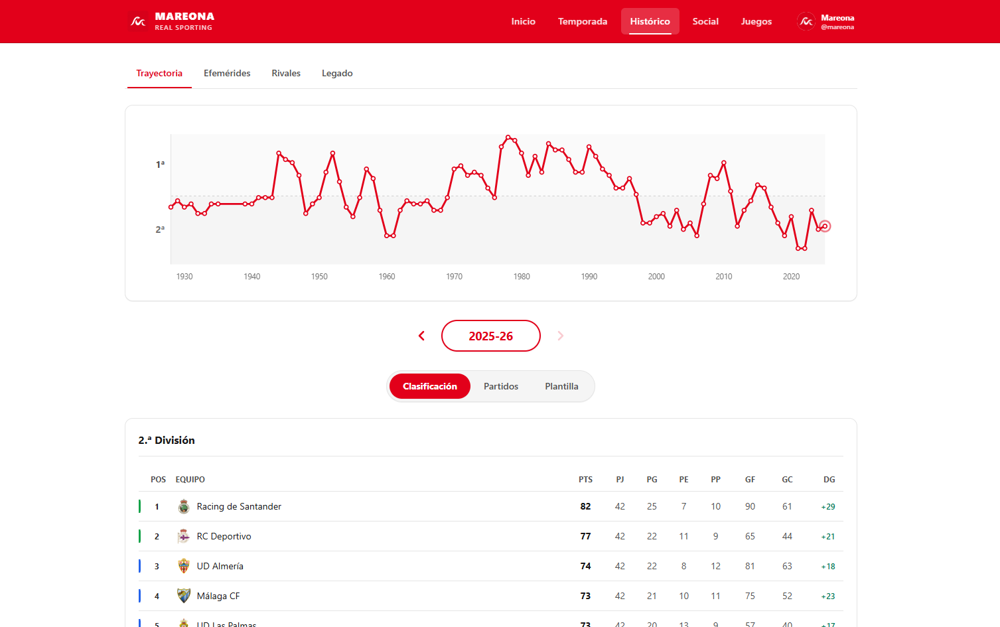

*Ilustración 43. Trayectoria histórica del Real Sporting.*

## 6.5 Social

En *Social* se reúnen las publicaciones de la comunidad (Ilustración 44). La parte superior permite alternar entre las pestañas *Todos* (muro general) y *Amigos* (solo publicaciones de usuarios con amistad aceptada), además de acceder a las solicitudes de amistad y a la bandeja de mensajes directos.

Con sesión iniciada se puede:

- Escribir publicaciones nuevas (con opción de adjuntar una encuesta de votación o una alineación creada en *Mi Once*).
- Abrir cualquier publicación para ver su hilo completo y añadir respuestas.
- Dar "me gusta", compartir un enlace, o editar y eliminar publicaciones propias.
- Enviar solicitudes de amistad desde el buscador o el perfil público de otro usuario, y mantener conversaciones privadas uno a uno por mensajería directa (donde también es posible borrar mensajes propios).
- Reportar publicaciones, mensajes o usuarios que incumplan las normas de convivencia, así como bloquear a un usuario para impedir el contacto directo.

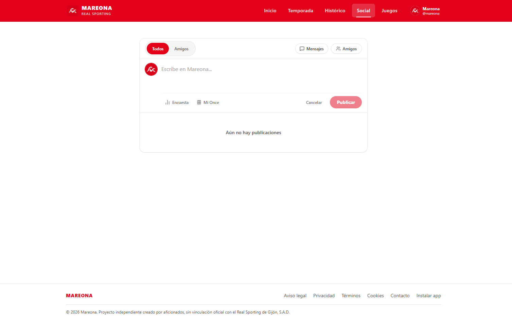

*Ilustración 44. Muro social y opciones de comunidad.*

## 6.6 Juegos

La sección *Juegos* reúne la colección de cromos, los pronósticos de cada partido, tres retos diarios con cambio a medianoche (hora peninsular española) y un modo continuo de racha.

### 6.6.1 Memoria Rojiblanca (Álbum de Cartas)

Colección de cromos digitales de jugadores actuales, leyendas, entrenadores, escudos y momentos del club, divididos en cuatro rarezas: básica, especial, histórica y legendaria. En la cabecera se alterna entre tres vistas (Ilustración 45):

- *Álbum*: formato libro con paso de páginas por capítulos y décadas.
- *Cuadrícula*: todos los cromos en mosaico con filtros por década y demarcación.
- *Mis Sobres*: inventario de sobres pendientes de abrir, panel de misiones para conseguir sobres (bienvenida, visita diaria, reto diario, racha de 7 días y *La Porra*) y opción de reciclar 10 cromos repetidos del taco para obtener un Sobre Rojiblanco.

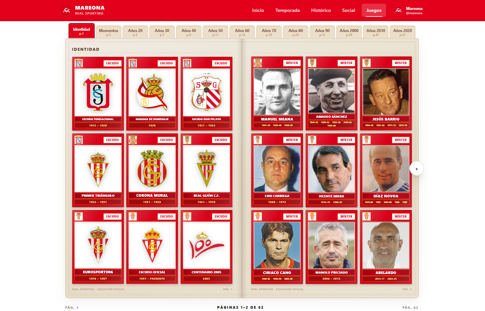

*Ilustración 45. Álbum digital Memoria Rojiblanca.*

### 6.6.2 La Porra

Permite pronosticar el marcador exacto y los goleadores rojiblancos del próximo partido oficial antes de que empiece (el plazo se cierra un minuto antes del pitido inicial) (Ilustración 46). Al terminar el partido, el sistema calcula automáticamente los puntos:

- 5 puntos por acertar el marcador exacto.
- 2 puntos por acertar el signo (1X2) sin el marcador exacto.
- 1 punto adicional por cada goleador rojiblanco acertado.

Según los puntos obtenidos en la jornada se entrega un sobre para el álbum (Aficionado, Rojiblanco o Leyenda). Debajo del pronóstico se consulta la clasificación general, que también puede filtrarse para comparar resultados solo con los amigos.

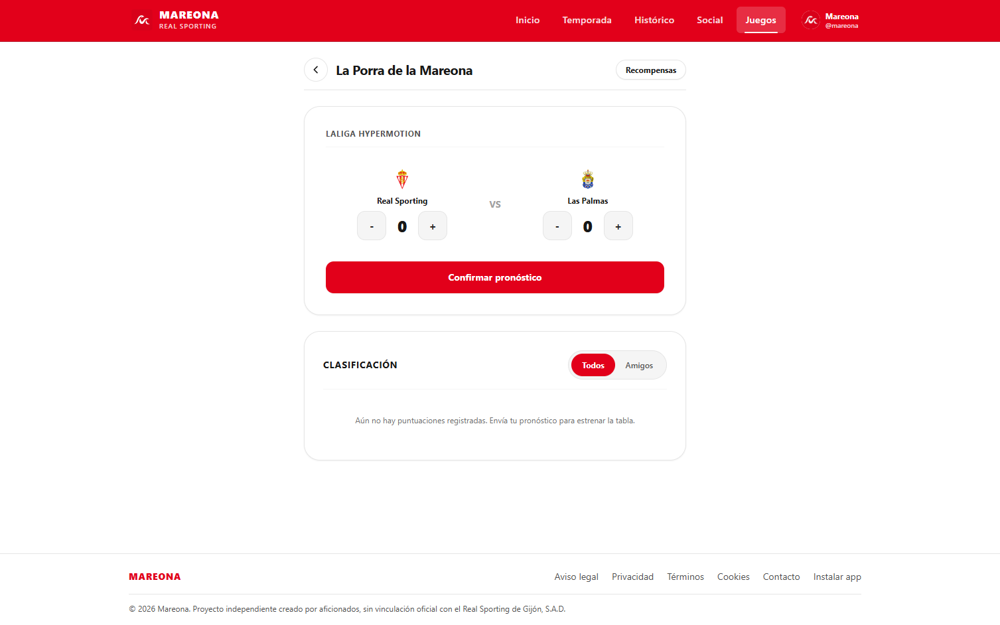

*Ilustración 46. La Porra de la Mareona.*

### 6.6.3 Wordle

Reto diario para adivinar una palabra relacionada con el club en 6 intentos (o 7 en palabras de 7 o más letras), con cambio cada día a las 00:00 y un botón de archivo para jugar fechas anteriores (Ilustración 47). Además del color, cada casilla muestra un símbolo para distinguir letra en posición correcta (✓), letra presente en otra posición (▲) o ausente (×). Al acertar el reto del día con sesión iniciada se obtiene un Sobre Rojiblanco (una vez al día entre los retos diarios), y con una racha de 7 días seguidos se recibe un Sobre Leyenda.

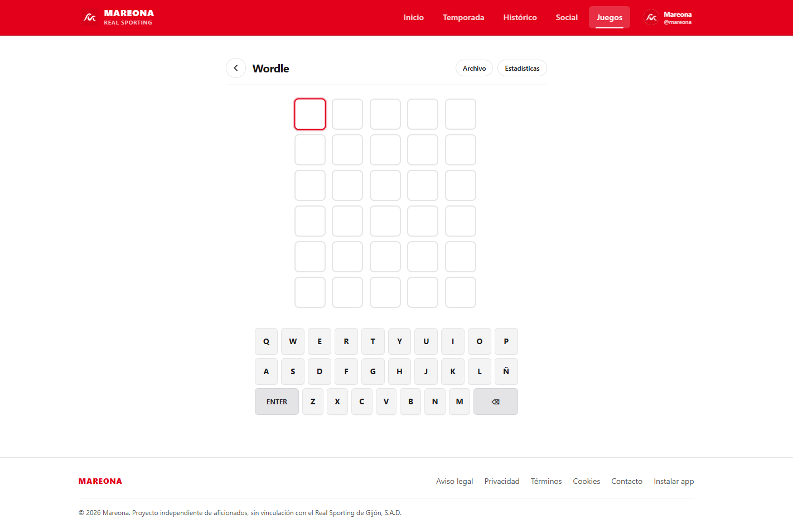

*Ilustración 47. Wordle del Real Sporting.*

### 6.6.4 La Pregunta del Día

Reto diario consistente en responder a una cuestión sobre la historia del Real Sporting (Ilustración 48). Tras responder, la pantalla muestra la respuesta correcta junto con una breve explicación histórica. Incluye archivo para consultar y jugar preguntas de días anteriores y aporta progreso para las recompensas diarias y la racha de sobres.

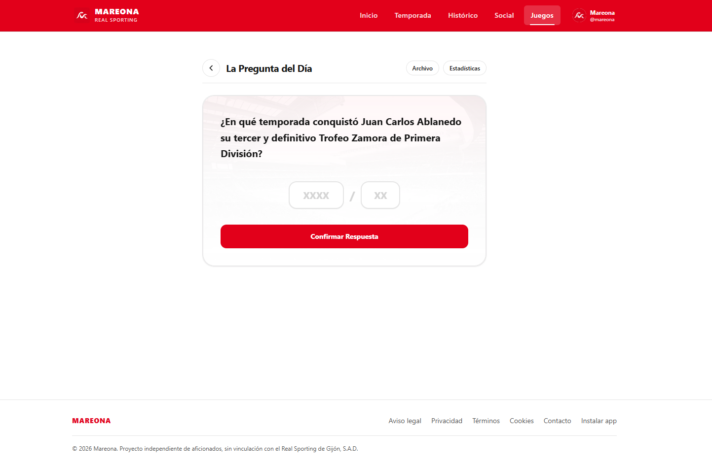

*Ilustración 48. La Pregunta del Día.*

### 6.6.5 ¿Quién es?

Reto diario en el que hay que identificar a un futbolista histórico o actual del club a partir de una fotografía inicialmente pixelada que se aclara conforme avanzan los intentos (Ilustración 49). Cada fallo ofrece pistas comparativas frente al jugador buscado (nacionalidad, demarcación, década de debut y dorsal). También dispone de archivo de fechas pasadas y cuenta para el sobre diario y la racha semanal.

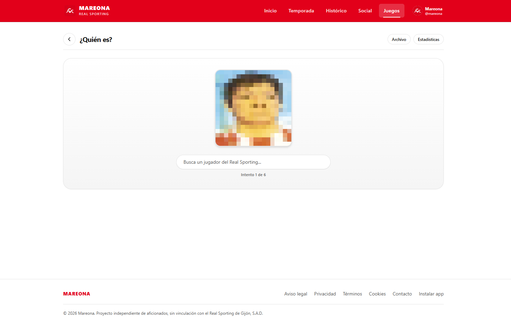

*Ilustración 49. Juego ¿Quién es?.*

### 6.6.6 ¿Más o Menos?

Juego continuo sin límite diario en el que se comparan dos futbolistas del club y el usuario elige cuál tiene una cifra mayor en el modo seleccionado: *Partidos*, *Goles* o *Minutos* (Ilustración 50). El objetivo es encadenar la racha más larga posible de aciertos consecutivos sin fallar.

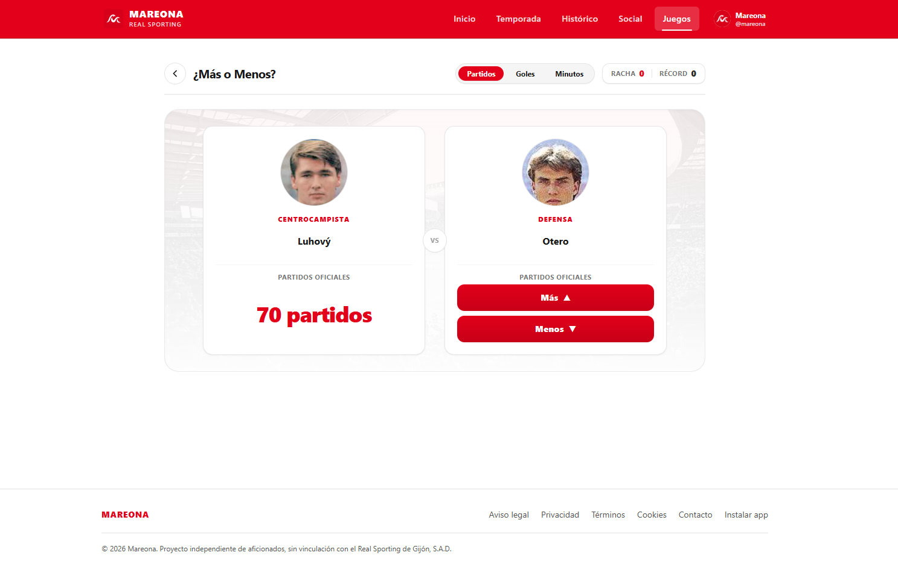

*Ilustración 50. Juego ¿Más o Menos?.*

## 6.7 Perfil

Desde el icono de usuario en la cabecera se accede a *Perfil*, donde se pueden consultar el nombre público, los puntos acumulados en *La Porra*, el historial de publicaciones propias y la gestión de amigos (Ilustración 51).

Pulsando en editar perfil se puede cambiar el nombre visible, el nombre de usuario y subir una fotografía de avatar (la imagen se ajusta automáticamente antes de guardarse). Al final de la página se encuentra la opción para eliminar la cuenta de forma definitiva tras confirmar la acción, lo que borra todos los datos personales asociados.

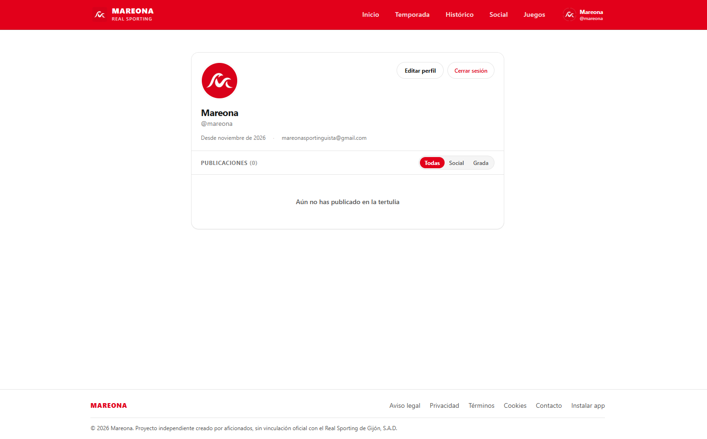

*Ilustración 51. Página de Perfil del usuario.*

## 6.8 Instalación como Aplicación

Mareona puede instalarse en el teléfono o en el ordenador como aplicación independiente sin pasar por tiendas de aplicaciones. La página `/instalar` detecta automáticamente el dispositivo y muestra las instrucciones concretas (Ilustración 52):

- En Android y navegadores de escritorio compatibles (Chrome o Edge), aparece un botón directo para instalar la aplicación.
- En iPhone y iPad (Safari), se indican los pasos mediante el menú *Compartir* y la opción *Añadir a la pantalla de inicio*.

Una vez instalada, la aplicación permite consultar todo el archivo de *Histórico* y jugar a los retos de *Juegos* aunque se pierda la cobertura en el estadio o durante un viaje; las partidas completadas con sesión iniciada se guardan en el dispositivo y se envían automáticamente a la cuenta al recuperar la conexión.

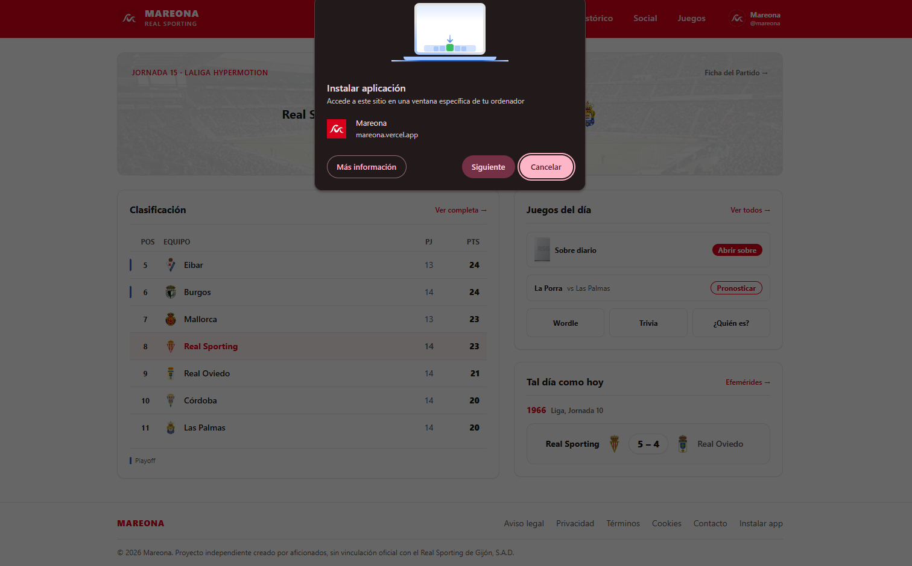

*Ilustración 52. Pantalla de instalación como aplicación.*

---

# Capítulo 7. Conclusiones y Ampliaciones

## 7.1 Conclusiones

El desarrollo de Mareona cumple los objetivos planteados en el [apartado 1.2](#12-objetivos-del-proyecto): la aplicación reúne en un único sitio el seguimiento de la temporada del Real Sporting, su archivo histórico, un espacio de comunidad moderado y una colección de juegos diarios y cromos digitales, funcionando como PWA instalable y sin coste para el usuario.

Desde el punto de vista técnico, las decisiones de arquitectura responden a la restricción de operar dentro de los planes gratuitos de Vercel y Supabase sin degradar la experiencia en móvil:

- La combinación de fuentes deportivas detrás de adaptadores de servidor con caché en dos niveles (memoria con deduplicación `inFlightRequests` y `external_api_cache` en PostgreSQL) y la compilación del archivo histórico en ficheros JSON permiten servir vistas densas sin agotar cuotas ni exponer claves externas.
- El Service Worker propio (`public/sw.js`), con límite de espera de 3 segundos en navegación y cola de sincronización en `localStorage`, mantiene disponibles el archivo histórico y los juegos diarios cuando falla la cobertura en el estadio.
- La seguridad y el cumplimiento legal recaen en la propia base de datos mediante *Row Level Security* y permisos por columna en todas las tablas, validaciones con Zod en cada Server Action, moderación automática con Groq acompañada de revisión manual, borrado completo de cuenta (`delete_current_user`) y borrado lógico con custodia en mensajería directa.
- El diseño visual en rojo y blanco cumple WCAG 2.2 AA [1] de forma verificable (contraste comprobado sobre los tokens CSS, tablas `sr-only` para gráficos SVG y gestión de foco en modales), respaldado por una batería de 641 tests (146 suites) en Node.js y 5 suites extremo a extremo en Playwright [14].

El proyecto también deja claras sus contrapartidas. Depender de fuentes deportivas gratuitas o no oficiales obliga a mantener parsers defensivos y a mostrar avisos explícitos cuando falta un dato en lugar de recurrir a valores simulados; del mismo modo, los límites de ejecución y conexiones de los planes gratuitos exigen vigilar el tamaño de las consultas y el tiempo de vida de las cachés.

Mareona ha permitido aplicar y unificar conocimientos de arquitectura en capas con Next.js App Router y Server Components, diseño relacional y seguridad en PostgreSQL, procesamiento de datos deportivos, accesibilidad web y pruebas automatizadas en un producto pensado para un uso real por parte de la afición.


## 7.2 Ampliaciones

Hay múltiples posibilidades de ampliación de Mareona, las cuales se podrían implementar en futuras versiones del producto:
- Duelos 11vs11: modo de juego integrado en Memoria Rojiblanca, que permitiría a los usuarios crear alineaciones propias y enfrentarlas a las de otros aficionados, con un estilo de juego similar al de los cromos tradicionales, en el que se jugaría por rondas, enfrentando las características de un jugador de cada equipo en cada ronda. Se podría incluir un sistema de ligas y de recompensas que funcionase con matchmaking, y que permitiera a los usuarios ir subiendo de rango a medida que obtienen victorias, consiguiendo a su vez sobres para completar la colección. Se ha decidido esperar a incluir esta ampliación para no sobresaturar con demasiados juegos al inicio, y para formar una buena base de usuarios que dispongan de cromos suficientes para competir entre sí una vez se integren los duelos en la aplicación.
- Intercambio de cromos repetidos: se podría incluir un sistema mediante el que los usuarios podrían intercambiar aquellos cromos de Memoria Rojiblanca que tuviesen repetidos con otros usuarios. De esta forma, ambos saldrían beneficiados, ayudándose mutuamente a completar la colección, lo que fomentaría la interacción entre usuarios y el entretenimiento en la aplicación.
- Más juegos: se dispone de múltiples ideas de nuevos juegos que podrían ser incluidos en el sistema para el entretenimiento de los usuarios y fomentar la ampliación de sus conocimientos, pero se ha decidido reservarlos para un futuro para no sobresaturar la aplicación en un inicio, y para poder ofrecer novedades en un futuro a los usuarios.
- Internacionalización a varios idiomas: la aplicación actualmente solamente se muestra en español, pero se podría ampliar para incluir otros idiomas (como el asturiano o el inglés), lo que permitiría llegar a una audiencia más amplia y mejorar la accesibilidad para usuarios de diferentes regiones.
- Notificaciones push: enviar avisos al móvil cuando falte poco para el cierre de La Porra, al inicio del partido, los goles en directo, o al recibir mensajes privados o menciones. Esto aportaría retención sin depender necesariamente de abrir la aplicación.
- Seguimiento del Real Sporting Femenino y el Sporting Atlético: inicialmente, se ha desarrollado la aplicación para mostrar datos del primer equipo masculino, pero podría ser interesante para el futuro incluir cobertura del primer equipo femenino y el filial, para que los usuarios puedan realizar un seguimiento de los principales equipos de la institución en una sola plataforma, sirviendo como nexo de unión para los seguidores de todos los equipos, y como proveedor de toda la información que cualquier aficionado del club puede querer visualizar durante la temporada.
- Ligas privadas en los juegos: permitir crear competiciones entre amigos para comparar el rendimiento en los juegos, especialmente en la porra, de forma que se potencie el entretenimiento proporcionado por los juegos, al poder realizar comparaciones reales con tu grupo de amigos, y comentar los resultados entre todos.

---

# Capítulo 8. Referencias

A continuación se recogen los estándares técnicos, marcos normativos y documentación oficial de las tecnologías y fuentes de datos empleadas en Mareona.

[1] W3C (World Wide Web Consortium). *Web Content Accessibility Guidelines (WCAG) 2.2*. Disponible en: https://www.w3.org/TR/WCAG22/

[2] Unión Europea. *Reglamento (UE) 2016/679, General de Protección de Datos (RGPD)*. Disponible en: https://eur-lex.europa.eu/eli/reg/2016/679/oj

[3] Jefatura del Estado (España). *Ley Orgánica 3/2018, de Protección de Datos Personales y garantía de los derechos digitales (LOPDGDD)*. Disponible en: https://www.boe.es/buscar/act.php?id=BOE-A-2018-16673

[4] Unión Europea. *Reglamento (UE) 2022/2065 relativo a un mercado único de servicios digitales (Digital Services Act, DSA)*. Disponible en: https://eur-lex.europa.eu/eli/reg/2022/2065/oj

[5] OWASP Foundation. *Application Security Verification Standard (ASVS)*. Disponible en: https://owasp.org/www-project-application-security-verification-standard/

[6] Vercel. *Next.js 16 Documentation (App Router, Server Components, Server Actions)*. Disponible en: https://nextjs.org/docs

[7] Meta Open Source. *React 19 Documentation*. Disponible en: https://react.dev

[8] Microsoft. *TypeScript Handbook*. Disponible en: https://www.typescriptlang.org/docs/

[9] Tailwind Labs. *Tailwind CSS v4 Documentation*. Disponible en: https://tailwindcss.com/docs

[10] Lucide Contributors. *Lucide React Icon Library Documentation*. Disponible en: https://lucide.dev/guide/packages/lucide-react

[11] Colin McDonnell. *Zod Schema Validation Documentation*. Disponible en: https://zod.dev

[12] Supabase. *Supabase Documentation (PostgreSQL, Auth SSR, Row Level Security, Realtime, Storage)*. Disponible en: https://supabase.com/docs

[13] The PostgreSQL Global Development Group. *PostgreSQL 15+ Documentation*. Disponible en: https://www.postgresql.org/docs/

[14] Microsoft. *Playwright Documentation*. Disponible en: https://playwright.dev/docs/intro

[15] Google Chrome Developers. *Lighthouse Documentation*. Disponible en: https://developer.chrome.com/docs/lighthouse/overview

[16] Groq. *GroqCloud API Documentation*. Disponible en: https://console.groq.com/docs

[17] ESPN / FotMob / API-Football. *Fuentes de datos deportivos y estadísticas de competición* (utilizadas exclusivamente desde adaptadores de servidor con almacenamiento en caché).

---

# Capítulo 9. Apéndices

## 9.1 Glosario

| Término | Definición |
| :--- | :--- |
| Caché L1 / L2 | Almacenamiento temporal de datos en dos niveles: en memoria del servidor (L1) para respuestas inmediatas y en PostgreSQL (L2) para persistir entre reinicios. |
| CSP (*Content Security Policy*) | Cabecera HTTP que restringe desde qué orígenes puede cargar scripts, estilos, imágenes o conexiones el navegador. |
| *Edge Proxy* | Código ejecutado en el borde de la red antes de servir una ruta, encargado en Mareona de validar y renovar las cookies de sesión. |
| HSTS (*HTTP Strict Transport Security*) | Cabecera que obliga al navegador a comunicarse exclusivamente mediante HTTPS. |
| JWT (*JSON Web Token*) | Token firmado que identifica la sesión autenticada del usuario y sus permisos. |
| OAuth 2.0 / PKCE | Protocolo estándar de autorización utilizado para iniciar sesión con Google de forma segura desde navegador y PWA instalada. |
| *Polling* | Consulta periódica desde el cliente al servidor en intervalos acotados para actualizar datos en directo sin mantener un canal abierto permanente. |
| PWA (*Progressive Web App*) | Aplicación web instalable en móvil y escritorio que utiliza un Service Worker para funcionar con mala cobertura o sin conexión. |
| RLS (*Row Level Security*) | Mecanismo de PostgreSQL que evalúa políticas de acceso sobre cada fila de una tabla según el usuario autenticado. |
| RPC (*Remote Procedure Call*) | Llamada directa a una función almacenada en PostgreSQL (`PL/pgSQL`) para ejecutar operaciones atómicas como abrir sobres o liquidar puntos. |
| RSC (*React Server Component*) | Componente de React que se ejecuta únicamente en el servidor y envía HTML ya renderizado sin añadir JavaScript al cliente. |
| *Server Action* | Función asíncrona ejecutada en el servidor e invocada desde formularios o componentes cliente para validar y persistir cambios. |
| *Service Worker* | Script en segundo plano del navegador que intercepta peticiones de red, gestiona cachés locales y habilita la navegación sin conexión. |
| *Soft delete* (borrado lógico) | Ocultación de un registro mediante una marca temporal (`deleted_at`) sin eliminar físicamente la fila de la base de datos. |
| TTL (*Time To Live*) | Tiempo de vigencia tras el cual un dato almacenado en caché se considera caducado y vuelve a consultarse en origen. |
| WCAG 2.2 AA | Conjunto de pautas internacionales de accesibilidad web de nivel intermedio (contraste, teclado, foco y alternativas textuales). |
| Zod | Librería de validación y tipado en tiempo de ejecución utilizada para comprobar toda entrada externa antes de procesarla. |

*Tabla 10. Glosario de términos técnicos.*

## 9.2 Propiedad Intelectual y Licencias

Mareona es una plataforma independiente creada por y para aficionados, sin patrocinio, respaldo ni afiliación oficial con el Real Sporting de Gijón, LaLiga ni la RFEF. Esta condición figura de forma explícita en el pie de página y en los textos legales públicos de la aplicación.

El tratamiento de escudos, fotografías de futbolistas y marcas de terceros sigue los criterios definidos en `docs/LEGAL-ASSETS.md`:

- Punto de entrada único: todas las imágenes deportivas externas se renderizan exclusivamente mediante los componentes `<TeamCrest>` y `<PlayerPhoto>` (`src/components/media/`), evitando etiquetas `` dispersas.
- Respeto a los orígenes: cuando una fuente externa no autoriza el rehospedaje, los archivos no se copian en almacenamiento propio y se sirven desde los dominios permitidos en `next.config.ts`, manteniendo sus proporciones y colores originales sin alteraciones ni fusiones con la marca de Mareona.
- Alternativas neutras y retirada inmediata: si falla una carga externa se muestra una silueta o monograma vectorial; además, la variable `NEXT_PUBLIC_SHOW_OFFICIAL_ASSETS` permite sustituir al instante todos los escudos y fotografías oficiales por marcadores neutros, y cualquier solicitud de retirada por parte de titulares de derechos se atiende en un plazo máximo de 48 horas.
- Identidad propia: el logotipo de Mareona, los iconos de la aplicación instalada (PWA), el favicon y la iconografía propia pertenecen al proyecto.

Las estadísticas actuales y las clasificaciones proceden de las fuentes deportivas integradas en servidor [17], mientras que los datos históricos compilados se utilizan con fines informativos, divulgativos y culturales dentro de la comunidad sportinguista.
