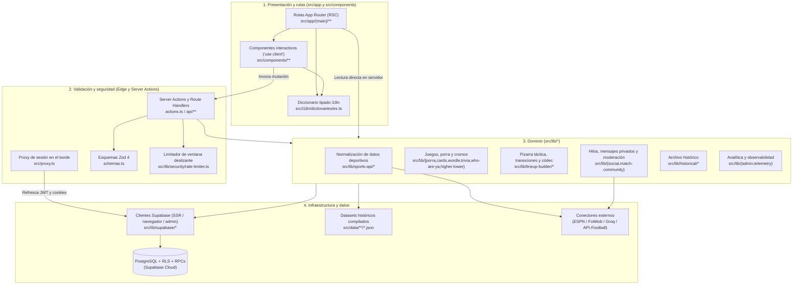
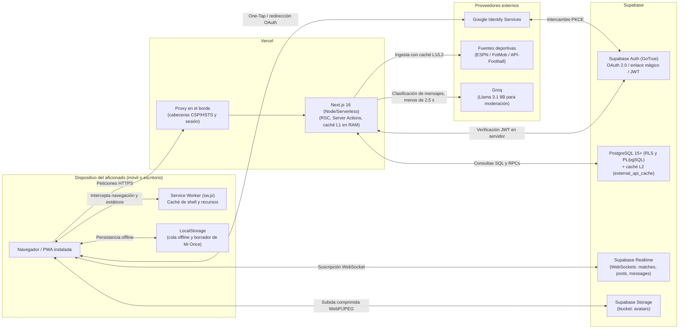
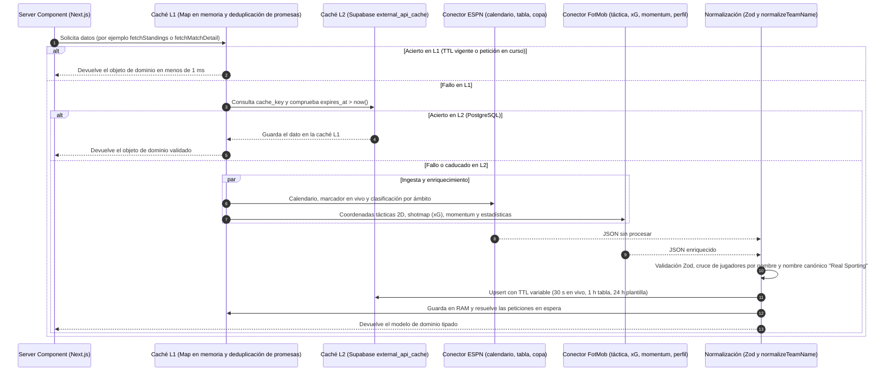
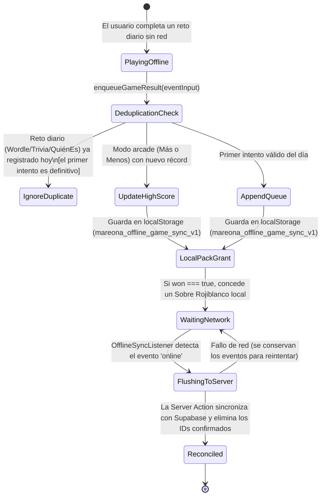
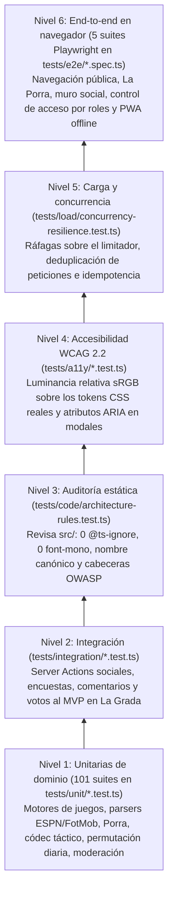

# Mareona — Documentación técnica

> Plataforma web y PWA para la afición del Real Sporting: temporada en directo, archivo histórico, juegos, red social y álbum de cromos.
>
> **Autor:** Marco Lorenzo Martínez — Ingeniero Informático del Software  
> **Producción:** [mareona.vercel.app](https://mareona.vercel.app)  
> **Stack y estándares:** Next.js 16 (App Router) · React 19 · TypeScript 5 (`strict: true`) · Supabase (PostgreSQL + RLS) · WCAG 2.2 AA · OWASP ASVS L2

---

## Índice

1. [Introducción y decisiones de arquitectura](#1-introducción-y-decisiones-de-arquitectura)
   - [1.1. Motivación y objetivos](#11-motivación-y-objetivos)
   - [1.2. Alternativas evaluadas](#12-alternativas-evaluadas)
2. [Arquitectura del sistema](#2-arquitectura-del-sistema)
   - [2.1. Capas y flujo de dependencias](#21-capas-y-flujo-de-dependencias)
   - [2.2. Server Components y Client Components](#22-server-components-y-client-components)
   - [2.3. Despliegue e infraestructura](#23-despliegue-e-infraestructura)
   - [2.4. Proxy de sesión y autenticación](#24-proxy-de-sesión-y-autenticación)
3. [Base de datos, lógica en servidor y RLS](#3-base-de-datos-lógica-en-servidor-y-rls)
   - [3.1. Modelo entidad-relación](#31-modelo-entidad-relación)
   - [3.2. Diccionario de datos](#32-diccionario-de-datos)
   - [3.3. Funciones y triggers en PostgreSQL](#33-funciones-y-triggers-en-postgresql)
   - [3.4. Row Level Security](#34-row-level-security)
4. [Subsistemas y algoritmos](#4-subsistemas-y-algoritmos)
   - [4.1. Ingesta de datos deportivos y caché](#41-ingesta-de-datos-deportivos-y-caché)
   - [4.2. Temporada, clasificación y pizarra táctica](#42-temporada-clasificación-y-pizarra-táctica)
   - [4.3. Archivo histórico y mapas SVG](#43-archivo-histórico-y-mapas-svg)
   - [4.4. Social, mensajería y moderación](#44-social-mensajería-y-moderación)
   - [4.5. Juegos y coleccionismo](#45-juegos-y-coleccionismo)
   - [4.6. Administración, auditoría y telemetría](#46-administración-auditoría-y-telemetría)
5. [PWA y modo offline](#5-pwa-y-modo-offline)
   - [5.1. Service Worker](#51-service-worker)
   - [5.2. Cola de sincronización offline](#52-cola-de-sincronización-offline)
   - [5.3. Detección de plataforma e instalación](#53-detección-de-plataforma-e-instalación)
6. [Seguridad y privacidad](#6-seguridad-y-privacidad)
   - [6.1. Cabeceras HTTP y límite de peticiones](#61-cabeceras-http-y-límite-de-peticiones)
   - [6.2. Validación con Zod](#62-validación-con-zod)
   - [6.3. Privacidad y protección de datos](#63-privacidad-y-protección-de-datos)
   - [6.4. Escudos y fotografías](#64-escudos-y-fotografías)
7. [Diseño y accesibilidad](#7-diseño-y-accesibilidad)
   - [7.1. Tokens de diseño y tipografía](#71-tokens-de-diseño-y-tipografía)
   - [7.2. Accesibilidad](#72-accesibilidad)
8. [Pruebas y calidad](#8-pruebas-y-calidad)
   - [8.1. Niveles de pruebas](#81-niveles-de-pruebas)
   - [8.2. Auditoría estática de la arquitectura](#82-auditoría-estática-de-la-arquitectura)
   - [8.3. Detalle por nivel](#83-detalle-por-nivel)
9. [Conclusiones y líneas futuras](#9-conclusiones-y-líneas-futuras)

---

## 1. Introducción y decisiones de arquitectura

### 1.1. Motivación y objetivos

Un aficionado suele repartir su atención entre varias aplicaciones: portales de resultados con mucha publicidad, bases de datos históricas sin visualización, redes sociales generalistas y juegos diarios sueltos.

**Mareona** reúne todo esto en una sola aplicación pensada para la afición del Real Sporting. El diseño parte de cinco objetivos:

1. **Coste de infraestructura cero.** La aplicación debe aguantar los picos de tráfico de un día de partido dentro de los planes gratuitos de Vercel y Supabase. Para ello usa caché en dos niveles, agrupa las peticiones idénticas que coinciden en el tiempo y compila el archivo histórico en ficheros estáticos.
2. **Funcionar con mala cobertura.** En un estadio hay miles de móviles conectados a la vez y la red se satura. La aplicación tiene que responder rápido y permitir consultar el archivo histórico y jugar a los juegos diarios sin conexión, sincronizando el progreso cuando vuelva la red.
3. **Seguridad en la base de datos y cumplimiento legal (RGPD, LOPDGDD, DSA).** Todas las tablas tienen políticas *Row Level Security* (RLS). A esto se suman la moderación automática con IA y la conservación de mensajes ante una denuncia.
4. **Accesibilidad (WCAG 2.2 AA).** La afición incluye a personas de todas las edades y capacidades. El contraste mínimo de 4,5:1, el uso completo con teclado, la independencia del color y las tablas alternativas para lectores de pantalla son requisitos desde el primer commit.
5. **Código mantenible.** Los componentes tienen como máximo 180 líneas, TypeScript va en modo estricto (sin `any` ni `@ts-ignore`) y hay **597 tests en 137 suites**.

---

### 1.2. Alternativas evaluadas

Estas son las decisiones principales de arquitectura, con las alternativas que se descartaron:

| Área | Opción elegida | Alternativas descartadas | Motivo |
| :--- | :--- | :--- | :--- |
| **Renderizado** | **Next.js 16 (App Router) + React 19 (Server Components y Server Actions)** | SPA con Vite + React y un backend REST aparte (Express, NestJS, Spring Boot) | Los Server Components no envían JavaScript al cliente en las vistas con muchos datos (`/temporada`, `/historico`), mejoran el LCP y el SEO, y consultan la base de datos o las APIs externas desde el servidor sin exponer claves ni mantener una capa REST intermedia. |
| **Base de datos, auth y tiempo real** | **Supabase (PostgreSQL 15+ con RLS, Auth SSR, Realtime y Storage)** | Firebase (Firestore), MongoDB Atlas, VPS con PostgreSQL y Prisma | Los datos son muy relacionales: clasificaciones, árbol de comentarios, amistades, inventario de cromos y liquidación de puntos. PostgreSQL permite agrupar operaciones atómicas en funciones PL/pgSQL (`SECURITY DEFINER`) y delegar la autorización en RLS. |
| **Datos deportivos** | **Varias fuentes combinadas: ESPN API, parser de FotMob, API-Football como respaldo y datos históricos de BDFutbol compilados** | Un único proveedor de pago (Opta, StatsPerform, API-Football Pro) | Las APIs gratuitas tienen límites muy bajos (por ejemplo, 100 peticiones al día) y no ofrecen mapas de tiros (xG), *momentum* ni más de 100 años de historia. Combinar fuentes con caché en memoria y en PostgreSQL (`external_api_cache`) da datos completos sin coste. |
| **Service Worker (PWA)** | **Service Worker propio (`public/sw.js`)** | `@serwist/next`, `next-pwa` (Workbox) | Los plugins basados en Webpack/Workbox no funcionan bien con **Turbopack** en Next.js 16 y generan código difícil de auditar. Un Service Worker de unas 200 líneas permite controlar qué rutas funcionan offline, el timeout de 3 s en redes saturadas y la limpieza de cachés. |
| **Moderación** | **LLM de baja latencia (Groq API, Llama 3.1 8B Instant) con degradación controlada** | Moderación solo manual, filtro de palabras prohibidas (regex) | Una regex es fácil de esquivar y da falsos positivos con la jerga futbolera (*"vaya robo arbitral"*). Llama 3.1 8B en Groq evalúa la intención en menos de 300 ms, con un timeout de 2500 ms y política *fail-open*: si la IA no responde, el mensaje se marca (`flag`) para revisión humana en lugar de bloquear al usuario. |
| **Tests unitarios** | **Test runner nativo de Node.js (`node --test`) + Playwright (E2E)** | Jest, Vitest | El runner de Node.js 20+ ejecuta TypeScript sin transpiladores ni dependencias extra, y corre más de 100 archivos de tests en pocos segundos. |

---

## 2. Arquitectura del sistema

### 2.1. Capas y flujo de dependencias

El código sigue una arquitectura por capas inspirada en *Clean Architecture* y adaptada a Next.js App Router. Las dependencias apuntan hacia el dominio: la interfaz usa los motores de dominio, pero el dominio nunca importa componentes de React ni detalles de red.



#### Reglas estructurales
- **Máximo 180 líneas por componente.** Ningún archivo de componente en `src/` las supera. Cuando un componente crece, se divide en subcomponentes (filas, cabeceras, modales, lienzos SVG o Canvas) y hooks (`use-lineup-state.ts`, `use-wordle-game.ts`, `use-modal-a11y.ts`).
- **Código solo de servidor (`import "server-only"`).** Los módulos que usan claves de API, el cliente administrativo de Supabase (`service_role`) o el motor de moderación incluyen esta directiva. Si un componente de cliente intenta importarlos, la compilación falla.

---

### 2.2. Server Components y Client Components

Por defecto, todo es Server Component. Cada página bajo `src/app/(main)/` se ejecuta en el servidor, lanza las lecturas de datos en paralelo (`Promise.all`) y envía HTML ya renderizado, sin aumentar el JavaScript del cliente.

`"use client"` se usa solo en los componentes que necesitan APIs del navegador (`localStorage`, `HTMLCanvasElement`, `navigator.onLine`), eventos táctiles o de teclado, o suscripciones WebSocket. Cada archivo de cliente indica el motivo en su primera línea con un comentario `// Client: <motivo>`.

---

### 2.3. Despliegue e infraestructura



---

### 2.4. Proxy de sesión y autenticación

La sesión se gestiona con `@supabase/ssr` a través de un proxy que se ejecuta antes de cada navegación ([`src/proxy.ts`](file:///c:/Users/marco/dev/mareona/src/proxy.ts) y [`src/lib/supabase/middleware.ts`](file:///c:/Users/marco/dev/mareona/src/lib/supabase/middleware.ts)). Los tokens van en cookies HTTP, no en almacenamiento accesible por scripts.

1. **Refresco de sesión en el proxy.** En cada petición de navegación (los recursos estáticos se excluyen con una expresión regular en `config.matcher`), el proxy lee las cookies, valida el JWT contra Supabase Auth y, si ha caducado, usa el *refresh token* para emitir cookies nuevas hacia los Server Components y hacia el navegador.
2. **Tres formas de iniciar sesión ([`src/lib/auth/`](file:///c:/Users/marco/dev/mareona/src/lib/auth)):**
   - **Correo y contraseña, o enlace mágico.** Registro e inicio de sesión con validación Zod, normalización del nombre de usuario y confirmación por correo.
   - **Google Identity Services (GSI) y OAuth 2.0 con PKCE.** El sistema distingue si el usuario navega en un navegador normal o desde una **PWA instalada** ([`oauth-redirect.ts`](file:///c:/Users/marco/dev/mareona/src/lib/auth/oauth-redirect.ts), [`google-sign-in.ts`](file:///c:/Users/marco/dev/mareona/src/lib/auth/google-sign-in.ts)). En iOS y Android en modo *standalone* evita las ventanas emergentes y redirige con PKCE a `/auth/callback`, donde el código de autorización se cambia por una sesión.
   - **Creación automática del perfil (`on_auth_user_created`).** Al insertarse un registro en `auth.users`, un trigger llama a `public.handle_new_user()`, que genera un `username` único a partir del prefijo del correo ([`2026_1021000000_username_from_email.sql`](file:///c:/Users/marco/dev/mareona/supabase/migrations/2026_1021000000_username_from_email.sql)) y crea la fila en `public.profiles` en la misma transacción.

---

## 3. Base de datos, lógica en servidor y RLS

El esquema usa **PostgreSQL** con las extensiones `pgcrypto` (UUIDs v4) y `citext` (texto sin distinción de mayúsculas, necesario para que los nombres de usuario sean únicos aunque cambien las mayúsculas). Toda la evolución del esquema está en **15 migraciones SQL** que no se modifican una vez aplicadas, en [`supabase/migrations/`](file:///c:/Users/marco/dev/mareona/supabase/migrations).

### 3.1. Modelo entidad-relación

```mermaid
erDiagram
    PROFILES ||--o{ PREDICTIONS : "realiza"
    PROFILES ||--o{ POSTS : "publica"
    PROFILES ||--o{ POLL_VOTES : "vota en"
    PROFILES ||--o{ FRIENDSHIPS : "solicita / recibe"
    PROFILES ||--o{ CONVERSATION_MEMBERS : "participa en"
    PROFILES ||--o{ MESSAGES : "envía"
    PROFILES ||--o{ USER_BLOCKS : "bloquea"
    PROFILES ||--o{ USER_REPORTS : "denuncia"
    PROFILES ||--o{ BLOCKED_POST_ATTEMPTS : "genera"
    PROFILES ||--o{ USER_CARDS : "colecciona"
    PROFILES ||--o{ USER_PACKS : "posee"
    PROFILES ||--o{ CARD_DUELS : "compite en"
    PROFILES ||--o{ USER_ROLES : "tiene"
    PROFILES ||--o{ ADMIN_AUDIT_LOGS : "ejecuta"

    TEAMS ||--o{ MATCHES : "juega local/visitante"
    TEAMS ||--o{ PLAYERS : "integra"
    TEAMS ||--o{ STANDINGS : "clasifica"

    MATCHES ||--o{ PREDICTIONS : "recibe"
    MATCHES ||--o{ POSTS : "asocia (La Grada)"

    POSTS ||--o{ POSTS : "responde a (parent_id)"
    POSTS ||--o| POLLS : "contiene"
    POLLS ||--|{ POLL_OPTIONS : "ofrece"
    POLL_OPTIONS ||--o{ POLL_VOTES : "acumula"

    CONVERSATIONS ||--|{ CONVERSATION_MEMBERS : "agrupa"
    CONVERSATIONS ||--o{ MESSAGES : "alberga"
    CONVERSATIONS ||--o{ USER_REPORTS : "evidencia"

    CARDS ||--o{ USER_CARDS : "instancia en"

    PROFILES {
        uuid id PK "FK auth.users ON DELETE CASCADE"
        citext username UK "Regex ^[a-zA-Z0-9_]{3,20}$"
        text display_name
        text avatar_url
        integer points "Default 0, >= 0"
        boolean is_banned "Sanción activa"
        timestamptz banned_until
        text banned_reason
    }

    MATCHES {
        uuid id PK
        text external_id UK
        text competition
        text season
        smallint matchday
        timestamptz kickoff_at
        match_status status "scheduled|live|finished..."
        uuid home_team_id FK
        uuid away_team_id FK
        smallint home_score
        smallint away_score
        jsonb lineups
        jsonb events
    }

    PREDICTIONS {
        uuid id PK
        uuid user_id FK "UK (user_id, match_id)"
        uuid match_id FK
        smallint home_score "0..20"
        smallint away_score "0..20"
        integer points_awarded
    }

    POSTS {
        uuid id PK
        uuid user_id FK
        uuid match_id FK "Nullable (La Grada)"
        uuid parent_id FK "Nullable (hilos)"
        text body "1..4000 chars (incluye códec once)"
        text moderation_status "approved | flagged"
        text moderation_reason
        timestamptz deleted_at "Borrado lógico"
    }

    MESSAGES {
        uuid id PK
        uuid conversation_id FK
        uuid sender_id FK
        text body "1..2000 chars"
        timestamptz deleted_at "Borrado lógico (se conserva el contenido)"
    }

    CARDS {
        uuid id PK
        text slug UK
        text full_name
        card_decade decade "1920s..2020s"
        card_position position
        integer matches_played
        smallint attack_power "30..99"
        smallint defense_power "30..99"
        smallint ovr "50..99"
    }

    USER_PACKS {
        uuid id PK
        uuid user_id FK
        text pack_type "aficionado | rojiblanco | leyenda"
        smallint card_count "1..11"
        boolean is_opened
    }
```



---

### 3.2. Diccionario de datos

El esquema se divide en cinco dominios, con restricciones de integridad referencial e índices B-Tree parciales para acelerar las lecturas.

#### A. Identidad, administración y telemetría
1. **`profiles`:** extensión 1:1 de `auth.users`, con borrado en cascada (`ON DELETE CASCADE`). Guarda `username` (`citext`), `display_name`, `avatar_url`, los puntos de La Porra (`points`) y el estado de sanción (`is_banned`, `banned_until`, `banned_reason`).
2. **`user_roles`:** asigna los roles `admin` y `moderator` a los usuarios.
3. **`admin_audit_logs`:** registro de las acciones de administración (`action`, `target_type`, `target_id`, `metadata JSONB`). La clave foránea `admin_id` usa `ON DELETE RESTRICT` para que no se pueda borrar el rastro de auditoría.
4. **`system_announcements`:** avisos globales con severidad (`info`, `warning`, `alert`), un interruptor `is_active` y el indicador `read_only_wall`, que congela la escritura en el muro social ante una incidencia grave.
5. **`site_visits`:** telemetría anónima sin cookies (`pathname`, `device_type`, `is_pwa`, `session_id`, `duration_seconds`, `country`, `province`), con índices por fecha, ruta y provincia para el panel de analítica.

#### B. Datos deportivos y caché de ingesta
6. **`teams`:** catálogo de clubes. El índice único parcial `teams_single_home_club_idx` (`WHERE is_home_club`) asegura que solo un club, el Real Sporting, esté marcado como club local del sistema.
7. **`matches`:** calendario y estado de los partidos (`scheduled`, `live`, `finished`, `postponed`, `cancelled`), marcadores y los datos de alineaciones y eventos en `JSONB` (`lineups`, `events`).
8. **`players`:** plantilla vinculada a equipos, con demarcación normalizada (`goalkeeper`, `defender`, `midfielder`, `forward`), dorsal (`1..99`) y estado de actividad.
9. **`standings`:** clasificación por competición y temporada, con restricción única `(competition, season, team_id)`.
10. **`external_api_cache`:** caché L2 persistente de tipo clave-valor (`cache_key TEXT PK`, `payload JSONB`, `fetched_at`, `expires_at`). Evita agotar las cuotas de las APIs externas cuando se reinician o se crean instancias serverless.

#### C. Pronósticos (La Porra)
11. **`predictions`:** pronóstico de cada usuario por partido, con restricción única `(user_id, match_id)`, goles entre `0..20` y la columna `points_awarded`, que el cliente no puede modificar.

#### D. Social, mensajería privada y seguridad
12. **`posts`:** publicaciones de La Tertulia y comentarios de La Grada (`match_id` opcional). Admite respuestas anidadas con `parent_id`, estado de moderación (`approved`, `flagged`) y borrado lógico (`deleted_at`). El cuerpo admite hasta 4.000 caracteres ([`2026_1117000000_widen_post_body_length.sql`](file:///c:/Users/marco/dev/mareona/supabase/migrations/2026_1117000000_widen_post_body_length.sql)) para guardar, junto al texto, los datos serializados de una pizarra táctica (`<!--once:...-->`).
13. **`polls`, `poll_options` y `poll_votes`:** encuestas adjuntas a publicaciones (relación 1:1 entre `posts` y `polls`). La restricción `unique_user_poll_vote UNIQUE (poll_id, user_id)` impide en la propia base de datos que un usuario vote dos veces, aunque envíe peticiones simultáneas.
14. **`friendships`:** amistades con estados `pending`, `accepted` y `declined`, con `CHECK (requester_id <> addressee_id)` y clave única por pareja.
15. **`conversations`, `conversation_members` y `messages`:** mensajería privada 1:1. Cada conversación directa tiene una clave canónica `direct_key = least(u1, u2) || ':' || greatest(u1, u2)`, que evita crear dos chats entre los mismos usuarios. `messages` tiene `REPLICA IDENTITY FULL` para emitir en tiempo real, vía Supabase Realtime, las inserciones y los borrados lógicos.
16. **`user_blocks`:** bloqueos entre usuarios (`blocker_id`, `blocked_id`).
17. **`user_reports`:** denuncias conforme a la *Digital Services Act* (DSA), con categoría (`harassment`, `threats`, `spam_scam`, `impersonation`, `other`), conversación denunciada opcional y un `evidence_snapshot` que no se puede modificar.
18. **`blocked_post_attempts`:** registro de los mensajes rechazados por la moderación con IA, tanto en el muro público como en mensajes directos (hasta 2.000 caracteres). Sirve para detectar reincidencias y ajustar el sistema.

#### E. Coleccionismo y juegos (Memoria Rojiblanca)
19. **`cards`:** catálogo de cromos históricos y actuales, con década (`1920s` a `2020s`), posición, partidos oficiales jugados (`matches_played`), atributos de combate (`attack_power`, `defense_power`, `ovr` entre 50 y 99) y escudo del club de esa época (`historical_crest_era`).
20. **`user_cards`:** cromos de cada usuario, con contador de unidades (`quantity >= 1`). `quantity - 1` son los cromos repetidos que se pueden reciclar.
21. **`user_packs`:** sobres pendientes o abiertos de cada usuario, de tres tipos: `aficionado`, `rojiblanco` y `leyenda`.
22. **`card_duels`:** estado de las partidas de duelos tácticos (`quick_3`, `lineup_11`), con formaciones y marcador por rondas.

---

### 3.3. Funciones y triggers en PostgreSQL

Para evitar condiciones de carrera y garantizar atomicidad, las operaciones críticas son funciones PL/pgSQL con `SECURITY DEFINER` y `SET search_path = ''`, que evita ataques de inyección de esquema.

1. **`open_card_pack(p_pack_id, p_user_id)`** ([`2026_1029000000_pack_inventory_tiers.sql`](file:///c:/Users/marco/dev/mareona/supabase/migrations/2026_1029000000_pack_inventory_tiers.sql)):
   - Bloquea la fila del sobre en `user_packs` con `SELECT ... FOR UPDATE`, de modo que el mismo sobre no se pueda abrir dos veces a la vez.
   - Aplica una garantía según el tipo de sobre:
     - **Leyenda (`leyenda`):** busca primero un cromo con OVR ≥ 82 que el usuario aún no tenga (`NOT EXISTS` en `user_cards`). Solo si ya tiene todas las leyendas del catálogo elige una al azar.
     - **Rojiblanco (`rojiblanco`):** garantiza al menos un cromo con OVR ≥ 75.
   - Completa el resto del sobre (`card_count`) con muestreo sin reemplazo (`DISTINCT ON (id)`), hace `INSERT ... ON CONFLICT (user_id, card_id) DO UPDATE SET quantity = quantity + 1` en `user_cards` y devuelve los cromos indicando cuáles son nuevos (`is_new := NOT v_already_owned`).
2. **`sync_active_player_card_matches(p_matches)`** ([`2026_1023000000_card_match_sync.sql`](file:///c:/Users/marco/dev/mareona/supabase/migrations/2026_1023000000_card_match_sync.sql)):
   - Recibe un array JSON de pares `{slug, matches_played}` cuando termina un partido oficial del Real Sporting y actualiza en una sola operación los cromos de la plantilla activa (`WHERE matches_played <> target`).
3. **`get_or_create_direct_conversation(p_other_user)` y `can_message_conversation(p_conversation_id)`** ([`2026_1111010000_user_reports_and_mutual_block_guard.sql`](file:///c:/Users/marco/dev/mareona/supabase/migrations/2026_1111010000_user_reports_and_mutual_block_guard.sql)):
   - Comprueban en `user_blocks`, en ambos sentidos, que ningún usuario haya bloqueado al otro antes de abrir un chat o aceptar un mensaje.
4. **`apply_prediction_points(p_prediction_id, p_points)`** ([`2026_1012000000_init_schema.sql`](file:///c:/Users/marco/dev/mareona/supabase/migrations/2026_1012000000_init_schema.sql#L441-L468)):
   - Liquida los puntos de La Porra sin duplicarlos. Bloquea la predicción con `FOR UPDATE`, comprueba que `points_awarded IS NULL` (así un reintento no suma dos veces) y suma los puntos al perfil en la misma transacción. Solo puede ejecutarla `service_role`.
5. **`delete_current_user()`** ([`2026_1109000000_delete_current_user_rpc.sql`](file:///c:/Users/marco/dev/mareona/supabase/migrations/2026_1109000000_delete_current_user_rpc.sql)):
   - Permite al usuario autenticado ejercer su derecho de supresión (art. 17 RGPD). Elimina su registro en `auth.users` (`WHERE id = auth.uid()`), y el borrado en cascada (`ON DELETE CASCADE`) elimina su perfil, cromos, sobres, amistades, votos y pronósticos.

---

### 3.4. Row Level Security

Todas las tablas del esquema `public` tienen `ALTER TABLE ... ENABLE ROW LEVEL SECURITY`. Además de las políticas, se restringen los permisos por columna (`REVOKE UPDATE ... GRANT UPDATE (cols)`).

| Tabla | Lectura (`SELECT`) | Escritura (`INSERT` / `UPDATE` / `DELETE`) | Restricción por columna o garantía |
| :--- | :--- | :--- | :--- |
| **`profiles`** | Pública (`anon`, `authenticated`). | Solo el propietario (`auth.uid() = id`). | `GRANT UPDATE (username, display_name, avatar_url)`: un usuario no puede modificar sus `points` ni quitarse `is_banned`. |
| **`predictions`** | El autor, siempre. El resto, solo cuando `kickoff_at <= now()`, para que nadie copie pronósticos antes del partido. | `INSERT` y `UPDATE` solo si `status = 'scheduled'`, `kickoff_at > now()` y `points_awarded IS NULL`. | `GRANT UPDATE (home_score, away_score)`: el cliente no puede escribir `points_awarded`. |
| **`posts`** | Pública para filas activas (`deleted_at IS NULL`). | `INSERT` por el autor autenticado. `UPDATE` solo sobre el propio mensaje. | `GRANT UPDATE (body, deleted_at)`: el autor no puede cambiar `moderation_status` ni `moderation_reason` para limpiar un mensaje marcado (`flagged`). |
| **`messages`** | Solo los miembros de la conversación (`is_conversation_member`) y mientras `deleted_at IS NULL`. | `INSERT` requiere `can_message_conversation` (membresía y ausencia de bloqueo en `user_blocks`). | `GRANT UPDATE (deleted_at)`: el remitente puede ocultar su mensaje, pero no cambiar su `body`. El contenido original queda intacto si hay una denuncia. |
| **`blocked_post_attempts`** | Los usuarios no pueden leerla. Solo `is_admin()`. | `INSERT` del propio `user_id` desde la Server Action. | Los usuarios solo pueden añadir filas: no pueden leer, editar ni borrar su historial de mensajes bloqueados. |
| **`user_roles` y `admin_audit_logs`** | Solo administradores (`public.is_admin()`). | `user_roles` solo lo modifica `service_role`. `admin_audit_logs` solo admite `INSERT` de administradores, nunca `UPDATE` ni `DELETE`. | El rastro de auditoría no se puede alterar y nadie puede darse permisos de administrador. |
| **`site_visits`** | Solo administradores (`is_admin()`). | `INSERT` abierto a `anon` y `authenticated` para la baliza de telemetría. | Cualquier visitante puede registrar una visita, pero no leer las métricas. |
| **`user_cards` y `user_packs`** | `user_cards` es legible para mostrar el álbum. `user_packs` es privada del propietario. | Limitada a `auth.uid() = user_id`. Los sobres se abren mediante la RPC `open_card_pack`. | El bloqueo `FOR UPDATE` de la RPC evita gastar dos veces el mismo sobre con peticiones simultáneas. |
| **`matches`, `teams`, `players`, `standings`, `cards`** | Pública (`anon`, `authenticated`). | Sin políticas de escritura para clientes. Solo `service_role` desde la ingesta del servidor. | Los clientes no pueden alterar los datos deportivos oficiales. |

---

## 4. Subsistemas y algoritmos

### 4.1. Ingesta de datos deportivos y caché

El módulo [`src/lib/sports-api/`](file:///c:/Users/marco/dev/mareona/src/lib/sports-api) ofrece partidos en directo, clasificaciones (general, local y visitante), alineaciones sobre el campo, estadísticas de equipo y jugador, mapas de tiros (*shotmaps*) y gráficos de *momentum* minuto a minuto, sin depender de una API comercial de pago.



#### Decisiones principales
1. **Caché de dos niveles con TTL variable** ([`cache.ts`](file:///c:/Users/marco/dev/mareona/src/lib/sports-api/cache.ts), [`client.ts`](file:///c:/Users/marco/dev/mareona/src/lib/sports-api/client.ts)):
   - **Nivel 1 (RAM del proceso Node.js y deduplicación de peticiones en curso).** Si 500 usuarios piden la portada o la ficha del partido en el mismo segundo tras un gol, un mapa de promesas en curso (`inFlightRequests`) las reúne en **una sola petición HTTP saliente** y reparte el resultado a todos.
   - **Nivel 2 (Supabase `external_api_cache`).** Mantiene la caché cuando Vercel recicla las instancias serverless.
   - **TTL según el estado del partido (`resolveMatchDetailTtlMs`):**
     - Partido en directo (`live`) o en la hora previa al saque inicial (`PRE_MATCH_POLL_WINDOW_MS` en [`live-poll.ts`](file:///c:/Users/marco/dev/mareona/src/lib/sports-api/live-poll.ts)): **30 a 60 segundos**.
     - Clasificación (`TTL_STANDINGS_MS`): **1 hora**.
     - Calendario y plantillas (`TTL_FIXTURES_MS`, `TTL_SQUAD_MS`): **12 a 24 horas**.
     - Partidos terminados (`finished`): **caché larga**, porque ya no cambian.
2. **Cruce de jugadores entre fuentes** ([`fotmob-player-resolver.ts`](file:///c:/Users/marco/dev/mareona/src/lib/sports-api/fotmob-player-resolver.ts), [`player-stats-matcher.ts`](file:///c:/Users/marco/dev/mareona/src/lib/sports-api/player-stats-matcher.ts)):
   - ESPN, FotMob y la base de datos usan identificadores distintos y escriben los nombres de forma diferente (por ejemplo, *"Gaspar Campos-Ansó"* y *"Gaspar Campos"*, o *"Jonathan Dubasin"* y *"J. Dubasin"*). Para emparejarlos se aplican tres criterios en orden:
     1. Normalización Unicode NFD, eliminando diacríticos, signos de puntuación y sufijos (`normalizeAthleteName`).
     2. Coincidencia exacta de dorsal (`shirtNumber`) junto con los apellidos.
     3. Similitud por subconjuntos de palabras significativas, para nombres compuestos o apodos.
3. **Nombre canónico del club** (`normalizeTeamName` en [`types.ts`](file:///c:/Users/marco/dev/mareona/src/lib/sports-api/types.ts)):
   - Las APIs devuelven variantes como `"Sporting Gijón"`, `"Sporting de Gijón"` o `"Real Sporting de Gijón"`. El adaptador las convierte, al ingerir los datos y según el ID del equipo o un patrón de texto, en **`"Real Sporting"`** y marca `isSporting: true`. Los componentes de UI reciben el nombre ya normalizado y no hacen ningún renombrado en JSX.
4. **Actualización de cromos al terminar un partido** ([`card-catalog-sync.ts`](file:///c:/Users/marco/dev/mareona/src/lib/cards/card-catalog-sync.ts)):
   - Cuando el conector detecta que un partido del Real Sporting pasa a `finished`, ejecuta en segundo plano `triggerCardSyncForFinishedMatch`, que actualiza `matches_played` en los cromos de los jugadores de la plantilla actual.

---

### 4.2. Temporada, clasificación y pizarra táctica

#### A. Vistas de la clasificación
En `/temporada/clasificacion`, además de la tabla filtrable por ámbito (*General*, *En casa*, *A domicilio*), hay dos visualizaciones propias:
- **Distancia real escalonada:** agrupa a los 22 equipos de LaLiga Hypermotion en peldaños según su puntuación exacta (de $P_{\max}$ a $P_{\min}$) y muestra también los peldaños vacíos. Así se ven las diferencias reales de puntos hasta el ascenso directo, el *play-off* o el descenso, que una tabla ordenada no muestra.
- **Evolución por jornada:** calcula los puntos acumulados y la posición del Real Sporting desde la jornada 1 hasta la actual, y los dibuja en un gráfico SVG de doble eje (trazo continuo rojo con nodos circulares para la posición 1..22, y trazo discontinuo gris con nodos cuadrados para los puntos). Incluye una tabla HTML equivalente (`sr-only`) para lectores de pantalla.

#### B. Pizarra táctica «Mi Once» ([`src/lib/lineup-builder/`](file:///c:/Users/marco/dev/mareona/src/lib/lineup-builder))
La ruta `/temporada/pizarra` permite montar alineaciones con jugadores del primer equipo, del **Sporting Atlético**, del **Juvenil División de Honor** ([`academy-players.ts`](file:///c:/Users/marco/dev/mareona/src/lib/lineup-builder/academy-players.ts)) o jugadores personalizados.

1. **Cambio de formación** ([`formation-transition.ts`](file:///c:/Users/marco/dev/mareona/src/lib/lineup-builder/formation-transition.ts)):
   - Al pasar de un sistema a otro (por ejemplo de `4-3-3` a `5-3-2` o `4-2-3-1`), los 11 jugadores no se vacían del campo: se reasignan según su demarcación (`POR`, `DFC`, `LD`, `LI`, `MCD`, `MC`, `MCO`, `ED`, `EI`, `DC`) y la distancia euclídea entre las coordenadas normalizadas $(x, y) \in [5, 95]^2$ de la formación de origen y la de destino.
2. **Arrastrar y soltar, con roles dinámicos** ([`player-roles.ts`](file:///c:/Users/marco/dev/mareona/src/lib/lineup-builder/player-roles.ts)):
   - Funciona igual con ratón y con pantalla táctil. Al soltar una ficha en el campo, se recalcula la etiqueta de rol del jugador según la zona $(x, y)$ donde queda.
3. **Exportación a PNG con Canvas 2D** ([`export-canvas.ts`](file:///c:/Users/marco/dev/mareona/src/lib/lineup-builder/export-canvas.ts)):
   - Genera en el navegador una imagen de $1080 \times 1350$ px. Dibuja con `CanvasRenderingContext2D` las franjas del césped, las líneas del campo, la cabecera rojiblanca, los avatares recortados en círculo (con gestión de CORS) y las etiquetas de dorsal y nombre. No usa librerías como `html2canvas`.
4. **Códec para compartir en la red social** ([`shared-lineup-codec.ts`](file:///c:/Users/marco/dev/mareona/src/lib/lineup-builder/shared-lineup-codec.ts)):
   - Para compartir un once en **La Tertulia** o **La Grada** sin tablas nuevas ni subir imágenes, el códec serializa la formación, los 11 titulares, sus dorsales, el identificador de foto (`L` para recursos locales o el ID numérico de FotMob) y sus coordenadas $(x, y)$ en una etiqueta al final del mensaje:
     ```text
     <!--once:4-3-3|Yáñez*1*L*POR*50*89,Rosas*2*L*LD*84*71,...-->
     ```
   - Al pintar el muro, [`parsePostLineup`](file:///c:/Users/marco/dev/mareona/src/lib/lineup-builder/shared-lineup-codec.ts#L126-L133) extrae la etiqueta, deja solo el texto visible y reconstruye un componente `<SharedLineupPitchCard>` con las posiciones que eligió el autor.

---

### 4.3. Archivo histórico y mapas SVG

Para no hacer miles de consultas a la base de datos al explorar más de un siglo de historia del Real Sporting (desde 1905), los datos se procesan antes del despliegue ([`scripts/ingest-historical-*.js`](file:///c:/Users/marco/dev/mareona/scripts) y [`src/lib/historical/`](file:///c:/Users/marco/dev/mareona/src/lib/historical)).

1. **Datasets compilados en JSON** ([`src/data/historical/`](file:///c:/Users/marco/dev/mareona/src/data/historical)):
   - Los scripts extraen, limpian y cruzan las temporadas, clasificaciones, plantillas, partidos oficiales, goleadores, entrenadores, trofeos individuales (Pichichis y Zamoras, en [`awards.json`](file:///c:/Users/marco/dev/mareona/src/data/historical/awards.json)) y efemérides diarias. El resultado son ficheros JSON tipados que los Server Components leen directamente, sin consultar la base de datos.
2. **Unificación de rivales** ([`canonical-opponents.ts`](file:///c:/Users/marco/dev/mareona/src/lib/historical/canonical-opponents.ts) y [`rivals-service.ts`](file:///c:/Users/marco/dev/mareona/src/lib/historical/rivals-service.ts)):
   - En 120 años, muchos rivales cambiaron de nombre (por ejemplo, *Athletic Club* y *Atlético de Bilbao*, *Real Sociedad* y *Donostia FC*, *CE Sabadell* y *CD Sabadell*). El servicio de rivales agrupa todas las variantes bajo un único club y calcula el balance global (partidos, victorias, empates, derrotas, goles a favor y en contra, por competición). También asocia cada club a sus coordenadas ([`rivals-geo.json`](file:///c:/Users/marco/dev/mareona/src/data/historical/rivals-geo.json)).
3. **Mapas SVG de España y del mundo:**
   - A partir de los trazados de [`spain-svg-paths.json`](file:///c:/Users/marco/dev/mareona/src/data/historical/spain-svg-paths.json) y [`world-svg-paths.json`](file:///c:/Users/marco/dev/mareona/src/data/historical/world-svg-paths.json), la sección `/historico/rivales` dibuja mapas interactivos. Cada comunidad autónoma o país europeo se colorea según el número de enfrentamientos o el porcentaje de victorias rojiblancas. Al pulsar un territorio se filtran los rivales y el balance de esa zona.

---

### 4.4. Social, mensajería y moderación

El módulo social ([`src/lib/social/`](file:///c:/Users/marco/dev/mareona/src/lib/social) y [`src/lib/match-community/`](file:///c:/Users/marco/dev/mareona/src/lib/match-community)) combina interacción en tiempo real con controles de seguridad.

```mermaid
flowchart LR
    User["Aficionado autenticado"] -->|Envía post, comentario o DM| Action["Server Action\n(social/actions.ts)"]
    Action -->|1. Valida el esquema| Zod["Esquema Zod y comprobación de sesión"]
    Zod -->|2. Comprueba la cuota| RL["Limitador de peticiones\n(ventana deslizante)"]
    RL -->|3. Comprueba la cuenta| BanCheck{"¿Usuario sancionado\no muro en solo lectura?"}
    BanCheck -->|Sí| RejectBan["Rechaza e indica el motivo"]
    BanCheck -->|No| AIMod["Groq: Llama 3.1 8B\n(timeout 2,5 s, temperatura 0)"]

    AIMod -->|verdict: 'block'\n(odio, acoso, amenazas)| ForensicLog[("INSERT blocked_post_attempts\n(registro para auditoría)")]
    ForensicLog --> RejectUser["No publica y avisa de la norma"]

    AIMod -->|verdict: 'flag'\n(dudoso o timeout de la IA)| InsertFlagged[("INSERT posts\nmoderation_status = 'flagged'")]
    InsertFlagged --> AdminQueue["Cola de revisión de moderadores"]

    AIMod -->|verdict: 'allow'\n(debate futbolístico legítimo)| InsertApproved[("INSERT posts / messages\nmoderation_status = 'approved'")]
    InsertApproved --> Realtime["Difusión con Supabase Realtime"]
```

1. **Árboles de conversación en tiempo lineal $O(N)$** ([`post-tree.ts`](file:///c:/Users/marco/dev/mareona/src/lib/social/post-tree.ts), [`comment-tree.ts`](file:///c:/Users/marco/dev/mareona/src/lib/match-community/comment-tree.ts)):
   - Las publicaciones y sus respuestas se leen con una sola consulta SQL plana y se ensamblan en memoria con tablas hash (`Map<id, Node>`), en tiempo $O(N)$. Las ramas se ordenan cronológicamente y se calculan los contadores de respuestas y «me gusta».
2. **Moderación resistente a *prompt injection*** ([`moderation.ts`](file:///c:/Users/marco/dev/mareona/src/lib/social/moderation.ts), [`moderation-ai.ts`](file:///c:/Users/marco/dev/mareona/src/lib/social/moderation-ai.ts)):
   - El texto del usuario se envuelve en etiquetas `<mensaje>${text}</mensaje>`, y la instrucción de sistema indica que debe tratarse solo como datos. Así se evita que el mensaje contenga órdenes dirigidas al modelo.
   - El prompt está ajustado al fútbol español («cero censura innecesaria»): permite la crítica dura a la directiva, los árbitros o el juego (*"vaya robo"*, *"dimisión ya"*) y bloquea (`block`) solo los delitos de odio, el racismo, los insultos personales entre usuarios, las amenazas físicas y el *doxxing*.
   - Un mensaje bloqueado nunca se publica, pero se guarda en `blocked_post_attempts` para detectar reincidencias. Si la API de IA tarda más de 2500 ms o devuelve un error HTTP 429/5xx, el motor pasa a `flag` o `allow`, de modo que un fallo de terceros no interrumpe al usuario.
3. **Mensajes directos con borrado lógico y conservación** ([`dm-privacy-custody.ts`](file:///c:/Users/marco/dev/mareona/src/lib/social/dm-privacy-custody.ts)):
   - Los chats 1:1 están aislados con RLS: ni siquiera un administrador puede leer conversaciones privadas desde la interfaz.
   - Para cumplir el **art. 32 de la LOPDGDD**, la **LSSI-CE** y la **DSA**, cuando un usuario borra un mensaje que ha enviado se hace un borrado lógico (`UPDATE messages SET deleted_at = now()`). La política RLS `messages_select_member` (`deleted_at IS NULL`) lo oculta de inmediato para los dos participantes, pero el registro sigue en la base de datos sin cambios. Si la persona afectada presenta una denuncia (`user_reports`), se adjunta una copia de la evidencia (`evidence_snapshot`) para la revisión disciplinaria o un requerimiento judicial.

---

### 4.5. Juegos y coleccionismo

La sección `/juegos` incluye seis juegos conectados por el sistema de sobres del álbum **Memoria Rojiblanca**.

#### A. Fecha de referencia y selección diaria sin repeticiones ([`daily-date.ts`](file:///c:/Users/marco/dev/mareona/src/lib/games/daily-date.ts), [`daily-permutation.ts`](file:///c:/Users/marco/dev/mareona/src/lib/games/daily-permutation.ts))
- Los retos diarios (*Wordle*, *La Pregunta del Día*, *¿Quién es?*) calculan el número de día (`daysElapsed`) con la zona horaria **`Europe/Madrid`** mediante `Intl.DateTimeFormat`. El reto cambia a las 00:00 h de Gijón con independencia de la zona horaria del dispositivo o del servidor.
- **Selección con permutación (Mulberry32 y Fisher-Yates).** Elegir con `Math.random()` o con `hash(date) % N` provoca repeticiones a los pocos días, por la paradoja del cumpleaños. Para evitarlo, el tiempo se divide en ciclos de tamaño $N$ (el total del catálogo):
  $$\text{roundNumber} = \lfloor \text{daysElapsed} / N \rfloor, \quad \text{stepInRound} = \text{daysElapsed} \bmod N$$
  En cada ciclo se inicializa el generador de 32 bits **Mulberry32** con la semilla $\text{seed} = (\text{salt} + \text{roundNumber} \times 10007) \ggg 0$ y se aplica una permutación de Fisher-Yates completa al vector $[0, 1, \dots, N-1]$. Con esto, **ninguna palabra, pregunta o jugador se repite hasta haber usado todo el catálogo**.

#### B. Motor de cada juego
1. **La Porra de la Mareona** ([`src/lib/porra/engine.ts`](file:///c:/Users/marco/dev/mareona/src/lib/porra/engine.ts)):
   - Los pronósticos se cierran 60 segundos antes del saque inicial (`PORRA_CUTOFF_MS = 60_000`). El límite se comprueba en el cliente, en el servidor y con la política RLS de PostgreSQL (`kickoff_at > now()`).
   - **Puntuación:** marcador exacto, **5 puntos**. Acertar el signo 1X2 sin el marcador exacto, **2 puntos**. Cada goleador rojiblanco acertado suma **1 punto** más. El emparejamiento de goleadores tiene en cuenta los dobletes y los *hat-tricks*, de modo que repetir un nombre no multiplica los aciertos.
   - **Sobres de recompensa (`getPorraRewardTier`):** 1–2 puntos, *Sobre Aficionado*. 3–4 puntos, *Sobre Rojiblanco*. 5 puntos o más, *Sobre Leyenda*.
2. **Wordle Sportinguista** ([`src/lib/wordle/engine.ts`](file:///c:/Users/marco/dev/mareona/src/lib/wordle/engine.ts)):
   - Evalúa cada intento en **dos pasadas** sobre palabras normalizadas de 5 o 6 letras. La primera marca los aciertos exactos (`correct`, verde) y descuenta esas letras del recuento disponible. La segunda marca las letras presentes en otra posición (`present`, amarillo) solo si quedan apariciones sin usar de esa letra, lo que evita falsos amarillos con letras repetidas.
3. **¿Quién es?** ([`src/lib/who-are-ya/engine.ts`](file:///c:/Users/marco/dev/mareona/src/lib/who-are-ya/engine.ts)):
   - En cada intento compara los atributos del futbolista (nacionalidad, demarcación, década de debut y dorsal) e indica coincidencia exacta o dirección ($\uparrow$ mayor, $\downarrow$ menor). A medida que se acierta, reduce el pixelado de la foto en un `<canvas>`.
4. **¿Más o Menos?** ([`src/lib/higher-lower/engine.ts`](file:///c:/Users/marco/dev/mareona/src/lib/higher-lower/engine.ts)) y **La Pregunta del Día** ([`src/lib/trivia/engine.ts`](file:///c:/Users/marco/dev/mareona/src/lib/trivia/engine.ts)):
   - Motores deterministas que comparan datos estadísticos (partidos, goles, temporadas) y evalúan preguntas de historia, con una breve explicación tras cada respuesta.
5. **Memoria Rojiblanca, el álbum de cromos** ([`src/lib/cards/`](file:///c:/Users/marco/dev/mareona/src/lib/cards)):
   - Guarda los datos en Supabase (`cards`, `user_cards`, `user_packs`) y los sincroniza al instante en el cliente ([`pack-storage.ts`](file:///c:/Users/marco/dev/mareona/src/lib/cards/pack-storage.ts)). Las recompensas son: un Sobre Aficionado y un Sobre Rojiblanco de bienvenida, un sobre gratuito al día por iniciar sesión, un sobre por cada victoria diaria en los juegos y un Sobre Leyenda al llegar a **7 días seguidos**. Los repetidos se reciclan en el **Taco de Repetidos**: 10 cromos repetidos se canjean por un Sobre Rojiblanco.
   - El código ya incluye, con tests unitarios, el motor de combate táctico por zonas y la IA rival ([`combat.ts`](file:///c:/Users/marco/dev/mareona/src/lib/cards/combat.ts), [`duel-ai.ts`](file:///c:/Users/marco/dev/mareona/src/lib/cards/duel-ai.ts)), preparados para los *Duelos 11 vs 11* posteriores al lanzamiento.

---

### 4.6. Administración, auditoría y telemetría

Para operar la plataforma sin recurrir a rastreadores comerciales (Google Analytics, Meta Pixel), el proyecto tiene su propio sistema de administración y analítica ([`src/lib/admin/`](file:///c:/Users/marco/dev/mareona/src/lib/admin) y [`src/lib/telemetry/`](file:///c:/Users/marco/dev/mareona/src/lib/telemetry)).

1. **Autorización de administradores** ([`guard.ts`](file:///c:/Users/marco/dev/mareona/src/lib/admin/guard.ts), [`roles.ts`](file:///c:/Users/marco/dev/mareona/src/lib/admin/roles.ts)):
   - Ninguna ruta ni Server Action de administración se fía de parámetros del cliente. El guardián comprueba en cada llamada la sesión con `supabase.auth.getUser()` y la pertenencia a `public.user_roles` (`role = 'admin'`). Cada acción de administración deja además una entrada en `admin_audit_logs`.
2. **Telemetría propia sin cookies y geolocalización** ([`telemetry-beacon.tsx`](file:///c:/Users/marco/dev/mareona/src/components/telemetry/telemetry-beacon.tsx), [`geolocation.ts`](file:///c:/Users/marco/dev/mareona/src/lib/telemetry/geolocation.ts), [`analytics-calculator.ts`](file:///c:/Users/marco/dev/mareona/src/lib/telemetry/analytics-calculator.ts)):
   - Un componente ligero del cliente envía con `navigator.sendBeacon` (o `fetch keepalive`) el tiempo de permanencia, el tipo de dispositivo (`mobile`, `tablet`, `desktop`) y si la sesión es una **PWA instalada** (`display-mode: standalone`).
   - En el servidor ([`src/app/api/telemetry/route.ts`](file:///c:/Users/marco/dev/mareona/src/app/api/telemetry/route.ts)) se leen las cabeceras de geolocalización de Vercel (`x-vercel-ip-country`, `x-vercel-ip-country-region`, `x-vercel-ip-city`) para clasificar la visita por provincia española o por país. **La dirección IP se descarta** y no se guarda. Al no usar cookies de seguimiento, no hace falta un banner de cookies.
   - `analytics-calculator.ts` procesa las visitas y calcula visitantes únicos, duración media de sesión, porcentaje de uso como PWA, distribución geográfica y secciones más visitadas.
3. **Registro de errores del cliente** ([`client-error-reporter.ts`](file:///c:/Users/marco/dev/mareona/src/lib/telemetry/client-error-reporter.ts)):
   - Captura las excepciones sin tratar (`window.onerror` y `unhandledrejection`), las valida con el esquema Zod [`client-error-schema.ts`](file:///c:/Users/marco/dev/mareona/src/lib/telemetry/client-error-schema.ts) y las envía al servidor con límite de peticiones para evitar que un error repetido llene los logs.

---

## 5. PWA y modo offline

### 5.1. Service Worker

[`public/sw.js`](file:///c:/Users/marco/dev/mareona/public/sw.js) es un Service Worker escrito para Next.js 16 con **Turbopack**. Usa tres cachés con versión (`mareona-shell-v3`, `mareona-static-v3` y `mareona-images-v3`) y elimina las entradas más antiguas (`trimCache`, FIFO) a partir de 300 bundles estáticos o 150 imágenes, para no agotar la cuota de almacenamiento del móvil.

| Recurso o ruta | Estrategia | Comportamiento |
| :--- | :--- | :--- |
| **Rutas con soporte offline (`PRECACHE_PATHS`: `/juegos/*`, `/historico/*`, `/offline`)** | **Precache del HTML, extracción de bundles JS/CSS con regex y network-first con timeout de 3 s** | En el evento `install`, `precachePage()` descarga el HTML de las vistas offline y extrae con la regex `/\/_next\/static\/[^"'\s\\)<>]+?\.(?:js\|css\|woff2?)/g` los chunks JS y CSS necesarios para que la página se pueda hidratar y usar sin red. En las navegaciones posteriores, `Promise.race` enfrenta la red con un temporizador de 3000 ms (`NAVIGATION_TIMEOUT_MS`): si la cobertura está saturada, a los 3 s se sirve la copia en caché mientras la red actualiza en segundo plano. |
| **Rutas dinámicas o privadas (`/temporada`, `/social`, `/perfil`, `/api/*`, Server Actions)** | **Solo red, con `/offline` como alternativa en navegaciones** | Los marcadores en directo, las publicaciones, las sesiones OAuth y las mutaciones nunca se sirven desde la caché, para evitar datos desfasados o que se mezclen datos entre cuentas. Si falla la red al navegar, se muestra la página `/offline`. |
| **Bundles inmutables (`/_next/static/*`)** | **Cache-first** | El nombre de archivo incluye un hash del contenido, así que se sirven directamente desde `mareona-static-v3`. |
| **Imágenes (`/crests/*`, `/flags/*`, `/images/*`, `/stadiums/*`, `/_next/image`)** | **Stale-while-revalidate** | Se muestra al instante el escudo, la bandera o la foto de `mareona-images-v3` y se actualiza en segundo plano. |

---

### 5.2. Cola de sincronización offline

El usuario puede jugar a los juegos diarios (*Wordle*, *La Pregunta del Día*, *¿Quién es?*, *¿Más o Menos?*) sin conexión y recibir las recompensas cuando vuelva la cobertura ([`src/lib/games/offline-sync-queue.ts`](file:///c:/Users/marco/dev/mareona/src/lib/games/offline-sync-queue.ts) y [`src/components/pwa/offline-sync-listener.tsx`](file:///c:/Users/marco/dev/mareona/src/components/pwa/offline-sync-listener.tsx)).



- **Control de trampas offline.** Si un usuario pierde un reto diario de intento único (*Wordle*, *La Pregunta del Día* o *¿Quién es?*) sin conexión, ve la solución y recarga o vuelve a jugar antes de reconectarse, `enqueueGameResult` detecta que el par `(gameType, challengeDate)` ya está en la cola y **conserva el primer intento**. Así no se puede cambiar una derrota por una victoria. En el modo arcade de racha (*¿Más o Menos?*), en cambio, sí se actualiza el evento en cola si el jugador supera su marca anterior (`newScore > oldScore`).

---

### 5.3. Detección de plataforma e instalación

iOS y iPadOS Safari no implementan el evento `beforeinstallprompt` de Chromium. Por eso [`src/lib/pwa/install-platform.ts`](file:///c:/Users/marco/dev/mareona/src/lib/pwa/install-platform.ts) y [`pwa-install-provider.tsx`](file:///c:/Users/marco/dev/mareona/src/components/pwa/pwa-install-provider.tsx) comprueban el entorno (`navigator.userAgent`, `window.matchMedia('(display-mode: standalone)')`, `navigator.standalone`) y adaptan la página `/instalar`:
- **Android y Chromium de escritorio:** captura el evento `beforeinstallprompt` y lo guarda para mostrar un botón de instalación directa.
- **iOS Safari y macOS Safari:** muestra una guía con los pasos: pulsar *Compartir* y elegir *Añadir a la pantalla de inicio*.
- **Modo `standalone` (ya instalada):** detecta que la PWA ya está instalada, oculta los avisos de instalación y lo indica.

---

## 6. Seguridad y privacidad

### 6.1. Cabeceras HTTP y límite de peticiones

La configuración de seguridad ([`src/lib/security/headers.ts`](file:///c:/Users/marco/dev/mareona/src/lib/security/headers.ts)) aplica controles del estándar **OWASP ASVS nivel 2**:

1. **Content-Security-Policy (CSP) restrictiva:**
   - `default-src 'self'; base-uri 'self'; form-action 'self'; object-src 'none'; frame-ancestors 'none'`.
   - Las listas de orígenes permitidos para imágenes (`img-src`) y conexiones (`connect-src`) se limitan a Supabase (`https://*.supabase.co`, `wss://*.supabase.co`), Google Identity Services (`https://accounts.google.com/gsi/`) y las CDN de recursos deportivos.
2. **Protección contra clickjacking, sniffing y TLS degradado:**
   - `X-Frame-Options: DENY`, que refuerza `frame-ancestors 'none'`.
   - `X-Content-Type-Options: nosniff`.
   - `Strict-Transport-Security: max-age=63072000; includeSubDomains; preload` (2 años, con precarga HSTS).
   - `Permissions-Policy: camera=(), microphone=(), geolocation=(), browsing-topics=()`, que bloquea las APIs de hardware y de seguimiento publicitario (FLoC/Topics).
3. **Limitador de ventana deslizante** ([`src/lib/security/rate-limiter.ts`](file:///c:/Users/marco/dev/mareona/src/lib/security/rate-limiter.ts)):
   - Protege las Server Actions de escritura (publicaciones, votos, solicitudes de amistad, denuncias, telemetría). Guarda las marcas de tiempo de cada clave de usuario y acción (`post_${userId}`, etc.) en una ventana deslizante. La función `cleanupStore` elimina las claves inactivas cada 100 llamadas o al superar las 500 entradas, para evitar fugas de memoria.

---

### 6.2. Validación con Zod

Toda entrada que llega del cliente o de una API externa se valida con un esquema de **Zod 4** antes de usarse:
- **Autenticación** ([`src/lib/auth/schemas.ts`](file:///c:/Users/marco/dev/mareona/src/lib/auth/schemas.ts)): normalización y validación de correos, contraseñas y formato de `username` (`^[a-zA-Z0-9_]{3,20}$`).
- **Social y mensajería** ([`src/lib/social/schemas.ts`](file:///c:/Users/marco/dev/mareona/src/lib/social/schemas.ts), [`direct-messages-schemas.ts`](file:///c:/Users/marco/dev/mareona/src/lib/social/direct-messages-schemas.ts)): limpieza de espacios, límites de longitud, UUIDs v4 para destinatarios y mensajes padre, y estructura de las opciones de encuesta.
- **Comunidad de partido** ([`src/lib/match-community/schemas.ts`](file:///c:/Users/marco/dev/mareona/src/lib/match-community/schemas.ts)): comentarios de La Grada y votos al MVP.
- **Telemetría y administración** ([`client-error-schema.ts`](file:///c:/Users/marco/dev/mareona/src/lib/telemetry/client-error-schema.ts), [`admin/schemas.ts`](file:///c:/Users/marco/dev/mareona/src/lib/admin/schemas.ts)): límites en las trazas de error y en las acciones de moderación.

---

### 6.3. Privacidad y protección de datos

El proyecto cumple el **RGPD**, la **LOPDGDD** y el **Reglamento de Servicios Digitales (DSA)** desde el diseño del software:
- **Derecho de supresión (art. 17 RGPD).** Desde `/perfil`, el componente `<DeleteAccountDialog>` ([`delete-account-dialog.tsx`](file:///c:/Users/marco/dev/mareona/src/components/profile/delete-account-dialog.tsx)) pide confirmación y llama a la RPC `public.delete_current_user()`, que borra en cascada la cuenta y sus datos. No hay que pedirlo por correo.
- **Compresión de avatares y eliminación de EXIF** ([`avatar-compression.ts`](file:///c:/Users/marco/dev/mareona/src/lib/auth/avatar-compression.ts)). Al subir una foto de perfil, el navegador la redimensiona y la vuelve a codificar con un `<canvas>` antes de enviarla a Supabase Storage. Esto reduce el peso en un 85 % aproximadamente y **elimina los metadatos EXIF**, como las coordenadas GPS de la cámara.
- **Privacidad de los mensajes y colaboración con la justicia (art. 32 LOPDGDD).** El borrado lógico (`deleted_at`) y la restricción de columnas en `public.messages` hacen que nadie vea un mensaje eliminado, pero también que un acosador no pueda destruir las pruebas antes de que un moderador revise una denuncia en `public.user_reports`.

---

### 6.4. Escudos y fotografías

Para un uso responsable de escudos y fotografías ([`docs/LEGAL-ASSETS.md`](file:///c:/Users/marco/dev/mareona/docs/LEGAL-ASSETS.md)):
1. **Un único punto de acceso** ([`src/components/media/`](file:///c:/Users/marco/dev/mareona/src/components/media)). No se usan etiquetas `` sueltas para recursos deportivos. Los escudos y las fotos de jugadores se muestran solo con `<TeamCrest>` ([`team-crest.tsx`](file:///c:/Users/marco/dev/mareona/src/components/media/team-crest.tsx)) y `<PlayerPhoto>` ([`player-photo.tsx`](file:///c:/Users/marco/dev/mareona/src/components/media/player-photo.tsx)).
2. **Alternativa vectorial** ([`player-avatar-fallback.tsx`](file:///c:/Users/marco/dev/mareona/src/components/media/player-avatar-fallback.tsx)). Si una imagen externa falla o no existe, el componente muestra una silueta o un monograma con las iniciales del jugador o club. Así no se rompe el diseño ni aparecen iconos de imagen rota.
3. **Interruptor de retirada (`NEXT_PUBLIC_SHOW_OFFICIAL_ASSETS`).** Ambos componentes leen esta variable de entorno. Si vale `false`, toda la aplicación sustituye los escudos y fotos oficiales por placeholders neutros, sin modificar ninguna vista.

---

## 7. Diseño y accesibilidad

### 7.1. Tokens de diseño y tipografía

El sistema visual ([`docs/DESIGN.md`](file:///c:/Users/marco/dev/mareona/docs/DESIGN.md) y [`src/app/globals.css`](file:///c:/Users/marco/dev/mareona/src/app/globals.css)) usa un único tema claro (`color-scheme: light`) en rojo y blanco, con un estilo sobrio y sin plantillas genéricas.

- **Paleta rojiblanca sin azules.** Se sustituyó cualquier azul por defecto de navegadores o librerías (anillos de foco, selección de texto, enlaces) por los tokens del proyecto:
  - `--brand` (`#e2001a`): rojo del Sporting para cabeceras, píldoras activas y acciones principales (contraste sobre blanco de 4,90:1).
  - `--brand-strong` (`#b80015`): rojo oscuro para los anillos de foco (`--ring`), los enlaces de texto pequeño y los estados `:hover` y `:active` (contraste sobre blanco de 6,94:1).
  - `--foreground` (`#171717`) y `--foreground-muted` (`#525252`, contraste 7,82:1) sobre `--background` (`#ffffff`) y `--surface` (`#f5f5f5`).
- **Tipografía tabular (`font-sans tabular-nums`) y sin `font-mono`.** Los marcadores (`2 - 1`), los minutos (`89'`), los puntos y las columnas de clasificación deben alinearse en vertical. Por eso la interfaz pública no usa fuentes monoespaciadas (lo comprueba un test automático) y emplea la fuente sans-serif del proyecto con `font-variant-numeric: tabular-nums`.

---

### 7.2. Accesibilidad

El cumplimiento de **WCAG 2.2 nivel AA** está incorporado en los componentes:
1. **El color no es el único indicador (criterio 1.4.1):**
   - En **Wordle Sportinguista**, cada celda indica su estado con color, borde e icono a la vez: acierto exacto (relleno sólido y ✓), letra en otra posición (borde destacado y ▲) y letra ausente (gris y ×). Cada celda tiene además un `aria-label` descriptivo (*"Letra Q, posición correcta"*).
   - En el **gráfico de evolución de la clasificación**, la curva de posición y la de puntos se distinguen por color y por patrón (línea continua con círculos frente a línea discontinua con cuadrados).
2. **Alternativa de texto para los gráficos (criterio 1.1.1):**
   - Todos los gráficos SVG (evolución por jornada, *momentum* del partido, mapa de tiros) incluyen una tabla HTML oculta visualmente (`className="sr-only"`) con `<caption>` y `<th scope="col">`. Los lectores de pantalla (NVDA, VoiceOver, TalkBack) pueden leer los datos jornada a jornada o minuto a minuto.
3. **Foco y modales** ([`src/lib/ui/use-modal-a11y.ts`](file:///c:/Users/marco/dev/mareona/src/lib/ui/use-modal-a11y.ts)):
   - Todos los modales (autenticación, archivo de juegos, selector de plantilla de Mi Once, compartir alineación, confirmación de borrado de cuenta) tienen `role="dialog"` y `aria-modal="true"`, bloquean el scroll del fondo, mantienen el foco dentro con el tabulador (*focus trap*), se cierran con `Escape` y devuelven el foco al botón que los abrió.

---

## 8. Pruebas y calidad

### 8.1. Niveles de pruebas

Hay **111 archivos de tests (137 suites y 597 tests, que se ejecutan en unos 4,7 segundos)** en [`tests/`](file:///c:/Users/marco/dev/mareona/tests), organizados en seis niveles. Se lanzan con `npm run check` y `npm run test:e2e`.



---

### 8.2. Auditoría estática de la arquitectura

[`tests/code/architecture-rules.test.ts`](file:///c:/Users/marco/dev/mareona/tests/code/architecture-rules.test.ts) recorre todo `src/` en cada ejecución de CI/CD y falla si encuentra algo que incumple las reglas del proyecto:
- **Sin `font-mono` en la UI pública:** revisa todos los `.tsx` y `.css`.
- **Sin atajos de TypeScript:** comprueba que no hay `@ts-ignore` ni `@ts-expect-error` en ningún `.ts` o `.tsx`.
- **Nombre canónico del club:** pasa a los adaptadores respuestas simuladas de APIs con variantes como `"Sporting Gijón"` o `"Sporting de Gijón"` y verifica que devuelven `"Real Sporting"`.
- **Secretos en `.env.example`:** busca con expresiones regulares tokens JWT (`eyJh...`), claves secretas (`sk_...`) y cadenas de conexión con credenciales.
- **Cabeceras de seguridad:** comprueba que `getSecurityHeaders()` y `buildContentSecurityPolicy()` incluyen `frame-ancestors 'none'`, `default-src 'self'`, `X-Frame-Options: DENY`, `X-Content-Type-Options: nosniff` y `Strict-Transport-Security`.

---

### 8.3. Detalle por nivel

| Nivel | Archivos | Qué comprueba |
| :--- | :--- | :--- |
| **Accesibilidad (`test:a11y`)** | [`wcag-contrast.test.ts`](file:///c:/Users/marco/dev/mareona/tests/a11y/wcag-contrast.test.ts)<br>[`modal-standards.test.ts`](file:///c:/Users/marco/dev/mareona/tests/a11y/modal-standards.test.ts) | Lee [`src/app/globals.css`](file:///c:/Users/marco/dev/mareona/src/app/globals.css), calcula la luminancia relativa con la fórmula del W3C ($L = 0.2126 R + 0.7152 G + 0.0722 B$) y verifica que todos los pares de texto y fondo superan los umbrales WCAG 2.2 AA (4,5:1 y 3,0:1). También comprueba que todos los modales tienen atributos ARIA y gestión del foco. |
| **Carga y concurrencia (`test:load`)** | [`concurrency-resilience.test.ts`](file:///c:/Users/marco/dev/mareona/tests/load/concurrency-resilience.test.ts) | Lanza muchas peticiones simultáneas para comprobar que el limitador bloquea justo en el umbral y no pierde memoria, y que la cola de sincronización offline sigue siendo coherente con escrituras rápidas. |
| **Integración (`test:integration`)** | [`social-actions.test.ts`](file:///c:/Users/marco/dev/mareona/tests/integration/social-actions.test.ts)<br>[`match-community-actions.test.ts`](file:///c:/Users/marco/dev/mareona/tests/integration/match-community-actions.test.ts) | Prueba de principio a fin las Server Actions: validación Zod, bloqueo por moderación con IA, creación de encuestas, votos en La Grada y elección del MVP. |
| **Unitarias (`test:unit`)** | 101 suites en [`tests/unit/`](file:///c:/Users/marco/dev/mareona/tests/unit) | Prueba cada algoritmo por separado: cruce de jugadores FotMob/ESPN, transiciones tácticas 2D, códec de alineaciones, permutación Mulberry32 sin repeticiones durante varios años, liquidación de La Porra, probabilidades de los sobres, borrado de cuenta y telemetría. |
| **End-to-end (`test:e2e`)** | [`navigation-public.spec.ts`](file:///c:/Users/marco/dev/mareona/tests/e2e/navigation-public.spec.ts)<br>[`porra-flow.spec.ts`](file:///c:/Users/marco/dev/mareona/tests/e2e/porra-flow.spec.ts)<br>[`social-wall.spec.ts`](file:///c:/Users/marco/dev/mareona/tests/e2e/social-wall.spec.ts)<br>[`offline-pwa.spec.ts`](file:///c:/Users/marco/dev/mareona/tests/e2e/offline-pwa.spec.ts)<br>[`admin-security.spec.ts`](file:///c:/Users/marco/dev/mareona/tests/e2e/admin-security.spec.ts) | Usa Chromium con Playwright para probar los flujos principales, el modo offline del navegador (`context.setOffline(true)`) y el rechazo de accesos no autorizados a rutas protegidas. |
| **Lighthouse (`audit:perf`)** | [`scripts/audit-performance.mjs`](file:///c:/Users/marco/dev/mareona/scripts/audit-performance.mjs) | Ejecuta Google Lighthouse sobre las rutas principales y revisa Core Web Vitals (LCP, CLS, TBT), accesibilidad (95 o más) y requisitos de PWA. |

---

## 9. Conclusiones y líneas futuras

### 9.1. Resumen

Mareona combina **Next.js 16 (React Server Components)** y **PostgreSQL con Row Level Security (Supabase)** para ofrecer datos en tiempo real, juegos y red social a una comunidad de aficionados, con un **coste de infraestructura de 0 €**. Los resultados principales son:

- **Mantenibilidad:** más de 250 módulos TypeScript en modo estricto (`strict: true`), con componentes de 180 líneas como máximo. Las reglas de arquitectura se comprueban automáticamente en cada ejecución de los tests.
- **Rendimiento y funcionamiento sin red:** los datos deportivos pasan por una caché de dos niveles, el archivo histórico está compilado en ficheros estáticos y el Service Worker junto con la cola de sincronización permiten usar la aplicación sin cobertura en el estadio.
- **Privacidad y accesibilidad:** moderación en tiempo real con IA, conservación de mensajes conforme a la LOPDGDD y la DSA, telemetría propia sin cookies de seguimiento y accesibilidad WCAG 2.2 AA verificada con tests automáticos.

---

### 9.2. Líneas futuras

La arquitectura deja preparados los puntos de extensión para tres mejoras:

1. **Duelos tácticos 11 vs 11** ([`docs/DUELOS_11VS11_SPEC.md`](file:///c:/Users/marco/dev/mareona/docs/DUELOS_11VS11_SPEC.md)):
   - Cuando haya suficientes cromos coleccionados en el álbum *Memoria Rojiblanca*, se activará el modo de competición con las cartas del inventario. La tabla `public.card_duels` y los motores de combate por zonas y de IA rival ([`src/lib/cards/combat.ts`](file:///c:/Users/marco/dev/mareona/src/lib/cards/combat.ts) y [`src/lib/cards/duel-ai.ts`](file:///c:/Users/marco/dev/mareona/src/lib/cards/duel-ai.ts)) **ya están implementados y probados con tests unitarios**.
2. **Notificaciones push (Web Push API con VAPID):**
   - Ampliar el Service Worker ([`public/sw.js`](file:///c:/Users/marco/dev/mareona/public/sw.js)) para suscribir el dispositivo a avisos push del inicio del partido, los goles en directo, la liquidación de puntos de La Porra o la llegada del sobre diario gratuito.
3. **Más idiomas (asturiano e inglés):**
   - Todos los textos de la interfaz salen de [`src/i18n/dictionaries/es.ts`](file:///c:/Users/marco/dev/mareona/src/i18n/dictionaries/es.ts), con tipado. Añadir diccionarios (`ast.ts`, `en.ts`) permitirá ofrecer la aplicación en asturiano e inglés sin tocar la lógica de los componentes.
